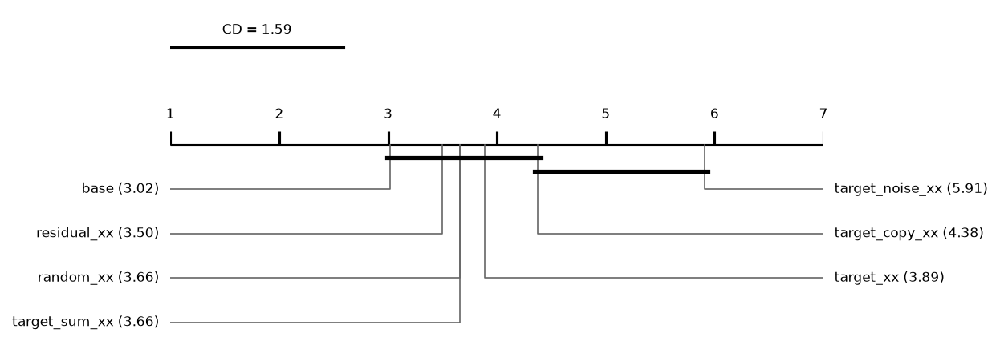
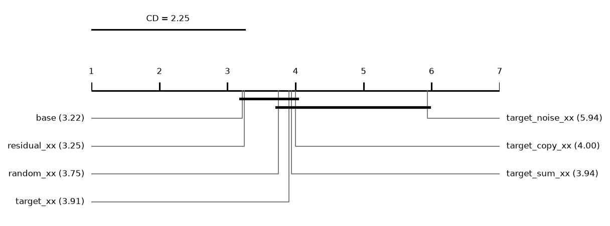
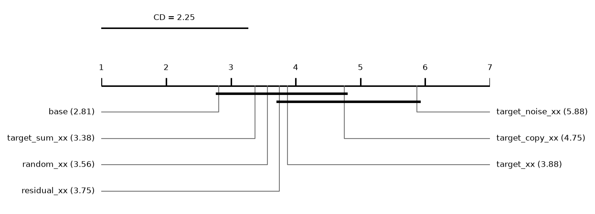

# Report: content

1120 runs on 32 datasets. Error = 1 - balanced accuracy (classification) or RMSE (regression); relative reduction = (e_ref - e) / max(e_ref, e) of errors averaged over a dataset's runs; positive favours the method.

## Hypotheses (plan §5)

Not tested: some runs of the compared methods are unfinished.

## Depth rule of the base cascade (descriptive)
*picked*: share of base runs whose chosen layer is this depth. *median_test_vs_oof*: median over runs of (OOF error - test error) / max of the two, with the OOF error from the depth score (1 - balanced accuracy, or √MSE); positive = the test error is lower than the OOF error the rule sees. *median_reduction* to *p*: base cut at this depth vs base at its chosen layer, over datasets; positive = the fixed depth has the lower error.

| depth | picked | picked_classification | picked_regression | median_test_vs_oof | median_reduction | wins | losses | zeros | p |
|---|---|---|---|---|---|---|---|---|---|
| 1 | 0.4625 | 0.35 | 0.575 | 0.0173 | -0.0088 | 2 | 22 | 8 | 4.97e-05 |
| 2 | 0.4375 | 0.475 | 0.4 | 0.0668 | 0.0025 | 17 | 9 | 6 | 0.023 |
| 3 | 0.0688 | 0.1375 | 0 | 0.09 | 0.0075 | 18 | 14 | 0 | 0.1658 |

## Other methods vs the base cascade (descriptive)
Two-sided Wilcoxon p without Holm's correction.

| comparison | method | reference | datasets | median_reduction | wins | losses | zeros | p |
|---|---|---|---|---|---|---|---|---|
| random_xx | random_xx | base | 32 | -0.0104 | 12 | 20 | 0 | 0.0521 |
| target_xx | target_xx | base | 32 | -0.0041 | 13 | 19 | 0 | 0.1336 |
| target_sum_xx | target_sum_xx | base | 32 | -0.0047 | 12 | 20 | 0 | 0.2169 |
| target_copy_xx | target_copy_xx | base | 32 | -0.0187 | 10 | 22 | 0 | 0.0057 |
| target_noise_xx | target_noise_xx | base | 32 | -0.0406 | 4 | 28 | 0 | 5.87e-07 |

## Mean ranks
Friedman over 7 methods and 32 datasets: chi2 = 36.06, p = 2.68e-06; Nemenyi critical difference = 1.59 (descriptive).

| method | mean rank |
|---|---|
| base | 3.0156 |
| residual_xx | 3.5 |
| random_xx | 3.6562 |
| target_sum_xx | 3.6562 |
| target_xx | 3.8906 |
| target_copy_xx | 4.375 |
| target_noise_xx | 5.9062 |

## Other methods vs the base cascade: classification (descriptive)
Two-sided Wilcoxon p without Holm's correction.

| comparison | method | reference | datasets | median_reduction | wins | losses | zeros | p |
|---|---|---|---|---|---|---|---|---|
| random_xx | random_xx | base | 16 | -0.0094 | 7 | 9 | 0 | 0.2114 |
| target_xx | target_xx | base | 16 | -0.0041 | 7 | 9 | 0 | 0.4332 |
| target_sum_xx | target_sum_xx | base | 16 | -0.0136 | 6 | 10 | 0 | 0.4037 |
| target_copy_xx | target_copy_xx | base | 16 | -0.0231 | 6 | 10 | 0 | 0.1928 |
| target_noise_xx | target_noise_xx | base | 16 | -0.0641 | 2 | 14 | 0 | 0.001 |

## Mean ranks: classification
Friedman over 7 methods and 16 datasets: chi2 = 17.19, p = 0.0086; Nemenyi critical difference = 2.25 (descriptive).

| method | mean rank |
|---|---|
| base | 3.2188 |
| residual_xx | 3.25 |
| random_xx | 3.75 |
| target_xx | 3.9062 |
| target_sum_xx | 3.9375 |
| target_copy_xx | 4 |
| target_noise_xx | 5.9375 |

## Other methods vs the base cascade: regression (descriptive)
Two-sided Wilcoxon p without Holm's correction.

| comparison | method | reference | datasets | median_reduction | wins | losses | zeros | p |
|---|---|---|---|---|---|---|---|---|
| random_xx | random_xx | base | 16 | -0.0104 | 5 | 11 | 0 | 0.1167 |
| target_xx | target_xx | base | 16 | -0.006 | 6 | 10 | 0 | 0.1297 |
| target_sum_xx | target_sum_xx | base | 16 | -0.0014 | 6 | 10 | 0 | 0.3755 |
| target_copy_xx | target_copy_xx | base | 16 | -0.0164 | 4 | 12 | 0 | 0.0131 |
| target_noise_xx | target_noise_xx | base | 16 | -0.0302 | 2 | 14 | 0 | 0.000153 |

## Mean ranks: regression
Friedman over 7 methods and 16 datasets: chi2 = 21.17, p = 0.0017; Nemenyi critical difference = 2.25 (descriptive).

| method | mean rank |
|---|---|
| base | 2.8125 |
| target_sum_xx | 3.375 |
| random_xx | 3.5625 |
| residual_xx | 3.75 |
| target_xx | 3.875 |
| target_copy_xx | 4.75 |
| target_noise_xx | 5.875 |

## Common depth (descriptive)
Median relative reduction vs base at each depth reached by every cascade variant in a run; *runs* counts those runs, so deep rows rest on few.

| depth | random_xx | target_xx | residual_xx | target_sum_xx | target_copy_xx | target_noise_xx | datasets | runs |
|---|---|---|---|---|---|---|---|---|
| 1 | -0.0105 | -0.0048 | -0.0048 | -0.0014 | -0.008 | -0.0852 | 32 | 160 |
| 2 | -0.0138 | -0.019 | -0.0085 | -0.0024 | -0.0157 | -0.0602 | 32 | 160 |
| 3 | -0.0067 | -0.0079 | -0.0046 | 0.000225 | -0.0127 | -0.0463 | 32 | 160 |
| 4 | -0.022 | -0.0545 | -0.0115 | -0.0357 | -0.0555 | -0.0545 | 15 | 47 |

## Per dataset: balanced_accuracy mean ± sd (classification)
| dataset | base | random_xx | target_xx | residual_xx | target_sum_xx | target_copy_xx | target_noise_xx |
|---|---|---|---|---|---|---|---|
| adult | 0.7715 ± 0.011 | 0.7688 ± 0.0099 | 0.7706 ± 0.011 | 0.774 ± 0.0084 | 0.7692 ± 0.0086 | 0.767 ± 0.0032 | 0.7642 ± 0.0048 |
| bank_marketing | 0.6044 ± 0.011 | 0.6053 ± 0.011 | 0.6081 ± 0.01 | 0.6083 ± 0.013 | 0.6061 ± 0.0093 | 0.5994 ± 0.0079 | 0.5939 ± 0.0093 |
| cardiotocography | 0.8433 ± 0.035 | 0.8498 ± 0.026 | 0.8277 ± 0.039 | 0.8305 ± 0.039 | 0.8289 ± 0.031 | 0.8299 ± 0.04 | 0.83 ± 0.031 |
| climate_crashes | 0.7774 ± 0.067 | 0.727 ± 0.12 | 0.7692 ± 0.078 | 0.7682 ± 0.078 | 0.8225 ± 0.1 | 0.7712 ± 0.077 | 0.6715 ± 0.049 |
| credit_default | 0.6606 ± 0.0052 | 0.662 ± 0.0059 | 0.6591 ± 0.012 | 0.6615 ± 0.012 | 0.6606 ± 0.0064 | 0.6615 ± 0.0085 | 0.661 ± 0.007 |
| german_credit | 0.6636 ± 0.034 | 0.6483 ± 0.025 | 0.6738 ± 0.026 | 0.6721 ± 0.027 | 0.6793 ± 0.019 | 0.6838 ± 0.038 | 0.6488 ± 0.025 |
| heart_statlog | 0.8317 ± 0.016 | 0.8125 ± 0.018 | 0.8375 ± 0.032 | 0.8317 ± 0.043 | 0.8542 ± 0.038 | 0.8192 ± 0.042 | 0.8292 ± 0.026 |
| page_blocks | 0.866 ± 0.026 | 0.8672 ± 0.034 | 0.853 ± 0.047 | 0.8609 ± 0.033 | 0.8568 ± 0.034 | 0.8699 ± 0.035 | 0.875 ± 0.026 |
| phishing | 0.9536 ± 0.007 | 0.951 ± 0.0089 | 0.9534 ± 0.005 | 0.9534 ± 0.005 | 0.9518 ± 0.0058 | 0.9522 ± 0.0057 | 0.9488 ± 0.0088 |
| qsar_biodeg | 0.84 ± 0.044 | 0.8428 ± 0.034 | 0.8407 ± 0.033 | 0.8364 ± 0.033 | 0.8462 ± 0.024 | 0.8401 ± 0.038 | 0.8296 ± 0.054 |
| sonar | 0.8007 ± 0.051 | 0.8305 ± 0.08 | 0.8279 ± 0.064 | 0.8233 ± 0.061 | 0.789 ± 0.051 | 0.7912 ± 0.033 | 0.7863 ± 0.091 |
| spambase | 0.9473 ± 0.01 | 0.9493 ± 0.0092 | 0.9491 ± 0.012 | 0.9501 ± 0.0094 | 0.949 ± 0.0075 | 0.9492 ± 0.0093 | 0.9415 ± 0.013 |
| spectf | 0.6464 ± 0.063 | 0.599 ± 0.04 | 0.5924 ± 0.082 | 0.6172 ± 0.089 | 0.6259 ± 0.052 | 0.5964 ± 0.068 | 0.5537 ± 0.043 |
| steel_plates | 0.7855 ± 0.035 | 0.7839 ± 0.03 | 0.7699 ± 0.026 | 0.7735 ± 0.023 | 0.7697 ± 0.018 | 0.7784 ± 0.022 | 0.7579 ± 0.024 |
| tictactoe | 0.9876 ± 0.011 | 0.9824 ± 0.016 | 0.9821 ± 0.0034 | 0.9769 ± 0.014 | 0.9802 ± 0.014 | 0.9708 ± 0.0088 | 0.9736 ± 0.017 |
| vehicle | 0.7534 ± 0.035 | 0.7428 ± 0.028 | 0.7615 ± 0.0089 | 0.7606 ± 0.017 | 0.7489 ± 0.016 | 0.7652 ± 0.021 | 0.7434 ± 0.033 |

## Per dataset: log_loss mean ± sd (classification)
| dataset | base | random_xx | target_xx | residual_xx | target_sum_xx | target_copy_xx | target_noise_xx |
|---|---|---|---|---|---|---|---|
| adult | 0.3101 ± 0.01 | 0.3136 ± 0.011 | 0.3077 ± 0.01 | 0.3084 ± 0.012 | 0.3071 ± 0.0086 | 0.3204 ± 0.013 | 0.3145 ± 0.01 |
| bank_marketing | 0.2942 ± 0.0042 | 0.2947 ± 0.0034 | 0.3018 ± 0.0061 | 0.3001 ± 0.0081 | 0.3125 ± 0.0071 | 0.3102 ± 0.0075 | 0.2912 ± 0.0026 |
| cardiotocography | 0.2267 ± 0.038 | 0.227 ± 0.033 | 0.2402 ± 0.038 | 0.2322 ± 0.029 | 0.2341 ± 0.03 | 0.2292 ± 0.043 | 0.2325 ± 0.037 |
| climate_crashes | 0.1463 ± 0.019 | 0.1499 ± 0.014 | 0.1366 ± 0.026 | 0.1375 ± 0.028 | 0.1286 ± 0.033 | 0.164 ± 0.044 | 0.1693 ± 0.0086 |
| credit_default | 0.4342 ± 0.0066 | 0.4346 ± 0.0064 | 0.4354 ± 0.0077 | 0.4366 ± 0.0068 | 0.4336 ± 0.006 | 0.4338 ± 0.0067 | 0.4327 ± 0.0064 |
| german_credit | 0.4975 ± 0.037 | 0.4947 ± 0.032 | 0.4982 ± 0.056 | 0.4922 ± 0.046 | 0.487 ± 0.042 | 0.4921 ± 0.044 | 0.5073 ± 0.03 |
| heart_statlog | 0.3809 ± 0.023 | 0.3897 ± 0.013 | 0.39 ± 0.018 | 0.3791 ± 0.017 | 0.3693 ± 0.018 | 0.3845 ± 0.02 | 0.4073 ± 0.022 |
| page_blocks | 0.0919 ± 0.026 | 0.09276 ± 0.023 | 0.1103 ± 0.027 | 0.09877 ± 0.025 | 0.1005 ± 0.025 | 0.11 ± 0.031 | 0.09797 ± 0.024 |
| phishing | 0.1315 ± 0.013 | 0.1214 ± 0.019 | 0.133 ± 0.012 | 0.133 ± 0.012 | 0.1291 ± 0.013 | 0.1301 ± 0.012 | 0.1315 ± 0.034 |
| qsar_biodeg | 0.3166 ± 0.031 | 0.3091 ± 0.041 | 0.3095 ± 0.038 | 0.3116 ± 0.036 | 0.304 ± 0.032 | 0.3122 ± 0.025 | 0.3346 ± 0.041 |
| sonar | 0.4039 ± 0.07 | 0.3781 ± 0.088 | 0.427 ± 0.045 | 0.4096 ± 0.047 | 0.4182 ± 0.057 | 0.4175 ± 0.046 | 0.4464 ± 0.085 |
| spambase | 0.153 ± 0.037 | 0.1471 ± 0.021 | 0.1441 ± 0.025 | 0.1451 ± 0.024 | 0.1379 ± 0.022 | 0.1585 ± 0.023 | 0.1675 ± 0.042 |
| spectf | 0.3764 ± 0.031 | 0.3875 ± 0.029 | 0.3934 ± 0.028 | 0.3843 ± 0.028 | 0.3818 ± 0.033 | 0.3876 ± 0.03 | 0.3909 ± 0.024 |
| steel_plates | 0.5581 ± 0.041 | 0.5516 ± 0.028 | 0.6249 ± 0.04 | 0.5796 ± 0.022 | 0.5943 ± 0.018 | 0.5869 ± 0.04 | 0.6048 ± 0.02 |
| tictactoe | 0.03389 ± 0.013 | 0.05597 ± 0.021 | 0.1059 ± 0.065 | 0.1046 ± 0.065 | 0.1085 ± 0.09 | 0.09995 ± 0.061 | 0.1096 ± 0.038 |
| vehicle | 0.4985 ± 0.078 | 0.442 ± 0.02 | 0.4575 ± 0.045 | 0.4558 ± 0.046 | 0.4902 ± 0.047 | 0.4634 ± 0.031 | 0.5601 ± 0.089 |

## Per dataset: macro_f1 mean ± sd (classification)
| dataset | base | random_xx | target_xx | residual_xx | target_sum_xx | target_copy_xx | target_noise_xx |
|---|---|---|---|---|---|---|---|
| adult | 0.7915 ± 0.011 | 0.7896 ± 0.0099 | 0.791 ± 0.011 | 0.7936 ± 0.0084 | 0.7901 ± 0.0075 | 0.786 ± 0.0071 | 0.7864 ± 0.0069 |
| bank_marketing | 0.6374 ± 0.013 | 0.6386 ± 0.013 | 0.6405 ± 0.011 | 0.6407 ± 0.015 | 0.6384 ± 0.01 | 0.6316 ± 0.0094 | 0.6249 ± 0.012 |
| cardiotocography | 0.8415 ± 0.029 | 0.8514 ± 0.026 | 0.8288 ± 0.021 | 0.834 ± 0.025 | 0.8308 ± 0.022 | 0.8319 ± 0.036 | 0.8355 ± 0.029 |
| climate_crashes | 0.8149 ± 0.056 | 0.7756 ± 0.099 | 0.821 ± 0.062 | 0.8158 ± 0.061 | 0.8635 ± 0.081 | 0.7911 ± 0.067 | 0.7243 ± 0.056 |
| credit_default | 0.6846 ± 0.0053 | 0.6863 ± 0.0051 | 0.6828 ± 0.012 | 0.6856 ± 0.011 | 0.6845 ± 0.0057 | 0.6859 ± 0.0084 | 0.6857 ± 0.0069 |
| german_credit | 0.6778 ± 0.039 | 0.6599 ± 0.028 | 0.6871 ± 0.032 | 0.6855 ± 0.033 | 0.6945 ± 0.023 | 0.6971 ± 0.043 | 0.661 ± 0.029 |
| heart_statlog | 0.8335 ± 0.016 | 0.8146 ± 0.02 | 0.8403 ± 0.032 | 0.8353 ± 0.044 | 0.8562 ± 0.037 | 0.8211 ± 0.041 | 0.8305 ± 0.026 |
| page_blocks | 0.8681 ± 0.019 | 0.8772 ± 0.021 | 0.8704 ± 0.034 | 0.8753 ± 0.022 | 0.8666 ± 0.018 | 0.8717 ± 0.027 | 0.8714 ± 0.022 |
| phishing | 0.9541 ± 0.0071 | 0.9506 ± 0.009 | 0.9538 ± 0.0048 | 0.9538 ± 0.0048 | 0.9523 ± 0.0058 | 0.953 ± 0.0058 | 0.9497 ± 0.0083 |
| qsar_biodeg | 0.8465 ± 0.039 | 0.8499 ± 0.029 | 0.8505 ± 0.028 | 0.8446 ± 0.028 | 0.8527 ± 0.022 | 0.8488 ± 0.034 | 0.8396 ± 0.046 |
| sonar | 0.7971 ± 0.05 | 0.8285 ± 0.078 | 0.8286 ± 0.063 | 0.8239 ± 0.059 | 0.7863 ± 0.047 | 0.7884 ± 0.03 | 0.7829 ± 0.088 |
| spambase | 0.948 ± 0.01 | 0.9495 ± 0.0091 | 0.9502 ± 0.011 | 0.9512 ± 0.0091 | 0.95 ± 0.0074 | 0.9503 ± 0.0099 | 0.9419 ± 0.012 |
| spectf | 0.6599 ± 0.065 | 0.6097 ± 0.056 | 0.5926 ± 0.093 | 0.6184 ± 0.11 | 0.6403 ± 0.059 | 0.5998 ± 0.072 | 0.539 ± 0.067 |
| steel_plates | 0.8002 ± 0.022 | 0.8033 ± 0.023 | 0.7864 ± 0.023 | 0.7934 ± 0.021 | 0.7877 ± 0.016 | 0.7953 ± 0.015 | 0.7792 ± 0.021 |
| tictactoe | 0.9863 ± 0.012 | 0.9828 ± 0.017 | 0.9794 ± 0.0063 | 0.9759 ± 0.015 | 0.9815 ± 0.013 | 0.9701 ± 0.0064 | 0.9704 ± 0.019 |
| vehicle | 0.7451 ± 0.038 | 0.7344 ± 0.027 | 0.7527 ± 0.0087 | 0.7514 ± 0.019 | 0.7398 ± 0.015 | 0.7583 ± 0.022 | 0.7302 ± 0.038 |

## Per dataset: accuracy mean ± sd (classification)
| dataset | base | random_xx | target_xx | residual_xx | target_sum_xx | target_copy_xx | target_noise_xx |
|---|---|---|---|---|---|---|---|
| adult | 0.8591 ± 0.0067 | 0.8583 ± 0.0066 | 0.859 ± 0.007 | 0.8601 ± 0.0057 | 0.8587 ± 0.0048 | 0.8548 ± 0.0073 | 0.8571 ± 0.0056 |
| bank_marketing | 0.8939 ± 0.0013 | 0.8941 ± 0.0013 | 0.8925 ± 0.00089 | 0.8926 ± 0.0011 | 0.8925 ± 0.0013 | 0.8935 ± 0.0019 | 0.8933 ± 0.0016 |
| cardiotocography | 0.9102 ± 0.017 | 0.913 ± 0.019 | 0.8998 ± 0.015 | 0.9045 ± 0.016 | 0.9017 ± 0.017 | 0.9059 ± 0.021 | 0.9059 ± 0.018 |
| climate_crashes | 0.95 ± 0.015 | 0.9481 ± 0.021 | 0.9556 ± 0.012 | 0.9537 ± 0.011 | 0.9648 ± 0.018 | 0.9407 ± 0.017 | 0.937 ± 0.012 |
| credit_default | 0.8184 ± 0.0026 | 0.8194 ± 0.0013 | 0.8178 ± 0.0043 | 0.8194 ± 0.0023 | 0.8184 ± 0.0016 | 0.8198 ± 0.0021 | 0.82 ± 0.0036 |
| german_credit | 0.765 ± 0.031 | 0.753 ± 0.024 | 0.762 ± 0.034 | 0.761 ± 0.036 | 0.771 ± 0.023 | 0.768 ± 0.035 | 0.755 ± 0.022 |
| heart_statlog | 0.837 ± 0.015 | 0.8185 ± 0.02 | 0.8444 ± 0.031 | 0.8407 ± 0.041 | 0.8593 ± 0.036 | 0.8259 ± 0.038 | 0.8333 ± 0.026 |
| page_blocks | 0.9761 ± 0.0048 | 0.977 ± 0.0053 | 0.9761 ± 0.0056 | 0.9766 ± 0.0052 | 0.9757 ± 0.0051 | 0.9761 ± 0.0052 | 0.9768 ± 0.005 |
| phishing | 0.9548 ± 0.007 | 0.9512 ± 0.0089 | 0.9545 ± 0.0047 | 0.9545 ± 0.0047 | 0.953 ± 0.0057 | 0.9538 ± 0.0058 | 0.9504 ± 0.008 |
| qsar_biodeg | 0.8664 ± 0.032 | 0.8692 ± 0.024 | 0.8711 ± 0.021 | 0.8654 ± 0.022 | 0.8711 ± 0.018 | 0.8692 ± 0.027 | 0.8635 ± 0.034 |
| sonar | 0.8027 ± 0.044 | 0.8319 ± 0.075 | 0.8315 ± 0.062 | 0.8267 ± 0.058 | 0.793 ± 0.045 | 0.7934 ± 0.026 | 0.7885 ± 0.085 |
| spambase | 0.9505 ± 0.0099 | 0.9518 ± 0.0087 | 0.9526 ± 0.011 | 0.9535 ± 0.0087 | 0.9524 ± 0.0071 | 0.9524 ± 0.0097 | 0.9446 ± 0.012 |
| spectf | 0.8126 ± 0.02 | 0.8014 ± 0.022 | 0.8127 ± 0.027 | 0.809 ± 0.024 | 0.8015 ± 0.025 | 0.7976 ± 0.026 | 0.7939 ± 0.025 |
| steel_plates | 0.7769 ± 0.026 | 0.7816 ± 0.03 | 0.7661 ± 0.032 | 0.7744 ± 0.026 | 0.7651 ± 0.018 | 0.7723 ± 0.022 | 0.7594 ± 0.029 |
| tictactoe | 0.9875 ± 0.011 | 0.9844 ± 0.016 | 0.9812 ± 0.0059 | 0.9781 ± 0.013 | 0.9833 ± 0.011 | 0.9729 ± 0.0058 | 0.9729 ± 0.017 |
| vehicle | 0.7506 ± 0.035 | 0.74 ± 0.029 | 0.7589 ± 0.0088 | 0.7577 ± 0.017 | 0.7459 ± 0.015 | 0.7624 ± 0.021 | 0.74 ± 0.033 |

## Per dataset: roc_auc mean ± sd (classification)
| dataset | base | random_xx | target_xx | residual_xx | target_sum_xx | target_copy_xx | target_noise_xx |
|---|---|---|---|---|---|---|---|
| adult | 0.909 ± 0.0065 | 0.9082 ± 0.0066 | 0.9115 ± 0.0061 | 0.9109 ± 0.0062 | 0.9107 ± 0.0055 | 0.9071 ± 0.0061 | 0.9084 ± 0.0075 |
| bank_marketing | 0.7822 ± 0.012 | 0.783 ± 0.011 | 0.7763 ± 0.01 | 0.7808 ± 0.008 | 0.7716 ± 0.005 | 0.7726 ± 0.0099 | 0.7852 ± 0.01 |
| cardiotocography | 0.9747 ± 0.0078 | 0.9754 ± 0.0086 | 0.9711 ± 0.011 | 0.9735 ± 0.0081 | 0.9727 ± 0.0089 | 0.9738 ± 0.011 | 0.9736 ± 0.0099 |
| climate_crashes | 0.9378 ± 0.028 | 0.9324 ± 0.027 | 0.9402 ± 0.048 | 0.9379 ± 0.05 | 0.9536 ± 0.039 | 0.9301 ± 0.055 | 0.9319 ± 0.027 |
| credit_default | 0.7713 ± 0.011 | 0.7704 ± 0.0093 | 0.7698 ± 0.0094 | 0.7693 ± 0.0089 | 0.7729 ± 0.009 | 0.7722 ± 0.0097 | 0.7714 ± 0.011 |
| german_credit | 0.7939 ± 0.044 | 0.7943 ± 0.037 | 0.7922 ± 0.054 | 0.7954 ± 0.05 | 0.8023 ± 0.048 | 0.7966 ± 0.048 | 0.779 ± 0.037 |
| heart_statlog | 0.9167 ± 0.013 | 0.9149 ± 0.012 | 0.9061 ± 0.019 | 0.91 ± 0.017 | 0.9165 ± 0.019 | 0.9039 ± 0.019 | 0.9137 ± 0.0099 |
| page_blocks | 0.9938 ± 0.0028 | 0.9928 ± 0.0037 | 0.9919 ± 0.0036 | 0.9918 ± 0.0051 | 0.9922 ± 0.0039 | 0.9922 ± 0.0036 | 0.9922 ± 0.0039 |
| phishing | 0.9924 ± 0.002 | 0.992 ± 0.0022 | 0.9913 ± 0.0018 | 0.9913 ± 0.0018 | 0.9914 ± 0.0018 | 0.9914 ± 0.0016 | 0.9907 ± 0.0028 |
| qsar_biodeg | 0.9343 ± 0.019 | 0.9348 ± 0.021 | 0.9342 ± 0.02 | 0.9333 ± 0.02 | 0.9374 ± 0.017 | 0.9366 ± 0.015 | 0.9269 ± 0.019 |
| sonar | 0.9278 ± 0.042 | 0.9439 ± 0.056 | 0.9203 ± 0.049 | 0.935 ± 0.049 | 0.9196 ± 0.048 | 0.9134 ± 0.052 | 0.9024 ± 0.048 |
| spambase | 0.9848 ± 0.0068 | 0.9839 ± 0.0068 | 0.9868 ± 0.0063 | 0.9853 ± 0.007 | 0.987 ± 0.0051 | 0.9858 ± 0.0066 | 0.9806 ± 0.0096 |
| spectf | 0.8403 ± 0.039 | 0.8393 ± 0.036 | 0.8301 ± 0.039 | 0.8516 ± 0.035 | 0.8378 ± 0.035 | 0.8256 ± 0.045 | 0.8304 ± 0.05 |
| steel_plates | 0.9625 ± 0.0055 | 0.9632 ± 0.0067 | 0.9565 ± 0.0068 | 0.9606 ± 0.0055 | 0.9573 ± 0.0037 | 0.9601 ± 0.0044 | 0.9558 ± 0.0044 |
| tictactoe | 0.9994 ± 0.00063 | 0.9987 ± 0.0016 | 0.9986 ± 0.0014 | 0.9985 ± 0.0015 | 0.999 ± 0.0011 | 0.9982 ± 0.00046 | 0.9956 ± 0.005 |
| vehicle | 0.9327 ± 0.0087 | 0.9315 ± 0.0095 | 0.9343 ± 0.0042 | 0.9352 ± 0.0053 | 0.9356 ± 0.0026 | 0.937 ± 0.0076 | 0.9299 ± 0.0071 |

## Per dataset: average_precision mean ± sd (classification)
| dataset | base | random_xx | target_xx | residual_xx | target_sum_xx | target_copy_xx | target_noise_xx |
|---|---|---|---|---|---|---|---|
| adult | 0.8789 ± 0.0083 | 0.8773 ± 0.0083 | 0.8819 ± 0.007 | 0.8812 ± 0.0077 | 0.8816 ± 0.0064 | 0.8749 ± 0.0089 | 0.878 ± 0.0092 |
| bank_marketing | 0.6914 ± 0.0039 | 0.6898 ± 0.0062 | 0.6853 ± 0.0066 | 0.6881 ± 0.0086 | 0.683 ± 0.0035 | 0.685 ± 0.0052 | 0.6908 ± 0.0032 |
| cardiotocography | 0.9167 ± 0.024 | 0.9156 ± 0.026 | 0.9102 ± 0.027 | 0.9157 ± 0.023 | 0.9108 ± 0.024 | 0.915 ± 0.034 | 0.9098 ± 0.044 |
| climate_crashes | 0.8675 ± 0.046 | 0.8743 ± 0.031 | 0.8956 ± 0.046 | 0.8961 ± 0.043 | 0.9194 ± 0.059 | 0.8666 ± 0.065 | 0.8569 ± 0.045 |
| credit_default | 0.7287 ± 0.0085 | 0.7288 ± 0.0092 | 0.7278 ± 0.0088 | 0.7277 ± 0.0092 | 0.7306 ± 0.0082 | 0.731 ± 0.0085 | 0.7289 ± 0.009 |
| german_credit | 0.7709 ± 0.046 | 0.7726 ± 0.035 | 0.7667 ± 0.06 | 0.772 ± 0.052 | 0.7769 ± 0.052 | 0.7726 ± 0.048 | 0.7507 ± 0.041 |
| heart_statlog | 0.9208 ± 0.014 | 0.9179 ± 0.014 | 0.9109 ± 0.016 | 0.9166 ± 0.016 | 0.9217 ± 0.016 | 0.9097 ± 0.017 | 0.9122 ± 0.02 |
| page_blocks | 0.9125 ± 0.017 | 0.9164 ± 0.022 | 0.9156 ± 0.019 | 0.9107 ± 0.026 | 0.9205 ± 0.016 | 0.9114 ± 0.0092 | 0.9142 ± 0.0099 |
| phishing | 0.9924 ± 0.0021 | 0.992 ± 0.0023 | 0.9913 ± 0.0019 | 0.9913 ± 0.0019 | 0.9914 ± 0.0018 | 0.9915 ± 0.0017 | 0.9908 ± 0.0026 |
| qsar_biodeg | 0.9269 ± 0.021 | 0.9285 ± 0.022 | 0.9273 ± 0.022 | 0.9268 ± 0.022 | 0.9303 ± 0.019 | 0.9297 ± 0.016 | 0.9182 ± 0.02 |
| sonar | 0.9332 ± 0.038 | 0.9479 ± 0.05 | 0.927 ± 0.042 | 0.9404 ± 0.043 | 0.9269 ± 0.044 | 0.9215 ± 0.046 | 0.9113 ± 0.043 |
| spambase | 0.9835 ± 0.0077 | 0.9822 ± 0.0074 | 0.9861 ± 0.0063 | 0.9837 ± 0.0087 | 0.9862 ± 0.0049 | 0.9849 ± 0.0067 | 0.9776 ± 0.011 |
| spectf | 0.7488 ± 0.037 | 0.7547 ± 0.034 | 0.7484 ± 0.048 | 0.7727 ± 0.034 | 0.7582 ± 0.026 | 0.7364 ± 0.049 | 0.7395 ± 0.066 |
| steel_plates | 0.8723 ± 0.013 | 0.8728 ± 0.014 | 0.8496 ± 0.013 | 0.8621 ± 0.014 | 0.8518 ± 0.01 | 0.8596 ± 0.012 | 0.8504 ± 0.014 |
| tictactoe | 0.9993 ± 0.00073 | 0.9985 ± 0.0019 | 0.9983 ± 0.0017 | 0.9982 ± 0.0018 | 0.9988 ± 0.0014 | 0.9979 ± 0.00057 | 0.9946 ± 0.0064 |
| vehicle | 0.831 ± 0.022 | 0.8257 ± 0.028 | 0.8296 ± 0.012 | 0.8328 ± 0.016 | 0.8362 ± 0.011 | 0.8369 ± 0.024 | 0.8241 ± 0.017 |

## Per dataset: cpu_seconds mean ± sd (classification)
| dataset | base | random_xx | target_xx | residual_xx | target_sum_xx | target_copy_xx | target_noise_xx |
|---|---|---|---|---|---|---|---|
| adult | 69.74 ± 13 | 96.18 ± 12 | 107.3 ± 22 | 108.8 ± 13 | 108.3 ± 1.8 | 103.2 ± 1.1 | 110.1 ± 1.1 |
| bank_marketing | 54.96 ± 9.5 | 90.16 ± 21 | 62.75 ± 17 | 59.97 ± 19 | 54.53 ± 7.9 | 67.83 ± 18 | 108.5 ± 30 |
| cardiotocography | 9.21 ± 1.9 | 12.73 ± 2.3 | 11.32 ± 1.3 | 10.9 ± 1.2 | 10.46 ± 2.1 | 9.454 ± 0.21 | 13.59 ± 4.1 |
| climate_crashes | 5.756 ± 0.7 | 6.464 ± 1.7 | 5.263 ± 0.093 | 5.269 ± 0.061 | 5.492 ± 0.61 | 6.469 ± 0.91 | 7.541 ± 0.75 |
| credit_default | 57.17 ± 14 | 77.02 ± 12 | 98.76 ± 20 | 77.27 ± 20 | 77.02 ± 0.36 | 86.28 ± 20 | 110.3 ± 29 |
| german_credit | 5.498 ± 0.9 | 6.424 ± 0.99 | 6.685 ± 2.5 | 5.965 ± 0.79 | 5.849 ± 0.085 | 6.401 ± 1.8 | 10.57 ± 2.1 |
| heart_statlog | 3.572 ± 0.55 | 3.429 ± 0.053 | 4.521 ± 1.1 | 3.649 ± 0.52 | 3.667 ± 0.53 | 4.318 ± 1.2 | 3.664 ± 0.54 |
| page_blocks | 12.45 ± 1.6 | 17.12 ± 0.36 | 16.45 ± 1.8 | 17.3 ± 2.5 | 15.8 ± 2.3 | 17.55 ± 2 | 18.08 ± 0.32 |
| phishing | 16.19 ± 0.18 | 23.92 ± 3.8 | 19.25 ± 0.35 | 19.37 ± 0.3 | 18.41 ± 0.23 | 17.83 ± 0.18 | 25.74 ± 3 |
| qsar_biodeg | 5.28 ± 0.71 | 7.455 ± 0.88 | 6.488 ± 1 | 7.842 ± 2.3 | 6.911 ± 1 | 5.913 ± 0.79 | 7.105 ± 1.1 |
| sonar | 4.154 ± 0.62 | 5.317 ± 1.3 | 4.139 ± 0.67 | 4.685 ± 1 | 4.396 ± 1 | 4.401 ± 0.65 | 4.652 ± 1 |
| spambase | 13.42 ± 1.5 | 22.13 ± 4.7 | 20.74 ± 4.1 | 21.59 ± 3.6 | 20.6 ± 0.53 | 15.03 ± 2.4 | 26.1 ± 3.5 |
| spectf | 4.887 ± 0.5 | 5.156 ± 0.54 | 6.421 ± 1.6 | 4.962 ± 0.036 | 5.176 ± 0.59 | 4.912 ± 0.88 | 6.919 ± 1.6 |
| steel_plates | 12.01 ± 2.2 | 15.15 ± 0.054 | 14.68 ± 1.7 | 15.38 ± 0.09 | 15.38 ± 0.11 | 14.03 ± 1.5 | 15.55 ± 0.061 |
| tictactoe | 5.093 ± 0.044 | 5.514 ± 0.037 | 5.351 ± 0.58 | 5.316 ± 0.61 | 5.286 ± 1.1 | 5.263 ± 0.58 | 6.564 ± 1.2 |
| vehicle | 5.918 ± 1.4 | 7.471 ± 0.051 | 7.034 ± 0.85 | 7.069 ± 0.81 | 6.996 ± 2.4 | 7.452 ± 1.9 | 6.807 ± 1.7 |

## Per dataset: rmse mean ± sd (regression)
| dataset | base | random_xx | target_xx | residual_xx | target_sum_xx | target_copy_xx | target_noise_xx |
|---|---|---|---|---|---|---|---|
| abalone | 2.147 ± 0.062 | 2.159 ± 0.065 | 2.172 ± 0.067 | 2.172 ± 0.067 | 2.15 ± 0.063 | 2.18 ± 0.068 | 2.182 ± 0.073 |
| air_quality | 0.4498 ± 0.032 | 0.4551 ± 0.031 | 0.4485 ± 0.033 | 0.4485 ± 0.033 | 0.4473 ± 0.035 | 0.4422 ± 0.031 | 0.4642 ± 0.031 |
| auto_mpg | 2.776 ± 0.32 | 2.724 ± 0.32 | 2.919 ± 0.34 | 2.805 ± 0.44 | 2.943 ± 0.34 | 2.846 ± 0.39 | 2.855 ± 0.27 |
| automobile | 2188 ± 6.4e+02 | 2391 ± 7.9e+02 | 2402 ± 8.1e+02 | 2417 ± 8.1e+02 | 2254 ± 7.5e+02 | 2320 ± 6.7e+02 | 2647 ± 7.8e+02 |
| bike_sharing | 49.68 ± 2.7 | 50.93 ± 2.8 | 58.38 ± 2.8 | 50.82 ± 2.6 | 66.33 ± 2.3 | 55.13 ± 3.5 | 51.19 ± 2.4 |
| california | 0.4761 ± 0.006 | 0.4951 ± 0.0069 | 0.4779 ± 0.0043 | 0.4794 ± 0.004 | 0.4687 ± 0.0076 | 0.5045 ± 0.0057 | 0.4996 ± 0.0065 |
| ccpp | 3.303 ± 0.052 | 3.368 ± 0.041 | 3.407 ± 0.049 | 3.407 ± 0.049 | 3.404 ± 0.048 | 3.529 ± 0.064 | 3.455 ± 0.048 |
| communities | 0.136 ± 0.0026 | 0.1368 ± 0.0023 | 0.1371 ± 0.0031 | 0.1372 ± 0.0032 | 0.1362 ± 0.0032 | 0.1366 ± 0.003 | 0.1375 ± 0.0029 |
| concrete_slump | 3.694 ± 0.87 | 3.921 ± 0.57 | 4.14 ± 0.86 | 4.276 ± 0.93 | 3.488 ± 0.92 | 4.252 ± 0.74 | 4.23 ± 0.47 |
| energy | 0.5074 ± 0.083 | 0.5221 ± 0.087 | 0.492 ± 0.084 | 0.5036 ± 0.081 | 0.516 ± 0.077 | 0.5168 ± 0.088 | 0.6159 ± 0.078 |
| parkinsons | 11.1 ± 1.7 | 11.21 ± 1.6 | 11.05 ± 1.6 | 11.09 ± 1.5 | 11.11 ± 1.6 | 11.44 ± 0.83 | 11.06 ± 1.9 |
| real_estate | 7.515 ± 1.8 | 7.45 ± 1.8 | 7.507 ± 1.9 | 7.54 ± 1.8 | 7.503 ± 1.7 | 7.472 ± 1.8 | 7.494 ± 1.8 |
| servo | 0.6078 ± 0.24 | 0.5794 ± 0.23 | 0.5868 ± 0.22 | 0.5793 ± 0.21 | 0.5918 ± 0.2 | 0.5927 ± 0.18 | 0.6501 ± 0.2 |
| student_math | 4.092 ± 0.33 | 4.044 ± 0.29 | 4.095 ± 0.31 | 4.087 ± 0.32 | 4.124 ± 0.32 | 4.116 ± 0.37 | 4.141 ± 0.37 |
| superconductivity | 9.894 ± 0.35 | 9.835 ± 0.49 | 9.831 ± 0.47 | 9.747 ± 0.55 | 9.755 ± 0.54 | 9.885 ± 0.37 | 10.19 ± 0.43 |
| wine_red | 0.6286 ± 0.031 | 0.6357 ± 0.029 | 0.6345 ± 0.034 | 0.6345 ± 0.034 | 0.6336 ± 0.034 | 0.6356 ± 0.034 | 0.6488 ± 0.03 |

## Per dataset: mae mean ± sd (regression)
| dataset | base | random_xx | target_xx | residual_xx | target_sum_xx | target_copy_xx | target_noise_xx |
|---|---|---|---|---|---|---|---|
| abalone | 1.516 ± 0.042 | 1.529 ± 0.042 | 1.53 ± 0.038 | 1.53 ± 0.038 | 1.518 ± 0.044 | 1.538 ± 0.043 | 1.548 ± 0.041 |
| air_quality | 0.2865 ± 0.0084 | 0.2906 ± 0.0078 | 0.2859 ± 0.0096 | 0.2859 ± 0.0096 | 0.2837 ± 0.011 | 0.2818 ± 0.0072 | 0.2985 ± 0.0083 |
| auto_mpg | 1.956 ± 0.22 | 1.938 ± 0.22 | 2.063 ± 0.23 | 1.992 ± 0.27 | 2.07 ± 0.21 | 1.984 ± 0.25 | 2.026 ± 0.23 |
| automobile | 1506 ± 4e+02 | 1606 ± 4.8e+02 | 1624 ± 5.2e+02 | 1642 ± 5.2e+02 | 1536 ± 5e+02 | 1552 ± 4e+02 | 1799 ± 4.8e+02 |
| bike_sharing | 31.31 ± 2 | 32.42 ± 2.1 | 37.86 ± 2.2 | 32.33 ± 2.2 | 44.77 ± 2.7 | 35.19 ± 2.2 | 32.74 ± 1.9 |
| california | 0.3093 ± 0.0026 | 0.327 ± 0.0034 | 0.3114 ± 0.0022 | 0.3126 ± 0.0023 | 0.3026 ± 0.0013 | 0.3326 ± 0.0019 | 0.3333 ± 0.0024 |
| ccpp | 2.382 ± 0.035 | 2.443 ± 0.033 | 2.469 ± 0.039 | 2.469 ± 0.039 | 2.467 ± 0.037 | 2.59 ± 0.046 | 2.542 ± 0.038 |
| communities | 0.09417 ± 0.0044 | 0.09521 ± 0.0041 | 0.09473 ± 0.0039 | 0.09481 ± 0.0039 | 0.09407 ± 0.0041 | 0.09388 ± 0.0036 | 0.09601 ± 0.0046 |
| concrete_slump | 2.943 ± 0.69 | 3.071 ± 0.62 | 3.17 ± 0.74 | 3.283 ± 0.81 | 2.685 ± 0.79 | 3.478 ± 0.71 | 3.487 ± 0.51 |
| energy | 0.3448 ± 0.035 | 0.3538 ± 0.043 | 0.333 ± 0.038 | 0.3383 ± 0.04 | 0.3489 ± 0.027 | 0.3486 ± 0.039 | 0.4267 ± 0.054 |
| parkinsons | 9.325 ± 2.1 | 9.426 ± 2 | 9.262 ± 2 | 9.327 ± 1.9 | 9.225 ± 2 | 9.39 ± 1.3 | 9.296 ± 2.2 |
| real_estate | 4.787 ± 0.63 | 4.749 ± 0.6 | 4.773 ± 0.72 | 4.796 ± 0.68 | 4.799 ± 0.62 | 4.84 ± 0.67 | 4.881 ± 0.7 |
| servo | 0.3872 ± 0.17 | 0.386 ± 0.16 | 0.3658 ± 0.14 | 0.3663 ± 0.14 | 0.3443 ± 0.12 | 0.3987 ± 0.082 | 0.4266 ± 0.087 |
| student_math | 3.1 ± 0.26 | 3.09 ± 0.21 | 3.1 ± 0.19 | 3.113 ± 0.2 | 3.115 ± 0.2 | 3.123 ± 0.23 | 3.153 ± 0.27 |
| superconductivity | 5.858 ± 0.16 | 5.782 ± 0.33 | 5.763 ± 0.33 | 5.677 ± 0.39 | 5.681 ± 0.38 | 5.853 ± 0.18 | 6.181 ± 0.22 |
| wine_red | 0.4934 ± 0.024 | 0.5 ± 0.021 | 0.5016 ± 0.026 | 0.5016 ± 0.026 | 0.4961 ± 0.026 | 0.502 ± 0.024 | 0.5173 ± 0.021 |

## Per dataset: r2 mean ± sd (regression)
| dataset | base | random_xx | target_xx | residual_xx | target_sum_xx | target_copy_xx | target_noise_xx |
|---|---|---|---|---|---|---|---|
| abalone | 0.5558 ± 0.0058 | 0.5509 ± 0.01 | 0.5457 ± 0.0055 | 0.5457 ± 0.0055 | 0.5546 ± 0.0058 | 0.5424 ± 0.0061 | 0.5412 ± 0.009 |
| air_quality | 0.8989 ± 0.024 | 0.8965 ± 0.024 | 0.8993 ± 0.025 | 0.8993 ± 0.025 | 0.8996 ± 0.026 | 0.9023 ± 0.023 | 0.8927 ± 0.023 |
| auto_mpg | 0.8719 ± 0.018 | 0.8764 ± 0.019 | 0.8583 ± 0.019 | 0.8691 ± 0.027 | 0.856 ± 0.019 | 0.8651 ± 0.025 | 0.8645 ± 0.013 |
| automobile | 0.9209 ± 0.032 | 0.9059 ± 0.044 | 0.9048 ± 0.046 | 0.9034 ± 0.046 | 0.9153 ± 0.041 | 0.9115 ± 0.035 | 0.8854 ± 0.046 |
| bike_sharing | 0.9247 ± 0.0059 | 0.921 ± 0.0056 | 0.8961 ± 0.0075 | 0.9213 ± 0.0044 | 0.8656 ± 0.011 | 0.9073 ± 0.0088 | 0.9201 ± 0.0049 |
| california | 0.8305 ± 0.003 | 0.8167 ± 0.0052 | 0.8292 ± 0.0024 | 0.8281 ± 0.0028 | 0.8357 ± 0.0044 | 0.8097 ± 0.0037 | 0.8134 ± 0.0035 |
| ccpp | 0.9625 ± 0.0016 | 0.961 ± 0.0014 | 0.9601 ± 0.0016 | 0.9601 ± 0.0016 | 0.9602 ± 0.0016 | 0.9572 ± 0.0019 | 0.959 ± 0.0016 |
| communities | 0.6586 ± 0.012 | 0.6545 ± 0.014 | 0.6529 ± 0.012 | 0.6526 ± 0.012 | 0.6575 ± 0.014 | 0.6556 ± 0.01 | 0.6506 ± 0.014 |
| concrete_slump | 0.7618 ± 0.1 | 0.7349 ± 0.068 | 0.698 ± 0.13 | 0.6783 ± 0.13 | 0.7864 ± 0.11 | 0.6884 ± 0.093 | 0.6945 ± 0.052 |
| energy | 0.9974 ± 0.00088 | 0.9972 ± 0.00095 | 0.9975 ± 0.00086 | 0.9974 ± 0.00081 | 0.9973 ± 0.0009 | 0.9973 ± 0.00095 | 0.9962 ± 0.00099 |
| parkinsons | -0.2485 ± 0.3 | -0.2774 ± 0.31 | -0.2502 ± 0.35 | -0.2662 ± 0.37 | -0.2636 ± 0.35 | -0.3938 ± 0.53 | -0.2303 ± 0.27 |
| real_estate | 0.6842 ± 0.067 | 0.6893 ± 0.068 | 0.6854 ± 0.076 | 0.6824 ± 0.072 | 0.685 ± 0.063 | 0.688 ± 0.067 | 0.6861 ± 0.071 |
| servo | 0.8416 ± 0.085 | 0.8548 ± 0.077 | 0.8514 ± 0.069 | 0.8551 ± 0.068 | 0.8502 ± 0.069 | 0.8492 ± 0.062 | 0.8207 ± 0.074 |
| student_math | 0.1909 ± 0.029 | 0.2084 ± 0.04 | 0.1886 ± 0.047 | 0.1912 ± 0.062 | 0.1771 ± 0.046 | 0.1817 ± 0.049 | 0.1722 ± 0.037 |
| superconductivity | 0.9159 ± 0.0058 | 0.9168 ± 0.0082 | 0.9169 ± 0.0076 | 0.9183 ± 0.009 | 0.9181 ± 0.0089 | 0.916 ± 0.0062 | 0.9107 ± 0.007 |
| wine_red | 0.3895 ± 0.046 | 0.3758 ± 0.043 | 0.378 ± 0.05 | 0.378 ± 0.05 | 0.3796 ± 0.051 | 0.3759 ± 0.05 | 0.3498 ± 0.045 |

## Per dataset: cpu_seconds mean ± sd (regression)
| dataset | base | random_xx | target_xx | residual_xx | target_sum_xx | target_copy_xx | target_noise_xx |
|---|---|---|---|---|---|---|---|
| abalone | 11.29 ± 0.048 | 13.05 ± 0.2 | 12.16 ± 0.048 | 12.88 ± 0.11 | 13.62 ± 0.075 | 11.08 ± 0.047 | 13.73 ± 2 |
| air_quality | 20.12 ± 0.2 | 24.1 ± 0.22 | 24 ± 0.25 | 23.96 ± 0.22 | 23.4 ± 0.25 | 23.18 ± 0.24 | 24.14 ± 0.25 |
| auto_mpg | 3.258 ± 0.45 | 3.154 ± 0.037 | 3.163 ± 0.038 | 3.812 ± 0.59 | 3.394 ± 0.49 | 3.292 ± 0.45 | 3.59 ± 0.56 |
| automobile | 3.75 ± 0.017 | 3.806 ± 0.45 | 4.42 ± 0.87 | 3.225 ± 0.43 | 4.11 ± 1.4 | 3.851 ± 0.82 | 5.303 ± 1.8 |
| bike_sharing | 63.15 ± 0.23 | 80.26 ± 0.64 | 95.31 ± 0.64 | 88.95 ± 0.71 | 118.9 ± 14 | 81.04 ± 0.42 | 122.7 ± 0.61 |
| california | 79.29 ± 0.17 | 98.07 ± 0.3 | 97.2 ± 0.23 | 98.58 ± 0.55 | 97.19 ± 0.083 | 93.75 ± 0.43 | 96.79 ± 0.23 |
| ccpp | 22.01 ± 0.059 | 25.67 ± 0.091 | 25.51 ± 0.047 | 25.57 ± 0.12 | 25.36 ± 0.057 | 25.35 ± 0.11 | 25.87 ± 0.085 |
| communities | 12.71 ± 0.11 | 21.99 ± 3.5 | 20.52 ± 2.9 | 19.59 ± 0.16 | 19.35 ± 0.15 | 19.45 ± 2.7 | 26.12 ± 4.5 |
| concrete_slump | 3.138 ± 0.4 | 3.388 ± 0.023 | 3.185 ± 0.4 | 3.019 ± 0.47 | 3.187 ± 0.37 | 2.845 ± 0.43 | 2.864 ± 0.14 |
| energy | 4.766 ± 0.029 | 5.084 ± 0.032 | 4.733 ± 0.55 | 4.554 ± 0.76 | 4.452 ± 0.67 | 4.886 ± 0.04 | 6.086 ± 0.77 |
| parkinsons | 35.25 ± 13 | 53.77 ± 22 | 45.58 ± 15 | 45.67 ± 16 | 34.74 ± 0.8 | 29.84 ± 11 | 48.31 ± 17 |
| real_estate | 3.369 ± 0.47 | 3.979 ± 1.4 | 3.75 ± 1.4 | 3.342 ± 0.48 | 3.571 ± 0.94 | 4.396 ± 1.9 | 3.143 ± 0.031 |
| servo | 3.095 ± 0.48 | 3.3 ± 0.39 | 3.162 ± 0.48 | 3.132 ± 0.49 | 3.005 ± 0.49 | 3.508 ± 0.027 | 3.555 ± 0.024 |
| student_math | 3.249 ± 0.045 | 4.524 ± 1.5 | 5.074 ± 1.6 | 3.835 ± 0.55 | 3.645 ± 0.029 | 3.52 ± 0.019 | 5.319 ± 1.1 |
| superconductivity | 84.78 ± 0.39 | 139.2 ± 24 | 146.1 ± 25 | 156 ± 24 | 156.9 ± 24 | 124.5 ± 0.45 | 191.8 ± 1 |
| wine_red | 5.417 ± 0.038 | 6.557 ± 0.068 | 6.507 ± 0.038 | 6.517 ± 0.055 | 6.474 ± 0.078 | 6.309 ± 0.061 | 6.658 ± 0.076 |
