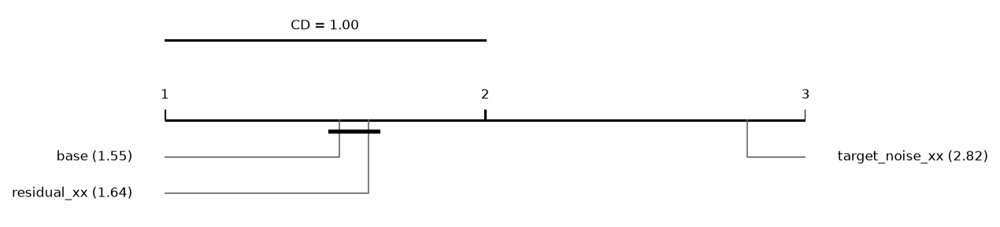
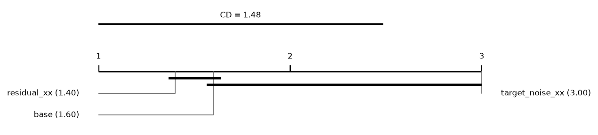
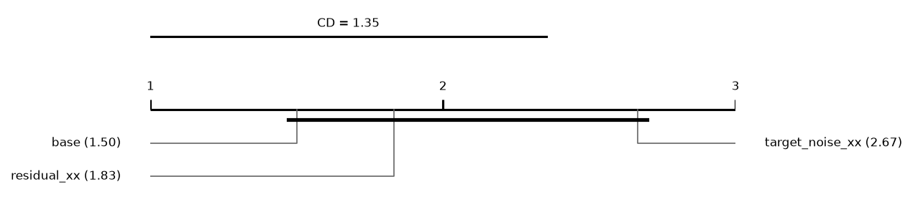

# Report: draws

660 runs on 11 datasets. Error = 1 - balanced accuracy (classification) or RMSE (regression); relative reduction = (e_ref - e) / max(e_ref, e) of errors averaged over a dataset's runs; positive favours the method.

## Hypotheses (plan §5)

Not tested: some runs of the compared methods are unfinished.

## Depth rule of the base cascade (descriptive)
*picked*: share of base runs whose chosen layer is this depth. *median_test_vs_oof*: median over runs of (OOF error - test error) / max of the two, with the OOF error from the depth score (1 - balanced accuracy, or √MSE); positive = the test error is lower than the OOF error the rule sees. *median_reduction* to *p*: base cut at this depth vs base at its chosen layer, over datasets; positive = the fixed depth has the lower error.

| depth | picked | picked_classification | picked_regression | median_test_vs_oof | median_reduction | wins | losses | zeros | p |
|---|---|---|---|---|---|---|---|---|---|
| 1 | 0.4 | 0.31 | 0.475 | 0.0163 | -0.0172 | 1 | 8 | 2 | 0.0078 |
| 2 | 0.4591 | 0.47 | 0.45 | 0.0547 | 0 | 5 | 5 | 1 | 0.7695 |
| 3 | 0.0727 | 0.16 | 0 | 0.0799 | -0.0086 | 3 | 8 | 0 | 0.2402 |

## Other methods vs the base cascade (descriptive)
Two-sided Wilcoxon p without Holm's correction.

| comparison | method | reference | datasets | median_reduction | wins | losses | zeros | p |
|---|---|---|---|---|---|---|---|---|
| target_noise_xx | target_noise_xx | base | 11 | -0.0288 | 1 | 10 | 0 | 0.002 |

## Mean ranks
Friedman over 3 methods and 11 datasets: chi2 = 11.09, p = 0.0039; Nemenyi critical difference = 1.00 (descriptive).

| method | mean rank |
|---|---|
| base | 1.5455 |
| residual_xx | 1.6364 |
| target_noise_xx | 2.8182 |

## Other methods vs the base cascade: classification (descriptive)
Two-sided Wilcoxon p without Holm's correction.

| comparison | method | reference | datasets | median_reduction | wins | losses | zeros | p |
|---|---|---|---|---|---|---|---|---|
| target_noise_xx | target_noise_xx | base | 5 | -0.0288 | 0 | 5 | 0 | 0.0625 |

## Mean ranks: classification
Friedman over 3 methods and 5 datasets: chi2 = 7.60, p = 0.0224; Nemenyi critical difference = 1.48 (descriptive).

| method | mean rank |
|---|---|
| residual_xx | 1.4 |
| base | 1.6 |
| target_noise_xx | 3 |

## Other methods vs the base cascade: regression (descriptive)
Two-sided Wilcoxon p without Holm's correction.

| comparison | method | reference | datasets | median_reduction | wins | losses | zeros | p |
|---|---|---|---|---|---|---|---|---|
| target_noise_xx | target_noise_xx | base | 6 | -0.0322 | 1 | 5 | 0 | 0.0625 |

## Mean ranks: regression
Friedman over 3 methods and 6 datasets: chi2 = 4.33, p = 0.1146; Nemenyi critical difference = 1.35 (descriptive).

| method | mean rank |
|---|---|
| base | 1.5 |
| residual_xx | 1.8333 |
| target_noise_xx | 2.6667 |

## Common depth (descriptive)
Median relative reduction vs base at each depth reached by every cascade variant in a run; *runs* counts those runs, so deep rows rest on few.

| depth | residual_xx | target_noise_xx | datasets | runs |
|---|---|---|---|---|
| 1 | -0.0094 | -0.0825 | 11 | 55 |
| 2 | -0.0053 | -0.0408 | 11 | 55 |
| 3 | 0.006 | -0.0103 | 11 | 55 |
| 4 | -0.000678 | -0.0191 | 9 | 39 |
| 5 | -0.0014 | 0.0156 | 5 | 7 |
| 6 | 0.0259 | 0.0183 | 2 | 2 |

## Per dataset: balanced_accuracy mean ± sd (classification)
| dataset | base | residual_xx | target_noise_xx |
|---|---|---|---|
| adult | 0.7489 ± 0.015 | 0.7542 ± 0.014 | 0.7415 ± 0.016 |
| bank_marketing | 0.587 ± 0.024 | 0.5911 ± 0.016 | 0.5829 ± 0.029 |
| credit_default | 0.6391 ± 0.017 | 0.6407 ± 0.02 | 0.6342 ± 0.022 |
| page_blocks | 0.7488 ± 0.058 | 0.7364 ± 0.063 | 0.7266 ± 0.053 |
| phishing | 0.9367 ± 0.011 | 0.935 ± 0.0093 | 0.9309 ± 0.011 |

## Per dataset: log_loss mean ± sd (classification)
| dataset | base | residual_xx | target_noise_xx |
|---|---|---|---|
| adult | 0.3537 ± 0.013 | 0.353 ± 0.02 | 0.3517 ± 0.0099 |
| bank_marketing | 0.3184 ± 0.012 | 0.3226 ± 0.0098 | 0.3116 ± 0.0055 |
| credit_default | 0.4524 ± 0.0081 | 0.4541 ± 0.0066 | 0.4497 ± 0.0065 |
| page_blocks | 0.1133 ± 0.018 | 0.1113 ± 0.016 | 0.1134 ± 0.021 |
| phishing | 0.1811 ± 0.021 | 0.1874 ± 0.025 | 0.2121 ± 0.037 |

## Per dataset: macro_f1 mean ± sd (classification)
| dataset | base | residual_xx | target_noise_xx |
|---|---|---|---|
| adult | 0.7638 ± 0.011 | 0.7686 ± 0.011 | 0.7612 ± 0.013 |
| bank_marketing | 0.6122 ± 0.034 | 0.6189 ± 0.021 | 0.6062 ± 0.042 |
| credit_default | 0.6603 ± 0.019 | 0.6619 ± 0.023 | 0.6548 ± 0.025 |
| page_blocks | 0.7869 ± 0.041 | 0.7809 ± 0.044 | 0.7693 ± 0.043 |
| phishing | 0.9375 ± 0.01 | 0.9362 ± 0.0089 | 0.9325 ± 0.01 |

## Per dataset: accuracy mean ± sd (classification)
| dataset | base | residual_xx | target_noise_xx |
|---|---|---|---|
| adult | 0.8383 ± 0.007 | 0.841 ± 0.0063 | 0.8407 ± 0.0068 |
| bank_marketing | 0.8895 ± 0.0033 | 0.8899 ± 0.0027 | 0.89 ± 0.003 |
| credit_default | 0.8098 ± 0.0067 | 0.8106 ± 0.0064 | 0.8105 ± 0.0059 |
| page_blocks | 0.9674 ± 0.0051 | 0.9679 ± 0.006 | 0.966 ± 0.0058 |
| phishing | 0.9384 ± 0.0099 | 0.9373 ± 0.0087 | 0.9337 ± 0.01 |

## Per dataset: roc_auc mean ± sd (classification)
| dataset | base | residual_xx | target_noise_xx |
|---|---|---|---|
| adult | 0.8858 ± 0.0077 | 0.8882 ± 0.0085 | 0.887 ± 0.0084 |
| bank_marketing | 0.739 ± 0.017 | 0.7375 ± 0.016 | 0.7422 ± 0.016 |
| credit_default | 0.7492 ± 0.012 | 0.7457 ± 0.011 | 0.7508 ± 0.012 |
| page_blocks | 0.9915 ± 0.0026 | 0.991 ± 0.0032 | 0.991 ± 0.0032 |
| phishing | 0.9848 ± 0.0034 | 0.9827 ± 0.0039 | 0.9811 ± 0.0039 |

## Per dataset: average_precision mean ± sd (classification)
| dataset | base | residual_xx | target_noise_xx |
|---|---|---|---|
| adult | 0.8374 ± 0.01 | 0.8428 ± 0.012 | 0.8399 ± 0.012 |
| bank_marketing | 0.6553 ± 0.013 | 0.655 ± 0.01 | 0.6576 ± 0.011 |
| credit_default | 0.7004 ± 0.011 | 0.6998 ± 0.011 | 0.7018 ± 0.011 |
| page_blocks | 0.8683 ± 0.028 | 0.8638 ± 0.024 | 0.861 ± 0.018 |
| phishing | 0.9849 ± 0.0033 | 0.9827 ± 0.004 | 0.9814 ± 0.0038 |

## Per dataset: cpu_seconds mean ± sd (classification)
| dataset | base | residual_xx | target_noise_xx |
|---|---|---|---|
| adult | 7.715 ± 1.6 | 9.064 ± 2.2 | 12.15 ± 2.7 |
| bank_marketing | 7.673 ± 1.4 | 7.64 ± 2.3 | 9.591 ± 2.8 |
| credit_default | 9.194 ± 3.4 | 8.946 ± 2 | 11 ± 3.4 |
| page_blocks | 4.922 ± 0.76 | 5.341 ± 0.78 | 6.416 ± 1.3 |
| phishing | 4.416 ± 0.67 | 4.929 ± 0.9 | 5.432 ± 1.1 |

## Per dataset: rmse mean ± sd (regression)
| dataset | base | residual_xx | target_noise_xx |
|---|---|---|---|
| air_quality | 0.4753 ± 0.027 | 0.4726 ± 0.027 | 0.4816 ± 0.033 |
| bike_sharing | 83.65 ± 4.1 | 83.44 ± 5 | 94.11 ± 5.6 |
| california | 0.5857 ± 0.015 | 0.6059 ± 0.014 | 0.6085 ± 0.011 |
| ccpp | 4.007 ± 0.054 | 4.053 ± 0.053 | 4.117 ± 0.058 |
| parkinsons | 11.09 ± 1.8 | 11.16 ± 1.5 | 10.99 ± 1.8 |
| superconductivity | 14.27 ± 0.45 | 14.28 ± 0.47 | 14.98 ± 0.34 |

## Per dataset: mae mean ± sd (regression)
| dataset | base | residual_xx | target_noise_xx |
|---|---|---|---|
| air_quality | 0.3087 ± 0.008 | 0.3097 ± 0.0078 | 0.3156 ± 0.015 |
| bike_sharing | 58.27 ± 3 | 58.42 ± 3.7 | 67.95 ± 4.5 |
| california | 0.4109 ± 0.016 | 0.4308 ± 0.014 | 0.4358 ± 0.0065 |
| ccpp | 3.031 ± 0.057 | 3.077 ± 0.054 | 3.145 ± 0.066 |
| parkinsons | 9.338 ± 2 | 9.37 ± 1.7 | 9.261 ± 2 |
| superconductivity | 9.635 ± 0.44 | 9.586 ± 0.46 | 10.37 ± 0.33 |

## Per dataset: r2 mean ± sd (regression)
| dataset | base | residual_xx | target_noise_xx |
|---|---|---|---|
| air_quality | 0.8878 ± 0.02 | 0.8889 ± 0.021 | 0.8846 ± 0.023 |
| bike_sharing | 0.7865 ± 0.017 | 0.7874 ± 0.021 | 0.7301 ± 0.02 |
| california | 0.7434 ± 0.012 | 0.7254 ± 0.014 | 0.7231 ± 0.0083 |
| ccpp | 0.9448 ± 0.0018 | 0.9436 ± 0.0017 | 0.9418 ± 0.0019 |
| parkinsons | -0.2299 ± 0.23 | -0.2665 ± 0.29 | -0.2027 ± 0.2 |
| superconductivity | 0.8249 ± 0.011 | 0.8248 ± 0.012 | 0.8074 ± 0.0082 |

## Per dataset: cpu_seconds mean ± sd (regression)
| dataset | base | residual_xx | target_noise_xx |
|---|---|---|---|
| air_quality | 4.206 ± 0.022 | 4.733 ± 0.031 | 5.797 ± 0.79 |
| bike_sharing | 7.264 ± 0.053 | 8.953 ± 0.65 | 9.679 ± 0.85 |
| california | 6.777 ± 0.42 | 7.422 ± 0.59 | 7.611 ± 0.039 |
| ccpp | 4.116 ± 0.031 | 4.441 ± 0.037 | 4.45 ± 0.038 |
| parkinsons | 8.07 ± 2.4 | 8.339 ± 1.9 | 9.099 ± 3.2 |
| superconductivity | 9.131 ± 1.3 | 14.02 ± 2 | 15.75 ± 1.3 |
