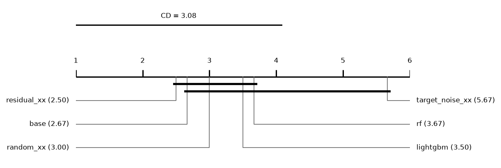
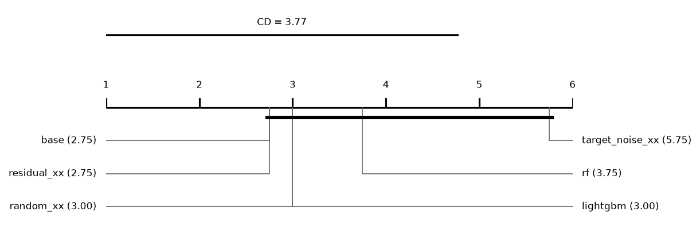
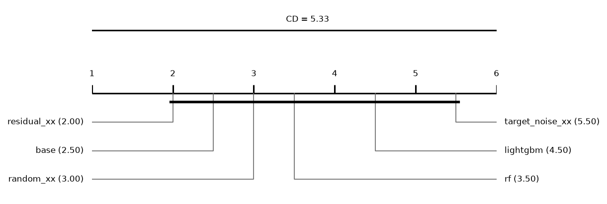

# Report: large (INCOMPLETE: 216 tasks missing; only runs finished by every method are used)

324 runs on 6 datasets. Error = 1 - balanced accuracy (classification) or RMSE (regression); relative reduction = (e_ref - e) / max(e_ref, e) of errors averaged over a dataset's runs; positive favours the method.

## Hypotheses (plan §5)

Not tested: some runs of the compared methods are unfinished.

## Depth rule of the base cascade (descriptive)
*picked*: share of base runs whose chosen layer is this depth. *median_test_vs_oof*: median over runs of (OOF error - test error) / max of the two, with the OOF error from the depth score (1 - balanced accuracy, or √MSE); positive = the test error is lower than the OOF error the rule sees. *median_reduction* to *p*: base cut at this depth vs base at its chosen layer, over datasets; positive = the fixed depth has the lower error.

| depth | picked | picked_classification | picked_regression | median_test_vs_oof | median_reduction | wins | losses | zeros | p |
|---|---|---|---|---|---|---|---|---|---|
| 1 | 0.4259 | 0.4722 | 0.3333 | 0.0146 | -0.0507 | 1 | 5 | 0 | 0.0938 |
| 2 | 0.3889 | 0.4167 | 0.3333 | 0.0587 | 0.0096 | 4 | 2 | 0 | 1 |
| 3 | 0.1296 | 0.0278 | 0.3333 | 0.0792 | 0.0076 | 6 | 0 | 0 | 0.0312 |

## Other methods vs the base cascade (descriptive)
Two-sided Wilcoxon p without Holm's correction.

| comparison | method | reference | datasets | median_reduction | wins | losses | zeros | p |
|---|---|---|---|---|---|---|---|---|
| random_xx | random_xx | base | 6 | -0.00084 | 3 | 3 | 0 | 0.6875 |
| target_noise_xx | target_noise_xx | base | 6 | -0.0742 | 0 | 6 | 0 | 0.0312 |
| rf | rf | base | 6 | -0.0111 | 3 | 3 | 0 | 0.4375 |
| lightgbm | lightgbm | base | 6 | -0.0124 | 1 | 5 | 0 | 0.3125 |

## Mean ranks
Friedman over 6 methods and 6 datasets: chi2 = 11.43, p = 0.0435; Nemenyi critical difference = 3.08 (descriptive).

| method | mean rank |
|---|---|
| residual_xx | 2.5 |
| base | 2.6667 |
| random_xx | 3 |
| lightgbm | 3.5 |
| rf | 3.6667 |
| target_noise_xx | 5.6667 |

## Other methods vs the base cascade: classification (descriptive)
Two-sided Wilcoxon p without Holm's correction.

| comparison | method | reference | datasets | median_reduction | wins | losses | zeros | p |
|---|---|---|---|---|---|---|---|---|
| random_xx | random_xx | base | 4 | -0.0074 | 2 | 2 | 0 | 0.625 |
| target_noise_xx | target_noise_xx | base | 4 | -0.0664 | 0 | 4 | 0 | 0.125 |
| rf | rf | base | 4 | -0.0111 | 2 | 2 | 0 | 0.625 |
| lightgbm | lightgbm | base | 4 | -0.0057 | 1 | 3 | 0 | 0.875 |

## Mean ranks: classification
Friedman over 6 methods and 4 datasets: chi2 = 7.71, p = 0.1727; Nemenyi critical difference = 3.77 (descriptive).

| method | mean rank |
|---|---|
| base | 2.75 |
| residual_xx | 2.75 |
| random_xx | 3 |
| lightgbm | 3 |
| rf | 3.75 |
| target_noise_xx | 5.75 |

## Other methods vs the base cascade: regression (descriptive)
Two-sided Wilcoxon p without Holm's correction.

| comparison | method | reference | datasets | median_reduction | wins | losses | zeros | p |
|---|---|---|---|---|---|---|---|---|
| random_xx | random_xx | base | 2 | 0.0116 | 1 | 1 | 0 | 1 |
| target_noise_xx | target_noise_xx | base | 2 | -0.0859 | 0 | 2 | 0 | 0.5 |
| rf | rf | base | 2 | -0.2083 | 1 | 1 | 0 | 1 |
| lightgbm | lightgbm | base | 2 | -0.0203 | 0 | 2 | 0 | 0.5 |

## Mean ranks: regression
Friedman over 6 methods and 2 datasets: chi2 = 4.86, p = 0.4336; Nemenyi critical difference = 5.33 (descriptive).

| method | mean rank |
|---|---|
| residual_xx | 2 |
| base | 2.5 |
| random_xx | 3 |
| rf | 3.5 |
| lightgbm | 4.5 |
| target_noise_xx | 5.5 |

## Common depth (descriptive)
Median relative reduction vs base at each depth reached by every cascade variant in a run; *runs* counts those runs, so deep rows rest on few.

| depth | random_xx | residual_xx | target_noise_xx | datasets | runs |
|---|---|---|---|---|---|
| 1 | -0.0066 | 0.0143 | -0.0902 | 6 | 18 |
| 2 | -0.0045 | 0.0107 | -0.0741 | 6 | 18 |
| 3 | -0.0034 | 0.0012 | -0.0603 | 6 | 18 |
| 4 | 0.0067 | 0.0021 | -0.1118 | 5 | 13 |
| 5 | -0.0874 | 0.2508 | -0.164 | 2 | 4 |

## Per dataset: balanced_accuracy mean ± sd (classification)
| dataset | base | random_xx | residual_xx | target_noise_xx | rf | lightgbm |
|---|---|---|---|---|---|---|
| covertype | 0.5752 ± 0.13 | 0.568 ± 0.13 | 0.5929 ± 0.13 | 0.5005 ± 0.1 | 0.5634 ± 0.1 | 0.5666 ± 0.11 |
| higgs | 0.6856 ± 0.019 | 0.6863 ± 0.018 | 0.6839 ± 0.022 | 0.6783 ± 0.025 | 0.6892 ± 0.018 | 0.6923 ± 0.02 |
| higgs_low | 0.588 ± 0.028 | 0.5887 ± 0.027 | 0.6019 ± 0.024 | 0.571 ± 0.025 | 0.59 ± 0.026 | 0.5839 ± 0.031 |
| miniboone | 0.9096 ± 0.012 | 0.9044 ± 0.017 | 0.9025 ± 0.018 | 0.9004 ± 0.021 | 0.8854 ± 0.019 | 0.9095 ± 0.019 |

## Per dataset: log_loss mean ± sd (classification)
| dataset | base | random_xx | residual_xx | target_noise_xx | rf | lightgbm |
|---|---|---|---|---|---|---|
| covertype | 0.5494 ± 0.12 | 0.5511 ± 0.12 | 0.5266 ± 0.12 | 0.6173 ± 0.079 | 0.5638 ± 0.11 | 0.5794 ± 0.12 |
| higgs | 0.6018 ± 0.017 | 0.5945 ± 0.019 | 0.5971 ± 0.025 | 0.5933 ± 0.025 | 0.5878 ± 0.019 | 0.5735 ± 0.024 |
| higgs_low | 0.6671 ± 0.012 | 0.6652 ± 0.013 | 0.6599 ± 0.013 | 0.6737 ± 0.011 | 0.6654 ± 0.014 | 0.665 ± 0.018 |
| miniboone | 0.1877 ± 0.027 | 0.1923 ± 0.028 | 0.1941 ± 0.028 | 0.2004 ± 0.033 | 0.2169 ± 0.023 | 0.1765 ± 0.029 |

## Per dataset: macro_f1 mean ± sd (classification)
| dataset | base | random_xx | residual_xx | target_noise_xx | rf | lightgbm |
|---|---|---|---|---|---|---|
| covertype | 0.6074 ± 0.13 | 0.5997 ± 0.14 | 0.628 ± 0.13 | 0.517 ± 0.12 | 0.6102 ± 0.1 | 0.6071 ± 0.11 |
| higgs | 0.6857 ± 0.019 | 0.6864 ± 0.018 | 0.6838 ± 0.022 | 0.6773 ± 0.027 | 0.6894 ± 0.018 | 0.6925 ± 0.02 |
| higgs_low | 0.5823 ± 0.033 | 0.5846 ± 0.029 | 0.5999 ± 0.026 | 0.5631 ± 0.029 | 0.5881 ± 0.026 | 0.5788 ± 0.036 |
| miniboone | 0.9075 ± 0.014 | 0.905 ± 0.016 | 0.9032 ± 0.017 | 0.9005 ± 0.02 | 0.8931 ± 0.016 | 0.9111 ± 0.017 |

## Per dataset: accuracy mean ± sd (classification)
| dataset | base | random_xx | residual_xx | target_noise_xx | rf | lightgbm |
|---|---|---|---|---|---|---|
| covertype | 0.7769 ± 0.054 | 0.7775 ± 0.053 | 0.7861 ± 0.054 | 0.7403 ± 0.036 | 0.7781 ± 0.05 | 0.762 ± 0.05 |
| higgs | 0.6887 ± 0.018 | 0.6888 ± 0.017 | 0.686 ± 0.021 | 0.6816 ± 0.022 | 0.6915 ± 0.017 | 0.6943 ± 0.02 |
| higgs_low | 0.5959 ± 0.027 | 0.5961 ± 0.026 | 0.608 ± 0.024 | 0.5799 ± 0.024 | 0.5957 ± 0.025 | 0.5911 ± 0.029 |
| miniboone | 0.9247 ± 0.012 | 0.9233 ± 0.013 | 0.9218 ± 0.013 | 0.9196 ± 0.016 | 0.9154 ± 0.012 | 0.9285 ± 0.013 |

## Per dataset: roc_auc mean ± sd (classification)
| dataset | base | random_xx | residual_xx | target_noise_xx | rf | lightgbm |
|---|---|---|---|---|---|---|
| covertype | 0.9529 ± 0.02 | 0.9532 ± 0.02 | 0.9563 ± 0.02 | 0.9401 ± 0.018 | 0.9529 ± 0.021 | 0.9416 ± 0.032 |
| higgs | 0.7601 ± 0.023 | 0.7572 ± 0.022 | 0.7532 ± 0.025 | 0.7504 ± 0.026 | 0.7616 ± 0.022 | 0.766 ± 0.025 |
| higgs_low | 0.633 ± 0.039 | 0.6328 ± 0.035 | 0.6465 ± 0.034 | 0.6099 ± 0.035 | 0.6294 ± 0.037 | 0.6237 ± 0.043 |
| miniboone | 0.9738 ± 0.0075 | 0.9727 ± 0.0077 | 0.9722 ± 0.0078 | 0.9702 ± 0.0091 | 0.9697 ± 0.0075 | 0.9763 ± 0.0075 |

## Per dataset: average_precision mean ± sd (classification)
| dataset | base | random_xx | residual_xx | target_noise_xx | rf | lightgbm |
|---|---|---|---|---|---|---|
| covertype | 0.699 ± 0.11 | 0.6986 ± 0.11 | 0.7132 ± 0.12 | 0.6261 ± 0.1 | 0.707 ± 0.11 | 0.6742 ± 0.13 |
| higgs | 0.7536 ± 0.025 | 0.7489 ± 0.025 | 0.7437 ± 0.028 | 0.7423 ± 0.029 | 0.7547 ± 0.023 | 0.7613 ± 0.027 |
| higgs_low | 0.6214 ± 0.039 | 0.6211 ± 0.035 | 0.6332 ± 0.035 | 0.5989 ± 0.035 | 0.6177 ± 0.037 | 0.6143 ± 0.043 |
| miniboone | 0.9604 ± 0.0098 | 0.9589 ± 0.01 | 0.9586 ± 0.01 | 0.955 ± 0.011 | 0.9554 ± 0.0096 | 0.9648 ± 0.01 |

## Per dataset: cpu_seconds mean ± sd (classification)
| dataset | base | random_xx | residual_xx | target_noise_xx | rf | lightgbm |
|---|---|---|---|---|---|---|
| covertype | 48.05 ± 31 | 62.59 ± 41 | 60.8 ± 39 | 80.85 ± 54 | 4.575 ± 3.5 | 76.62 ± 84 |
| higgs | 41.4 ± 33 | 60.91 ± 50 | 57.35 ± 51 | 71.66 ± 58 | 7.108 ± 6.6 | 12.64 ± 11 |
| higgs_low | 38.3 ± 27 | 57.5 ± 54 | 47.88 ± 41 | 63.8 ± 50 | 6.448 ± 5.8 | 7.741 ± 9.1 |
| miniboone | 51.26 ± 42 | 74.41 ± 62 | 74.1 ± 64 | 89.01 ± 84 | 8.77 ± 8.3 | 33.78 ± 28 |

## Per dataset: rmse mean ± sd (regression)
| dataset | base | random_xx | residual_xx | target_noise_xx | rf | lightgbm |
|---|---|---|---|---|---|---|
| casp | 4.294 ± 0.47 | 4.309 ± 0.49 | 4.302 ± 0.49 | 4.545 ± 0.5 | 4.271 ± 0.42 | 4.358 ± 0.44 |
| sgemm | 0.2309 ± 0.11 | 0.2247 ± 0.11 | 0.1808 ± 0.073 | 0.2614 ± 0.11 | 0.3994 ± 0.12 | 0.237 ± 0.11 |

## Per dataset: mae mean ± sd (regression)
| dataset | base | random_xx | residual_xx | target_noise_xx | rf | lightgbm |
|---|---|---|---|---|---|---|
| casp | 3.283 ± 0.57 | 3.31 ± 0.6 | 3.301 ± 0.6 | 3.581 ± 0.65 | 3.219 ± 0.43 | 3.287 ± 0.46 |
| sgemm | 0.1726 ± 0.082 | 0.1686 ± 0.085 | 0.1352 ± 0.058 | 0.1984 ± 0.09 | 0.315 ± 0.1 | 0.1818 ± 0.085 |

## Per dataset: r2 mean ± sd (regression)
| dataset | base | random_xx | residual_xx | target_noise_xx | rf | lightgbm |
|---|---|---|---|---|---|---|
| casp | 0.5052 ± 0.11 | 0.5014 ± 0.11 | 0.5029 ± 0.11 | 0.4455 ± 0.12 | 0.5115 ± 0.094 | 0.4911 ± 0.1 |
| sgemm | 0.9506 ± 0.042 | 0.9522 ± 0.043 | 0.9707 ± 0.022 | 0.9374 ± 0.051 | 0.8646 ± 0.079 | 0.9475 ± 0.045 |

## Per dataset: cpu_seconds mean ± sd (regression)
| dataset | base | random_xx | residual_xx | target_noise_xx | rf | lightgbm |
|---|---|---|---|---|---|---|
| casp | 31.01 ± 30 | 37.44 ± 37 | 37.63 ± 37 | 38.74 ± 35 | 5.064 ± 4.7 | 12.19 ± 12 |
| sgemm | 42.51 ± 32 | 43.08 ± 30 | 47.79 ± 42 | 72.62 ± 65 | 2.515 ± 1.8 | 14.66 ± 14 |
