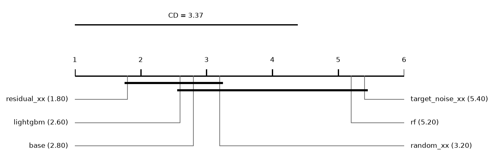
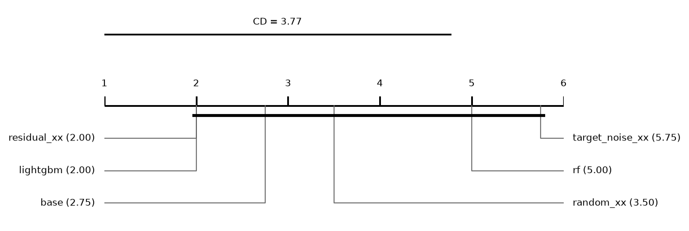
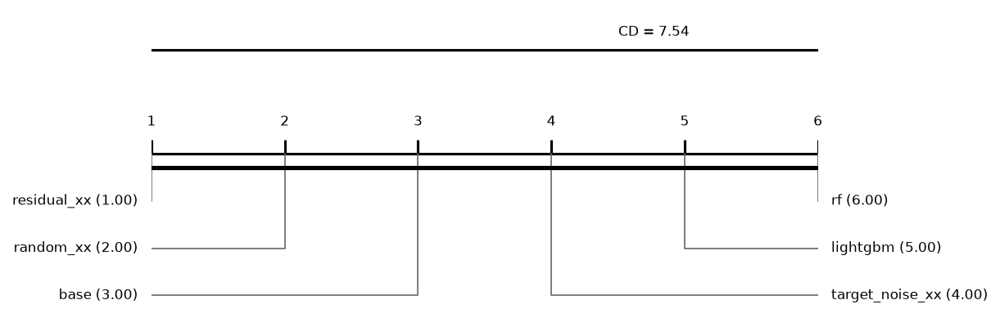

# Report: large64 (INCOMPLETE: 60 tasks missing; only runs finished by every method are used)

90 runs on 5 datasets. Error = 1 - balanced accuracy (classification) or RMSE (regression); relative reduction = (e_ref - e) / max(e_ref, e) of errors averaged over a dataset's runs; positive favours the method.

## Hypotheses (plan §5)

Not tested: some runs of the compared methods are unfinished.

## Depth rule of the base cascade (descriptive)
*picked*: share of base runs whose chosen layer is this depth. *median_test_vs_oof*: median over runs of (OOF error - test error) / max of the two, with the OOF error from the depth score (1 - balanced accuracy, or √MSE); positive = the test error is lower than the OOF error the rule sees. *median_reduction* to *p*: base cut at this depth vs base at its chosen layer, over datasets; positive = the fixed depth has the lower error.

| depth | picked | picked_classification | picked_regression | median_test_vs_oof | median_reduction | wins | losses | zeros | p |
|---|---|---|---|---|---|---|---|---|---|
| 1 | 0.2667 | 0.3333 | 0 | 0.0197 | -0.2427 | 0 | 4 | 1 | 0.125 |
| 2 | 0.3333 | 0.4167 | 0 | 0.0498 | 0 | 2 | 2 | 1 | 0.625 |
| 3 | 0.4 | 0.25 | 1 | 0.0965 | 0 | 2 | 1 | 2 | 1 |

## Other methods vs the base cascade (descriptive)
Two-sided Wilcoxon p without Holm's correction.

| comparison | method | reference | datasets | median_reduction | wins | losses | zeros | p |
|---|---|---|---|---|---|---|---|---|
| random_xx | random_xx | base | 5 | -0.0036 | 2 | 3 | 0 | 1 |
| target_noise_xx | target_noise_xx | base | 5 | -0.0545 | 0 | 5 | 0 | 0.0625 |
| rf | rf | base | 5 | -0.2058 | 0 | 5 | 0 | 0.0625 |
| lightgbm | lightgbm | base | 5 | 0.000548 | 3 | 2 | 0 | 0.8125 |

## Mean ranks
Friedman over 6 methods and 5 datasets: chi2 = 15.40, p = 0.0088; Nemenyi critical difference = 3.37 (descriptive).

| method | mean rank |
|---|---|
| residual_xx | 1.8 |
| lightgbm | 2.6 |
| base | 2.8 |
| random_xx | 3.2 |
| rf | 5.2 |
| target_noise_xx | 5.4 |

## Other methods vs the base cascade: classification (descriptive)
Two-sided Wilcoxon p without Holm's correction.

| comparison | method | reference | datasets | median_reduction | wins | losses | zeros | p |
|---|---|---|---|---|---|---|---|---|
| random_xx | random_xx | base | 4 | -0.0057 | 1 | 3 | 0 | 0.625 |
| target_noise_xx | target_noise_xx | base | 4 | -0.0484 | 0 | 4 | 0 | 0.125 |
| rf | rf | base | 4 | -0.1053 | 0 | 4 | 0 | 0.125 |
| lightgbm | lightgbm | base | 4 | 0.0088 | 3 | 1 | 0 | 0.875 |

## Mean ranks: classification
Friedman over 6 methods and 4 datasets: chi2 = 14.14, p = 0.0147; Nemenyi critical difference = 3.77 (descriptive).

| method | mean rank |
|---|---|
| residual_xx | 2 |
| lightgbm | 2 |
| base | 2.75 |
| random_xx | 3.5 |
| rf | 5 |
| target_noise_xx | 5.75 |

## Other methods vs the base cascade: regression (descriptive)
Two-sided Wilcoxon p without Holm's correction.

| comparison | method | reference | datasets | median_reduction | wins | losses | zeros | p |
|---|---|---|---|---|---|---|---|---|
| random_xx | random_xx | base | 1 | 0.0936 | 1 | 0 | 0 | 1 |
| target_noise_xx | target_noise_xx | base | 1 | -0.1484 | 0 | 1 | 0 | 1 |
| rf | rf | base | 1 | -0.5156 | 0 | 1 | 0 | 1 |
| lightgbm | lightgbm | base | 1 | -0.1975 | 0 | 1 | 0 | 1 |

## Mean ranks: regression
Friedman over 6 methods and 1 datasets: chi2 = nan, p = -; Nemenyi critical difference = 7.54 (descriptive).

| method | mean rank |
|---|---|
| residual_xx | 1 |
| random_xx | 2 |
| base | 3 |
| target_noise_xx | 4 |
| lightgbm | 5 |
| rf | 6 |

## Common depth (descriptive)
Median relative reduction vs base at each depth reached by every cascade variant in a run; *runs* counts those runs, so deep rows rest on few.

| depth | random_xx | residual_xx | target_noise_xx | datasets | runs |
|---|---|---|---|---|---|
| 1 | -0.0148 | 0.0039 | -0.1162 | 5 | 15 |
| 2 | -0.0063 | 0.0148 | -0.074 | 5 | 15 |
| 3 | -0.002 | 0.0179 | -0.0756 | 5 | 15 |
| 4 | 0.0252 | 0.0437 | -0.1551 | 4 | 11 |
| 5 | -0.0175 | -0.0185 | -0.0476 | 1 | 3 |

## Per dataset: balanced_accuracy mean ± sd (classification)
| dataset | base | random_xx | residual_xx | target_noise_xx | rf | lightgbm |
|---|---|---|---|---|---|---|
| covertype | 0.8393 ± 0.0046 | 0.8417 ± 0.0052 | 0.8486 ± 0.0036 | 0.746 ± 0.013 | 0.7972 ± 0.0084 | 0.8344 ± 0.0083 |
| higgs | 0.7187 ± 0.0033 | 0.7176 ± 0.0031 | 0.7219 ± 0.0045 | 0.7127 ± 0.0041 | 0.7173 ± 0.0029 | 0.7252 ± 0.0027 |
| higgs_low | 0.6408 ± 0.0041 | 0.638 ± 0.011 | 0.6459 ± 0.0025 | 0.6249 ± 0.0021 | 0.6404 ± 0.0059 | 0.641 ± 0.0047 |
| miniboone | 0.9363 ± 0.00037 | 0.9349 ± 0.0011 | 0.9332 ± 0.0007 | 0.9326 ± 0.00065 | 0.9198 ± 0.0015 | 0.9374 ± 0.00059 |

## Per dataset: log_loss mean ± sd (classification)
| dataset | base | random_xx | residual_xx | target_noise_xx | rf | lightgbm |
|---|---|---|---|---|---|---|
| covertype | 0.2592 ± 0.002 | 0.2465 ± 0.0055 | 0.2324 ± 0.0054 | 0.384 ± 0.0052 | 0.3138 ± 0.0039 | 0.2605 ± 0.0067 |
| higgs | 0.5493 ± 0.015 | 0.5451 ± 0.0015 | 0.5416 ± 0.0037 | 0.5515 ± 0.0032 | 0.5526 ± 0.0016 | 0.5332 ± 0.0039 |
| higgs_low | 0.6415 ± 0.0023 | 0.6385 ± 0.011 | 0.6273 ± 0.0047 | 0.6418 ± 0.0028 | 0.6354 ± 0.0026 | 0.6257 ± 0.0052 |
| miniboone | 0.1413 ± 0.0018 | 0.1439 ± 0.0013 | 0.1469 ± 0.00064 | 0.1466 ± 0.00074 | 0.1748 ± 0.0021 | 0.1325 ± 0.0025 |

## Per dataset: macro_f1 mean ± sd (classification)
| dataset | base | random_xx | residual_xx | target_noise_xx | rf | lightgbm |
|---|---|---|---|---|---|---|
| covertype | 0.8559 ± 0.0015 | 0.8589 ± 0.0063 | 0.8679 ± 0.0016 | 0.7748 ± 0.0076 | 0.8335 ± 0.0037 | 0.8602 ± 0.0077 |
| higgs | 0.7188 ± 0.003 | 0.7177 ± 0.0031 | 0.7219 ± 0.0045 | 0.7127 ± 0.004 | 0.7175 ± 0.0029 | 0.7254 ± 0.0026 |
| higgs_low | 0.6404 ± 0.0041 | 0.6376 ± 0.011 | 0.6459 ± 0.0025 | 0.625 ± 0.002 | 0.6404 ± 0.006 | 0.6409 ± 0.0048 |
| miniboone | 0.9333 ± 0.00086 | 0.9325 ± 0.0013 | 0.9308 ± 0.00089 | 0.9297 ± 0.00093 | 0.9218 ± 0.0015 | 0.9352 ± 0.0011 |

## Per dataset: accuracy mean ± sd (classification)
| dataset | base | random_xx | residual_xx | target_noise_xx | rf | lightgbm |
|---|---|---|---|---|---|---|
| covertype | 0.902 ± 0.00079 | 0.9071 ± 0.004 | 0.9116 ± 0.0017 | 0.8471 ± 0.0031 | 0.8958 ± 0.001 | 0.9011 ± 0.0035 |
| higgs | 0.7201 ± 0.0025 | 0.7186 ± 0.0031 | 0.7229 ± 0.0046 | 0.7138 ± 0.0038 | 0.7188 ± 0.0029 | 0.7265 ± 0.0025 |
| higgs_low | 0.6455 ± 0.0041 | 0.6421 ± 0.0093 | 0.6495 ± 0.0024 | 0.6278 ± 0.0021 | 0.6439 ± 0.0059 | 0.6449 ± 0.0045 |
| miniboone | 0.9456 ± 0.00083 | 0.9451 ± 0.0011 | 0.9437 ± 0.00075 | 0.9428 ± 0.00081 | 0.937 ± 0.0012 | 0.9474 ± 0.00093 |

## Per dataset: roc_auc mean ± sd (classification)
| dataset | base | random_xx | residual_xx | target_noise_xx | rf | lightgbm |
|---|---|---|---|---|---|---|
| covertype | 0.9904 ± 5.7e-05 | 0.9915 ± 0.00035 | 0.9924 ± 0.00045 | 0.9784 ± 0.00045 | 0.9903 ± 0.00048 | 0.9907 ± 0.00054 |
| higgs | 0.7982 ± 0.002 | 0.7963 ± 0.0019 | 0.7995 ± 0.0042 | 0.7904 ± 0.0037 | 0.797 ± 0.0027 | 0.8055 ± 0.0037 |
| higgs_low | 0.698 ± 0.0075 | 0.6953 ± 0.01 | 0.7046 ± 0.0063 | 0.6774 ± 0.006 | 0.6965 ± 0.0063 | 0.7009 ± 0.0086 |
| miniboone | 0.9848 ± 0.00011 | 0.9841 ± 0.00017 | 0.9838 ± 0.00024 | 0.9834 ± 0.00024 | 0.9814 ± 0.00041 | 0.9865 ± 0.00054 |

## Per dataset: average_precision mean ± sd (classification)
| dataset | base | random_xx | residual_xx | target_noise_xx | rf | lightgbm |
|---|---|---|---|---|---|---|
| covertype | 0.9235 ± 0.0019 | 0.9281 ± 0.0051 | 0.9349 ± 0.002 | 0.8518 ± 0.0018 | 0.9213 ± 0.0018 | 0.9298 ± 0.002 |
| higgs | 0.7955 ± 0.0016 | 0.7929 ± 0.0019 | 0.7959 ± 0.004 | 0.7869 ± 0.0035 | 0.793 ± 0.002 | 0.8038 ± 0.0038 |
| higgs_low | 0.6885 ± 0.008 | 0.6858 ± 0.011 | 0.6951 ± 0.0071 | 0.6691 ± 0.0062 | 0.6857 ± 0.0067 | 0.6939 ± 0.0092 |
| miniboone | 0.9755 ± 0.00069 | 0.9746 ± 0.00047 | 0.9744 ± 0.00059 | 0.9727 ± 0.0007 | 0.9713 ± 0.00098 | 0.9792 ± 0.0011 |

## Per dataset: cpu_seconds mean ± sd (classification)
| dataset | base | random_xx | residual_xx | target_noise_xx | rf | lightgbm |
|---|---|---|---|---|---|---|
| covertype | 240.6 ± 1.4 | 351.5 ± 10 | 346.5 ± 7 | 527.7 ± 7.2 | 31.63 ± 0.35 | 729.9 ± 42 |
| higgs | 354 ± 56 | 526.7 ± 0.36 | 525.4 ± 0.94 | 528.4 ± 1.2 | 66.13 ± 0.32 | 103.9 ± 23 |
| higgs_low | 252.3 ± 1.5 | 399.8 ± 72 | 436.8 ± 70 | 469.3 ± 0.77 | 53.3 ± 6.3 | 81.72 ± 20 |
| miniboone | 479.9 ± 5.5 | 700.6 ± 3.1 | 695.2 ± 4.5 | 832.7 ± 5.8 | 90.04 ± 0.21 | 185.3 ± 37 |

## Per dataset: rmse mean ± sd (regression)
| dataset | base | random_xx | residual_xx | target_noise_xx | rf | lightgbm |
|---|---|---|---|---|---|---|
| sgemm | 0.07767 ± 0.0008 | 0.0704 ± 0.003 | 0.06207 ± 0.003 | 0.0912 ± 0.00059 | 0.1603 ± 0.0015 | 0.09677 ± 0.0097 |

## Per dataset: mae mean ± sd (regression)
| dataset | base | random_xx | residual_xx | target_noise_xx | rf | lightgbm |
|---|---|---|---|---|---|---|
| sgemm | 0.05395 ± 0.00056 | 0.0493 ± 0.0025 | 0.04247 ± 0.0025 | 0.06563 ± 0.00041 | 0.1239 ± 0.0015 | 0.07358 ± 0.0077 |

## Per dataset: r2 mean ± sd (regression)
| dataset | base | random_xx | residual_xx | target_noise_xx | rf | lightgbm |
|---|---|---|---|---|---|---|
| sgemm | 0.9953 ± 0.00011 | 0.9961 ± 0.00033 | 0.997 ± 0.0003 | 0.9935 ± 9.3e-05 | 0.9799 ± 0.00035 | 0.9926 ± 0.0014 |

## Per dataset: cpu_seconds mean ± sd (regression)
| dataset | base | random_xx | residual_xx | target_noise_xx | rf | lightgbm |
|---|---|---|---|---|---|---|
| sgemm | 225.7 ± 0.58 | 219.1 ± 1.6 | 252.8 ± 33 | 454.9 ± 3.7 | 14.49 ± 0.69 | 88.75 ± 3 |
