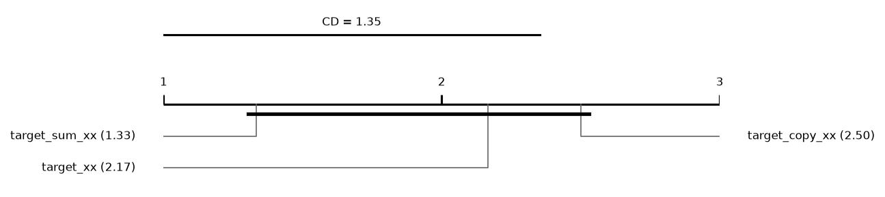
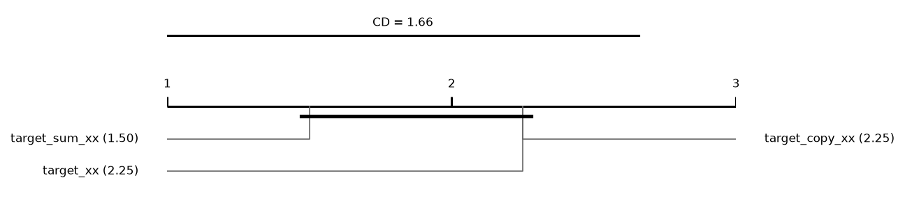
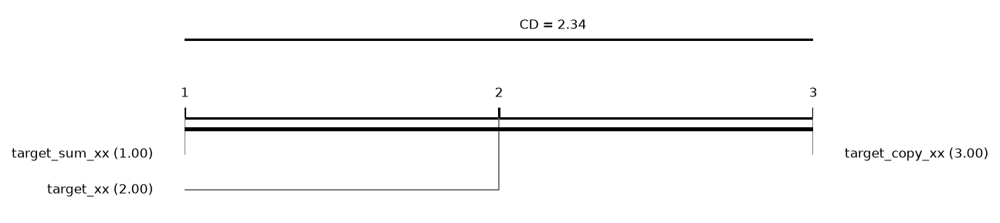

# Report: large_content (INCOMPLETE: 108 tasks missing; only runs finished by every method are used)

162 runs on 6 datasets. Error = 1 - balanced accuracy (classification) or RMSE (regression); relative reduction = (e_ref - e) / max(e_ref, e) of errors averaged over a dataset's runs; positive favours the method.

## Hypotheses (plan §5)

Not tested: some runs of the compared methods are unfinished.

## Mean ranks
Friedman over 3 methods and 6 datasets: chi2 = 4.33, p = 0.1146; Nemenyi critical difference = 1.35 (descriptive).

| method | mean rank |
|---|---|
| target_sum_xx | 1.3333 |
| target_xx | 2.1667 |
| target_copy_xx | 2.5 |

## Mean ranks: classification
Friedman over 3 methods and 4 datasets: chi2 = 1.50, p = 0.4724; Nemenyi critical difference = 1.66 (descriptive).

| method | mean rank |
|---|---|
| target_sum_xx | 1.5 |
| target_xx | 2.25 |
| target_copy_xx | 2.25 |

## Mean ranks: regression
Friedman over 3 methods and 2 datasets: chi2 = 4.00, p = 0.1353; Nemenyi critical difference = 2.34 (descriptive).

| method | mean rank |
|---|---|
| target_sum_xx | 1 |
| target_xx | 2 |
| target_copy_xx | 3 |

## Per dataset: balanced_accuracy mean ± sd (classification)
| dataset | target_xx | target_sum_xx | target_copy_xx |
|---|---|---|---|
| covertype | 0.5963 ± 0.12 | 0.5973 ± 0.12 | 0.5897 ± 0.12 |
| higgs | 0.6828 ± 0.021 | 0.6868 ± 0.021 | 0.6852 ± 0.02 |
| higgs_low | 0.6028 ± 0.024 | 0.5981 ± 0.021 | 0.5958 ± 0.024 |
| miniboone | 0.9019 ± 0.018 | 0.9049 ± 0.018 | 0.9067 ± 0.014 |

## Per dataset: log_loss mean ± sd (classification)
| dataset | target_xx | target_sum_xx | target_copy_xx |
|---|---|---|---|
| covertype | 0.5275 ± 0.12 | 0.5287 ± 0.12 | 0.5406 ± 0.11 |
| higgs | 0.5991 ± 0.022 | 0.5959 ± 0.022 | 0.5984 ± 0.02 |
| higgs_low | 0.6594 ± 0.014 | 0.6602 ± 0.013 | 0.6613 ± 0.013 |
| miniboone | 0.1957 ± 0.027 | 0.1917 ± 0.029 | 0.1889 ± 0.024 |

## Per dataset: macro_f1 mean ± sd (classification)
| dataset | target_xx | target_sum_xx | target_copy_xx |
|---|---|---|---|
| covertype | 0.6323 ± 0.12 | 0.6312 ± 0.12 | 0.6241 ± 0.13 |
| higgs | 0.6827 ± 0.021 | 0.6868 ± 0.021 | 0.6852 ± 0.02 |
| higgs_low | 0.6011 ± 0.025 | 0.5966 ± 0.022 | 0.5926 ± 0.028 |
| miniboone | 0.9023 ± 0.016 | 0.9052 ± 0.018 | 0.9062 ± 0.013 |

## Per dataset: accuracy mean ± sd (classification)
| dataset | target_xx | target_sum_xx | target_copy_xx |
|---|---|---|---|
| covertype | 0.785 ± 0.055 | 0.7843 ± 0.057 | 0.7779 ± 0.052 |
| higgs | 0.6849 ± 0.02 | 0.689 ± 0.019 | 0.6872 ± 0.019 |
| higgs_low | 0.6084 ± 0.023 | 0.6035 ± 0.021 | 0.6018 ± 0.023 |
| miniboone | 0.9211 ± 0.013 | 0.9234 ± 0.014 | 0.9241 ± 0.011 |

## Per dataset: roc_auc mean ± sd (classification)
| dataset | target_xx | target_sum_xx | target_copy_xx |
|---|---|---|---|
| covertype | 0.9566 ± 0.019 | 0.9564 ± 0.02 | 0.9541 ± 0.02 |
| higgs | 0.7522 ± 0.024 | 0.7556 ± 0.024 | 0.7534 ± 0.024 |
| higgs_low | 0.6467 ± 0.035 | 0.6426 ± 0.032 | 0.6398 ± 0.032 |
| miniboone | 0.9717 ± 0.0077 | 0.9728 ± 0.008 | 0.9736 ± 0.0066 |

## Per dataset: average_precision mean ± sd (classification)
| dataset | target_xx | target_sum_xx | target_copy_xx |
|---|---|---|---|
| covertype | 0.717 ± 0.11 | 0.7154 ± 0.11 | 0.7116 ± 0.11 |
| higgs | 0.7425 ± 0.027 | 0.747 ± 0.027 | 0.7444 ± 0.027 |
| higgs_low | 0.6333 ± 0.035 | 0.6304 ± 0.033 | 0.6277 ± 0.034 |
| miniboone | 0.958 ± 0.01 | 0.9592 ± 0.01 | 0.9604 ± 0.0088 |

## Per dataset: cpu_seconds mean ± sd (classification)
| dataset | target_xx | target_sum_xx | target_copy_xx |
|---|---|---|---|
| covertype | 54.6 ± 42 | 57.81 ± 42 | 58.42 ± 41 |
| higgs | 53.44 ± 45 | 53.09 ± 44 | 50.87 ± 41 |
| higgs_low | 53.01 ± 46 | 51.25 ± 39 | 47.89 ± 38 |
| miniboone | 75.61 ± 62 | 74.29 ± 60 | 72.95 ± 59 |

## Per dataset: rmse mean ± sd (regression)
| dataset | target_xx | target_sum_xx | target_copy_xx |
|---|---|---|---|
| casp | 4.306 ± 0.48 | 4.293 ± 0.47 | 4.332 ± 0.45 |
| sgemm | 0.1945 ± 0.072 | 0.1914 ± 0.07 | 0.1971 ± 0.077 |

## Per dataset: mae mean ± sd (regression)
| dataset | target_xx | target_sum_xx | target_copy_xx |
|---|---|---|---|
| casp | 3.304 ± 0.59 | 3.275 ± 0.57 | 3.294 ± 0.53 |
| sgemm | 0.1461 ± 0.057 | 0.1437 ± 0.056 | 0.1471 ± 0.061 |

## Per dataset: r2 mean ± sd (regression)
| dataset | target_xx | target_sum_xx | target_copy_xx |
|---|---|---|---|
| casp | 0.5023 ± 0.11 | 0.5055 ± 0.11 | 0.4968 ± 0.1 |
| sgemm | 0.9668 ± 0.023 | 0.9679 ± 0.022 | 0.9654 ± 0.025 |

## Per dataset: cpu_seconds mean ± sd (regression)
| dataset | target_xx | target_sum_xx | target_copy_xx |
|---|---|---|---|
| casp | 41.94 ± 41 | 41.08 ± 40 | 40.45 ± 40 |
| sgemm | 37.56 ± 28 | 37.07 ± 27 | 33.27 ± 24 |
