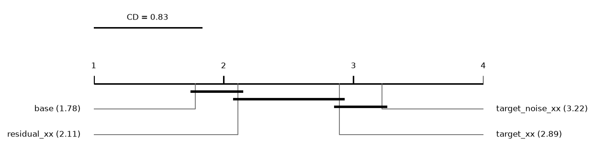
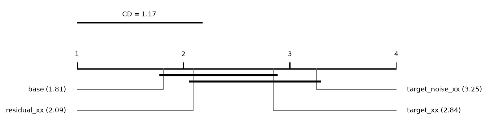
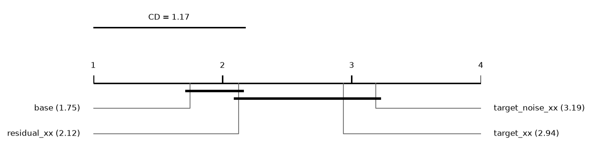

# Report: leaf

1280 runs on 32 datasets. Error = 1 - balanced accuracy (classification) or RMSE (regression); relative reduction = (e_ref - e) / max(e_ref, e) of errors averaged over a dataset's runs; positive favours the method.

## Hypotheses (plan §5)

Not tested: some runs of the compared methods are unfinished.

## Depth rule of the base cascade (descriptive)
*picked*: share of base runs whose chosen layer is this depth. *median_test_vs_oof*: median over runs of (OOF error - test error) / max of the two, with the OOF error from the depth score (1 - balanced accuracy, or √MSE); positive = the test error is lower than the OOF error the rule sees. *median_reduction* to *p*: base cut at this depth vs base at its chosen layer, over datasets; positive = the fixed depth has the lower error.

| depth | picked | picked_classification | picked_regression | median_test_vs_oof | median_reduction | wins | losses | zeros | p |
|---|---|---|---|---|---|---|---|---|---|
| 1 | 0.1406 | 0.1313 | 0.15 | 0.0028 | -0.0914 | 1 | 31 | 0 | 9.31e-10 |
| 2 | 0.6562 | 0.6 | 0.7125 | 0.0264 | 0 | 12 | 14 | 6 | 0.2804 |
| 3 | 0.1313 | 0.175 | 0.0875 | 0.0504 | 0.005 | 21 | 10 | 1 | 0.0882 |

## Other methods vs the base cascade (descriptive)
Two-sided Wilcoxon p without Holm's correction.

| comparison | method | reference | datasets | median_reduction | wins | losses | zeros | p |
|---|---|---|---|---|---|---|---|---|
| target_xx | target_xx | base | 32 | -0.0092 | 9 | 23 | 0 | 0.0545 |
| target_noise_xx | target_noise_xx | base | 32 | -0.0264 | 3 | 29 | 0 | 9.64e-08 |

## Mean ranks
Friedman over 4 methods and 32 datasets: chi2 = 25.78, p = 1.06e-05; Nemenyi critical difference = 0.83 (descriptive).

| method | mean rank |
|---|---|
| base | 1.7812 |
| residual_xx | 2.1094 |
| target_xx | 2.8906 |
| target_noise_xx | 3.2188 |

## Other methods vs the base cascade: classification (descriptive)
Two-sided Wilcoxon p without Holm's correction.

| comparison | method | reference | datasets | median_reduction | wins | losses | zeros | p |
|---|---|---|---|---|---|---|---|---|
| target_xx | target_xx | base | 16 | -0.0246 | 5 | 11 | 0 | 0.4037 |
| target_noise_xx | target_noise_xx | base | 16 | -0.0332 | 2 | 14 | 0 | 0.000214 |

## Mean ranks: classification
Friedman over 4 methods and 16 datasets: chi2 = 12.74, p = 0.0052; Nemenyi critical difference = 1.17 (descriptive).

| method | mean rank |
|---|---|
| base | 1.8125 |
| residual_xx | 2.0938 |
| target_xx | 2.8438 |
| target_noise_xx | 3.25 |

## Other methods vs the base cascade: regression (descriptive)
Two-sided Wilcoxon p without Holm's correction.

| comparison | method | reference | datasets | median_reduction | wins | losses | zeros | p |
|---|---|---|---|---|---|---|---|---|
| target_xx | target_xx | base | 16 | -0.008 | 4 | 12 | 0 | 0.0739 |
| target_noise_xx | target_noise_xx | base | 16 | -0.0164 | 1 | 15 | 0 | 0.000153 |

## Mean ranks: regression
Friedman over 4 methods and 16 datasets: chi2 = 13.12, p = 0.0044; Nemenyi critical difference = 1.17 (descriptive).

| method | mean rank |
|---|---|
| base | 1.75 |
| residual_xx | 2.125 |
| target_xx | 2.9375 |
| target_noise_xx | 3.1875 |

## Common depth (descriptive)
Median relative reduction vs base at each depth reached by every cascade variant in a run; *runs* counts those runs, so deep rows rest on few.

| depth | target_xx | residual_xx | target_noise_xx | datasets | runs |
|---|---|---|---|---|---|
| 1 | 0.0022 | 0.0022 | -0.0374 | 32 | 160 |
| 2 | -0.0091 | -0.003 | -0.0372 | 32 | 160 |
| 3 | -0.0077 | -0.000785 | -0.0227 | 32 | 160 |
| 4 | -0.0112 | 0.0016 | -0.0245 | 31 | 139 |
| 5 | -0.0022 | -0.0019 | -0.0175 | 11 | 30 |
| 6 | 0.0166 | 0.0154 | 0.0143 | 4 | 4 |

## Per dataset: balanced_accuracy mean ± sd (classification)
| dataset | base | target_xx | residual_xx | target_noise_xx |
|---|---|---|---|---|
| adult | 0.7754 ± 0.0067 | 0.7698 ± 0.007 | 0.7722 ± 0.0086 | 0.7675 ± 0.0042 |
| bank_marketing | 0.5991 ± 0.011 | 0.597 ± 0.0087 | 0.5977 ± 0.0077 | 0.5904 ± 0.006 |
| cardiotocography | 0.7905 ± 0.046 | 0.7804 ± 0.061 | 0.7772 ± 0.058 | 0.783 ± 0.047 |
| climate_crashes | 0.6276 ± 0.14 | 0.6452 ± 0.15 | 0.6452 ± 0.15 | 0.5879 ± 0.14 |
| credit_default | 0.6634 ± 0.0095 | 0.6609 ± 0.008 | 0.6615 ± 0.0076 | 0.6639 ± 0.0074 |
| german_credit | 0.6808 ± 0.036 | 0.6582 ± 0.036 | 0.6592 ± 0.044 | 0.6489 ± 0.029 |
| heart_statlog | 0.8383 ± 0.024 | 0.8317 ± 0.026 | 0.8321 ± 0.025 | 0.8333 ± 0.024 |
| page_blocks | 0.7547 ± 0.12 | 0.7666 ± 0.12 | 0.7605 ± 0.11 | 0.7381 ± 0.12 |
| phishing | 0.9461 ± 0.0086 | 0.9446 ± 0.0096 | 0.9452 ± 0.0096 | 0.9449 ± 0.0079 |
| qsar_biodeg | 0.8152 ± 0.036 | 0.8276 ± 0.032 | 0.8265 ± 0.031 | 0.8146 ± 0.045 |
| sonar | 0.767 ± 0.062 | 0.7851 ± 0.073 | 0.8062 ± 0.081 | 0.7696 ± 0.082 |
| spambase | 0.9343 ± 0.013 | 0.9327 ± 0.013 | 0.9355 ± 0.014 | 0.9321 ± 0.013 |
| spectf | 0.5392 ± 0.049 | 0.5393 ± 0.057 | 0.5654 ± 0.073 | 0.5235 ± 0.053 |
| steel_plates | 0.713 ± 0.038 | 0.6962 ± 0.044 | 0.7063 ± 0.041 | 0.6903 ± 0.051 |
| tictactoe | 0.8634 ± 0.12 | 0.8064 ± 0.11 | 0.8506 ± 0.1 | 0.815 ± 0.12 |
| vehicle | 0.7194 ± 0.035 | 0.7099 ± 0.032 | 0.71 ± 0.029 | 0.7138 ± 0.033 |

## Per dataset: log_loss mean ± sd (classification)
| dataset | base | target_xx | residual_xx | target_noise_xx |
|---|---|---|---|---|
| adult | 0.3081 ± 0.0099 | 0.3064 ± 0.0091 | 0.3059 ± 0.0093 | 0.3157 ± 0.0089 |
| bank_marketing | 0.2903 ± 0.0023 | 0.2921 ± 0.0031 | 0.2895 ± 0.0025 | 0.2902 ± 0.0024 |
| cardiotocography | 0.2525 ± 0.039 | 0.2667 ± 0.036 | 0.2624 ± 0.036 | 0.2634 ± 0.036 |
| climate_crashes | 0.1861 ± 0.048 | 0.1805 ± 0.05 | 0.1811 ± 0.049 | 0.2007 ± 0.049 |
| credit_default | 0.4292 ± 0.0053 | 0.4289 ± 0.0053 | 0.4289 ± 0.0056 | 0.4294 ± 0.0061 |
| german_credit | 0.5018 ± 0.033 | 0.5059 ± 0.04 | 0.5018 ± 0.036 | 0.5095 ± 0.028 |
| heart_statlog | 0.4292 ± 0.034 | 0.4123 ± 0.036 | 0.4152 ± 0.032 | 0.4504 ± 0.052 |
| page_blocks | 0.09707 ± 0.017 | 0.09745 ± 0.017 | 0.1001 ± 0.021 | 0.09989 ± 0.017 |
| phishing | 0.1311 ± 0.017 | 0.1338 ± 0.017 | 0.1324 ± 0.017 | 0.1361 ± 0.014 |
| qsar_biodeg | 0.3434 ± 0.037 | 0.3433 ± 0.04 | 0.3425 ± 0.037 | 0.3561 ± 0.035 |
| sonar | 0.4923 ± 0.09 | 0.5187 ± 0.066 | 0.4982 ± 0.069 | 0.5288 ± 0.069 |
| spambase | 0.1689 ± 0.029 | 0.1672 ± 0.029 | 0.1681 ± 0.028 | 0.1775 ± 0.028 |
| spectf | 0.3998 ± 0.037 | 0.4155 ± 0.034 | 0.4123 ± 0.037 | 0.4114 ± 0.037 |
| steel_plates | 0.7064 ± 0.085 | 0.7387 ± 0.076 | 0.7218 ± 0.077 | 0.7394 ± 0.074 |
| tictactoe | 0.2632 ± 0.14 | 0.3446 ± 0.11 | 0.3153 ± 0.12 | 0.3298 ± 0.12 |
| vehicle | 0.6234 ± 0.16 | 0.6785 ± 0.11 | 0.6642 ± 0.12 | 0.6304 ± 0.13 |

## Per dataset: macro_f1 mean ± sd (classification)
| dataset | base | target_xx | residual_xx | target_noise_xx |
|---|---|---|---|---|
| adult | 0.7935 ± 0.008 | 0.7901 ± 0.0077 | 0.7918 ± 0.0093 | 0.7872 ± 0.0059 |
| bank_marketing | 0.6314 ± 0.014 | 0.6286 ± 0.01 | 0.63 ± 0.0096 | 0.6209 ± 0.0078 |
| cardiotocography | 0.8139 ± 0.044 | 0.7973 ± 0.049 | 0.7955 ± 0.049 | 0.8077 ± 0.042 |
| climate_crashes | 0.6362 ± 0.17 | 0.6583 ± 0.19 | 0.6583 ± 0.19 | 0.591 ± 0.17 |
| credit_default | 0.6876 ± 0.0091 | 0.6857 ± 0.0076 | 0.6863 ± 0.0074 | 0.6881 ± 0.007 |
| german_credit | 0.6928 ± 0.039 | 0.6688 ± 0.042 | 0.6696 ± 0.049 | 0.6598 ± 0.034 |
| heart_statlog | 0.8407 ± 0.026 | 0.8346 ± 0.026 | 0.8348 ± 0.026 | 0.8364 ± 0.025 |
| page_blocks | 0.7652 ± 0.11 | 0.7789 ± 0.1 | 0.773 ± 0.098 | 0.7565 ± 0.1 |
| phishing | 0.9466 ± 0.0086 | 0.9453 ± 0.0094 | 0.946 ± 0.0095 | 0.9457 ± 0.0078 |
| qsar_biodeg | 0.8197 ± 0.032 | 0.8352 ± 0.029 | 0.8335 ± 0.028 | 0.8195 ± 0.038 |
| sonar | 0.7641 ± 0.062 | 0.7843 ± 0.074 | 0.806 ± 0.08 | 0.7679 ± 0.083 |
| spambase | 0.9357 ± 0.012 | 0.934 ± 0.014 | 0.9369 ± 0.015 | 0.9336 ± 0.014 |
| spectf | 0.5127 ± 0.081 | 0.5088 ± 0.093 | 0.5464 ± 0.11 | 0.4866 ± 0.081 |
| steel_plates | 0.745 ± 0.036 | 0.7263 ± 0.038 | 0.739 ± 0.037 | 0.7216 ± 0.054 |
| tictactoe | 0.8686 ± 0.11 | 0.8184 ± 0.1 | 0.8567 ± 0.1 | 0.8229 ± 0.11 |
| vehicle | 0.7005 ± 0.047 | 0.6902 ± 0.041 | 0.6915 ± 0.038 | 0.6948 ± 0.041 |

## Per dataset: accuracy mean ± sd (classification)
| dataset | base | target_xx | residual_xx | target_noise_xx |
|---|---|---|---|---|
| adult | 0.8591 ± 0.0064 | 0.8583 ± 0.0057 | 0.8589 ± 0.007 | 0.856 ± 0.005 |
| bank_marketing | 0.8942 ± 0.0012 | 0.8933 ± 0.00085 | 0.894 ± 0.0013 | 0.8936 ± 0.0013 |
| cardiotocography | 0.9024 ± 0.024 | 0.8916 ± 0.022 | 0.8921 ± 0.022 | 0.8998 ± 0.022 |
| climate_crashes | 0.9306 ± 0.02 | 0.9361 ± 0.023 | 0.9361 ± 0.023 | 0.9278 ± 0.023 |
| credit_default | 0.8198 ± 0.0025 | 0.8205 ± 0.0021 | 0.8205 ± 0.0025 | 0.8199 ± 0.0025 |
| german_credit | 0.7645 ± 0.031 | 0.7495 ± 0.037 | 0.7535 ± 0.036 | 0.7505 ± 0.024 |
| heart_statlog | 0.8444 ± 0.026 | 0.8389 ± 0.025 | 0.8389 ± 0.025 | 0.8407 ± 0.025 |
| page_blocks | 0.971 ± 0.0069 | 0.9725 ± 0.0067 | 0.972 ± 0.0067 | 0.9709 ± 0.0072 |
| phishing | 0.9474 ± 0.0084 | 0.9461 ± 0.0093 | 0.9468 ± 0.0093 | 0.9465 ± 0.0077 |
| qsar_biodeg | 0.8422 ± 0.025 | 0.8569 ± 0.024 | 0.855 ± 0.023 | 0.8431 ± 0.029 |
| sonar | 0.7717 ± 0.058 | 0.7909 ± 0.072 | 0.81 ± 0.078 | 0.7764 ± 0.079 |
| spambase | 0.9388 ± 0.012 | 0.9371 ± 0.014 | 0.9399 ± 0.014 | 0.9368 ± 0.013 |
| spectf | 0.7921 ± 0.0054 | 0.7977 ± 0.013 | 0.8071 ± 0.018 | 0.794 ± 0.018 |
| steel_plates | 0.7414 ± 0.031 | 0.7272 ± 0.03 | 0.7406 ± 0.028 | 0.7282 ± 0.028 |
| tictactoe | 0.8878 ± 0.095 | 0.8497 ± 0.082 | 0.8753 ± 0.086 | 0.8518 ± 0.091 |
| vehicle | 0.7163 ± 0.036 | 0.7068 ± 0.032 | 0.7069 ± 0.03 | 0.7104 ± 0.033 |

## Per dataset: roc_auc mean ± sd (classification)
| dataset | base | target_xx | residual_xx | target_noise_xx |
|---|---|---|---|---|
| adult | 0.9123 ± 0.0063 | 0.9122 ± 0.0059 | 0.913 ± 0.0059 | 0.9088 ± 0.0067 |
| bank_marketing | 0.7872 ± 0.0084 | 0.7849 ± 0.01 | 0.79 ± 0.0075 | 0.7883 ± 0.0068 |
| cardiotocography | 0.971 ± 0.01 | 0.9677 ± 0.0095 | 0.969 ± 0.0097 | 0.9689 ± 0.0097 |
| climate_crashes | 0.9478 ± 0.034 | 0.955 ± 0.035 | 0.9536 ± 0.038 | 0.9388 ± 0.037 |
| credit_default | 0.7787 ± 0.0077 | 0.7788 ± 0.0078 | 0.7789 ± 0.0082 | 0.7785 ± 0.0087 |
| german_credit | 0.7865 ± 0.038 | 0.7824 ± 0.048 | 0.7878 ± 0.045 | 0.7797 ± 0.039 |
| heart_statlog | 0.91 ± 0.017 | 0.9122 ± 0.013 | 0.9122 ± 0.013 | 0.9108 ± 0.016 |
| page_blocks | 0.9937 ± 0.0021 | 0.9937 ± 0.002 | 0.9935 ± 0.0024 | 0.9937 ± 0.002 |
| phishing | 0.9896 ± 0.0029 | 0.9892 ± 0.0027 | 0.9895 ± 0.0028 | 0.9889 ± 0.0025 |
| qsar_biodeg | 0.9196 ± 0.021 | 0.9206 ± 0.022 | 0.9208 ± 0.02 | 0.9157 ± 0.019 |
| sonar | 0.8941 ± 0.06 | 0.9049 ± 0.056 | 0.9094 ± 0.056 | 0.8803 ± 0.054 |
| spambase | 0.9809 ± 0.0078 | 0.9821 ± 0.0077 | 0.9819 ± 0.0079 | 0.9793 ± 0.0086 |
| spectf | 0.8491 ± 0.022 | 0.8331 ± 0.031 | 0.8375 ± 0.028 | 0.8482 ± 0.032 |
| steel_plates | 0.9458 ± 0.013 | 0.9423 ± 0.013 | 0.9464 ± 0.012 | 0.9413 ± 0.012 |
| tictactoe | 0.9505 ± 0.053 | 0.9237 ± 0.071 | 0.944 ± 0.056 | 0.9268 ± 0.068 |
| vehicle | 0.917 ± 0.016 | 0.9193 ± 0.0087 | 0.9189 ± 0.0082 | 0.9164 ± 0.015 |

## Per dataset: average_precision mean ± sd (classification)
| dataset | base | target_xx | residual_xx | target_noise_xx |
|---|---|---|---|---|
| adult | 0.881 ± 0.0086 | 0.8823 ± 0.0075 | 0.8831 ± 0.0078 | 0.8758 ± 0.0087 |
| bank_marketing | 0.6951 ± 0.0039 | 0.6919 ± 0.0052 | 0.6962 ± 0.0052 | 0.6934 ± 0.0037 |
| cardiotocography | 0.8917 ± 0.048 | 0.8839 ± 0.043 | 0.8882 ± 0.042 | 0.8814 ± 0.046 |
| climate_crashes | 0.8848 ± 0.024 | 0.9045 ± 0.041 | 0.905 ± 0.042 | 0.8816 ± 0.04 |
| credit_default | 0.7337 ± 0.0074 | 0.735 ± 0.0071 | 0.7347 ± 0.0076 | 0.7332 ± 0.0087 |
| german_credit | 0.761 ± 0.044 | 0.7578 ± 0.048 | 0.7609 ± 0.047 | 0.748 ± 0.044 |
| heart_statlog | 0.913 ± 0.02 | 0.9153 ± 0.015 | 0.9153 ± 0.015 | 0.9132 ± 0.019 |
| page_blocks | 0.8802 ± 0.033 | 0.8909 ± 0.027 | 0.8895 ± 0.027 | 0.8768 ± 0.035 |
| phishing | 0.9898 ± 0.0028 | 0.9894 ± 0.0026 | 0.9897 ± 0.0027 | 0.9892 ± 0.0024 |
| qsar_biodeg | 0.9101 ± 0.023 | 0.9129 ± 0.024 | 0.913 ± 0.022 | 0.9065 ± 0.02 |
| sonar | 0.9022 ± 0.054 | 0.9137 ± 0.046 | 0.9178 ± 0.046 | 0.8916 ± 0.047 |
| spambase | 0.9791 ± 0.008 | 0.9809 ± 0.0079 | 0.9804 ± 0.0085 | 0.9773 ± 0.0094 |
| spectf | 0.7583 ± 0.038 | 0.7445 ± 0.051 | 0.7539 ± 0.045 | 0.7569 ± 0.051 |
| steel_plates | 0.8146 ± 0.039 | 0.801 ± 0.035 | 0.8124 ± 0.04 | 0.8012 ± 0.037 |
| tictactoe | 0.9453 ± 0.058 | 0.9188 ± 0.072 | 0.9393 ± 0.057 | 0.9211 ± 0.071 |
| vehicle | 0.8025 ± 0.036 | 0.8075 ± 0.019 | 0.805 ± 0.021 | 0.7974 ± 0.031 |

## Per dataset: cpu_seconds mean ± sd (classification)
| dataset | base | target_xx | residual_xx | target_noise_xx |
|---|---|---|---|---|
| adult | 48.53 ± 8.6 | 92.64 ± 14 | 90.17 ± 13 | 89.57 ± 7.7 |
| bank_marketing | 86.28 ± 29 | 91.65 ± 18 | 87.52 ± 34 | 97.35 ± 32 |
| cardiotocography | 6.447 ± 0.49 | 8.724 ± 1.6 | 7.776 ± 0.67 | 8.586 ± 1.6 |
| climate_crashes | 3.947 ± 1.2 | 3.941 ± 1.6 | 3.89 ± 1.4 | 4.402 ± 1.9 |
| credit_default | 73.99 ± 18 | 88.52 ± 15 | 95.61 ± 23 | 90.91 ± 8.5 |
| german_credit | 4.533 ± 0.2 | 6.207 ± 1.6 | 5.139 ± 0.57 | 6.283 ± 1 |
| heart_statlog | 2.853 ± 0.41 | 2.869 ± 0.41 | 2.773 ± 0.39 | 2.947 ± 0.71 |
| page_blocks | 13.35 ± 1.7 | 16.73 ± 3.2 | 15.23 ± 1.9 | 18.33 ± 1.6 |
| phishing | 17.83 ± 1.5 | 21.55 ± 1.4 | 22.2 ± 1.3 | 24 ± 2.2 |
| qsar_biodeg | 5.276 ± 0.8 | 5.443 ± 0.89 | 5.641 ± 0.81 | 6.567 ± 1.2 |
| sonar | 3.247 ± 0.71 | 3.244 ± 1.3 | 3.484 ± 0.93 | 3.328 ± 0.62 |
| spambase | 13.59 ± 1.8 | 16.73 ± 3 | 17.39 ± 2.4 | 21.6 ± 2.6 |
| spectf | 3.059 ± 0.53 | 3.456 ± 0.93 | 3.491 ± 0.96 | 4.131 ± 2.1 |
| steel_plates | 8.911 ± 0.74 | 11.38 ± 0.95 | 11.12 ± 1 | 10.96 ± 1.1 |
| tictactoe | 4.711 ± 0.82 | 4.601 ± 0.68 | 5.132 ± 1 | 5.154 ± 0.86 |
| vehicle | 4.488 ± 0.67 | 4.334 ± 0.64 | 4.59 ± 1.1 | 5.098 ± 0.62 |

## Per dataset: rmse mean ± sd (regression)
| dataset | base | target_xx | residual_xx | target_noise_xx |
|---|---|---|---|---|
| abalone | 2.162 ± 0.057 | 2.178 ± 0.07 | 2.167 ± 0.067 | 2.177 ± 0.07 |
| air_quality | 0.4672 ± 0.026 | 0.4636 ± 0.03 | 0.4635 ± 0.03 | 0.4674 ± 0.031 |
| auto_mpg | 3.199 ± 0.5 | 3.306 ± 0.51 | 3.127 ± 0.47 | 3.248 ± 0.5 |
| automobile | 4549 ± 1.3e+03 | 4263 ± 1.3e+03 | 4334 ± 1.3e+03 | 4797 ± 1.3e+03 |
| bike_sharing | 62.75 ± 8.3 | 70.79 ± 8.1 | 59.06 ± 7.1 | 65.65 ± 8.6 |
| california | 0.5025 ± 0.013 | 0.5023 ± 0.013 | 0.5029 ± 0.013 | 0.5142 ± 0.016 |
| ccpp | 3.663 ± 0.21 | 3.695 ± 0.18 | 3.689 ± 0.18 | 3.694 ± 0.19 |
| communities | 0.138 ± 0.0033 | 0.1394 ± 0.0041 | 0.1395 ± 0.0041 | 0.1405 ± 0.0039 |
| concrete_slump | 6.272 ± 1.7 | 6.474 ± 1.5 | 6.487 ± 1.5 | 6.484 ± 1.5 |
| energy | 1.53 ± 0.69 | 1.554 ± 0.68 | 1.472 ± 0.68 | 1.681 ± 0.77 |
| parkinsons | 11.1 ± 1.8 | 11.12 ± 1.5 | 11.08 ± 1.5 | 11.06 ± 1.8 |
| real_estate | 7.858 ± 1.8 | 7.937 ± 1.8 | 7.917 ± 1.8 | 7.929 ± 1.9 |
| servo | 1.134 ± 0.42 | 1.181 ± 0.4 | 1.18 ± 0.4 | 1.179 ± 0.36 |
| student_math | 4.242 ± 0.35 | 4.173 ± 0.33 | 4.184 ± 0.33 | 4.261 ± 0.34 |
| superconductivity | 10.85 ± 0.8 | 10.92 ± 0.79 | 10.9 ± 0.8 | 11.33 ± 0.66 |
| wine_red | 0.6418 ± 0.032 | 0.6449 ± 0.035 | 0.6443 ± 0.035 | 0.6435 ± 0.033 |

## Per dataset: mae mean ± sd (regression)
| dataset | base | target_xx | residual_xx | target_noise_xx |
|---|---|---|---|---|
| abalone | 1.521 ± 0.042 | 1.533 ± 0.045 | 1.525 ± 0.044 | 1.536 ± 0.048 |
| air_quality | 0.2977 ± 0.0058 | 0.297 ± 0.0075 | 0.2968 ± 0.0075 | 0.2986 ± 0.011 |
| auto_mpg | 2.3 ± 0.35 | 2.382 ± 0.38 | 2.252 ± 0.33 | 2.329 ± 0.35 |
| automobile | 2918 ± 8.1e+02 | 2706 ± 7.2e+02 | 2741 ± 7.2e+02 | 3099 ± 8.3e+02 |
| bike_sharing | 41.55 ± 6.5 | 47.95 ± 6.9 | 38.91 ± 5.7 | 44.17 ± 6.8 |
| california | 0.3319 ± 0.011 | 0.3321 ± 0.011 | 0.3325 ± 0.012 | 0.3441 ± 0.015 |
| ccpp | 2.728 ± 0.21 | 2.743 ± 0.19 | 2.738 ± 0.19 | 2.75 ± 0.19 |
| communities | 0.09514 ± 0.0044 | 0.09598 ± 0.0038 | 0.09627 ± 0.0036 | 0.09746 ± 0.0046 |
| concrete_slump | 4.952 ± 1.4 | 5.051 ± 1.3 | 5.061 ± 1.3 | 5.145 ± 1.3 |
| energy | 0.9995 ± 0.48 | 0.9853 ± 0.47 | 0.9438 ± 0.47 | 1.162 ± 0.58 |
| parkinsons | 9.345 ± 2.1 | 9.324 ± 1.8 | 9.339 ± 1.8 | 9.309 ± 2.1 |
| real_estate | 5.355 ± 0.82 | 5.411 ± 0.82 | 5.379 ± 0.81 | 5.438 ± 0.83 |
| servo | 0.8086 ± 0.31 | 0.8453 ± 0.29 | 0.8438 ± 0.29 | 0.8452 ± 0.27 |
| student_math | 3.212 ± 0.29 | 3.146 ± 0.27 | 3.147 ± 0.26 | 3.207 ± 0.28 |
| superconductivity | 6.648 ± 0.69 | 6.76 ± 0.69 | 6.748 ± 0.7 | 7.131 ± 0.56 |
| wine_red | 0.5069 ± 0.022 | 0.5103 ± 0.025 | 0.5097 ± 0.026 | 0.5058 ± 0.027 |

## Per dataset: r2 mean ± sd (regression)
| dataset | base | target_xx | residual_xx | target_noise_xx |
|---|---|---|---|---|
| abalone | 0.5496 ± 0.0091 | 0.5429 ± 0.013 | 0.5475 ± 0.0097 | 0.5432 ± 0.012 |
| air_quality | 0.8919 ± 0.018 | 0.8932 ± 0.02 | 0.8933 ± 0.02 | 0.8916 ± 0.02 |
| auto_mpg | 0.8287 ± 0.041 | 0.8171 ± 0.043 | 0.8364 ± 0.038 | 0.8234 ± 0.042 |
| automobile | 0.6494 ± 0.16 | 0.6918 ± 0.15 | 0.6828 ± 0.15 | 0.613 ± 0.17 |
| bike_sharing | 0.8781 ± 0.031 | 0.8456 ± 0.034 | 0.8926 ± 0.024 | 0.8667 ± 0.034 |
| california | 0.8111 ± 0.0095 | 0.8113 ± 0.0094 | 0.8108 ± 0.0096 | 0.8021 ± 0.012 |
| ccpp | 0.9538 ± 0.0053 | 0.953 ± 0.0048 | 0.9531 ± 0.0048 | 0.953 ± 0.005 |
| communities | 0.648 ± 0.018 | 0.6412 ± 0.016 | 0.6407 ± 0.014 | 0.6354 ± 0.019 |
| concrete_slump | 0.2856 ± 0.37 | 0.2518 ± 0.33 | 0.2495 ± 0.33 | 0.2489 ± 0.33 |
| energy | 0.9725 ± 0.021 | 0.9718 ± 0.021 | 0.9744 ± 0.02 | 0.9667 ± 0.026 |
| parkinsons | -0.231 ± 0.23 | -0.259 ± 0.29 | -0.2517 ± 0.3 | -0.2204 ± 0.21 |
| real_estate | 0.6556 ± 0.074 | 0.648 ± 0.078 | 0.6498 ± 0.078 | 0.6491 ± 0.078 |
| servo | 0.419 ± 0.32 | 0.3824 ± 0.3 | 0.3829 ± 0.3 | 0.3858 ± 0.29 |
| student_math | 0.1308 ± 0.046 | 0.1588 ± 0.036 | 0.154 ± 0.037 | 0.1226 ± 0.045 |
| superconductivity | 0.8985 ± 0.015 | 0.8972 ± 0.015 | 0.8975 ± 0.015 | 0.8896 ± 0.013 |
| wine_red | 0.3637 ± 0.049 | 0.3573 ± 0.054 | 0.3585 ± 0.054 | 0.3601 ± 0.051 |

## Per dataset: cpu_seconds mean ± sd (regression)
| dataset | base | target_xx | residual_xx | target_noise_xx |
|---|---|---|---|---|
| abalone | 7.234 ± 0.99 | 8.206 ± 1.1 | 8.873 ± 1.1 | 8.706 ± 1 |
| air_quality | 12.11 ± 1.3 | 14.34 ± 0.36 | 14.34 ± 0.41 | 17 ± 2.2 |
| auto_mpg | 2.734 ± 0.089 | 2.804 ± 0.12 | 2.785 ± 0.11 | 2.812 ± 0.12 |
| automobile | 2.759 ± 0.27 | 3.162 ± 0.9 | 2.156 ± 0.26 | 3.248 ± 0.75 |
| bike_sharing | 44.1 ± 3.7 | 67.36 ± 6.7 | 67.54 ± 0.82 | 75.82 ± 8.8 |
| california | 45.64 ± 3.1 | 57.43 ± 1.4 | 57.05 ± 0.93 | 65.23 ± 7.7 |
| ccpp | 13.97 ± 1.7 | 16.63 ± 2.1 | 16.74 ± 2.1 | 17.03 ± 2 |
| communities | 8.547 ± 1.1 | 14.14 ± 2.3 | 13.91 ± 2.3 | 15.76 ± 3.8 |
| concrete_slump | 2.385 ± 0.5 | 2.426 ± 0.49 | 2.384 ± 0.49 | 2.219 ± 0.45 |
| energy | 3.102 ± 0.33 | 3.119 ± 0.17 | 3.215 ± 0.24 | 3.468 ± 0.54 |
| parkinsons | 17.38 ± 5.6 | 20.01 ± 3.4 | 22.92 ± 7.5 | 21.91 ± 5.2 |
| real_estate | 2.568 ± 0.29 | 2.568 ± 0.32 | 2.55 ± 0.29 | 2.64 ± 0.39 |
| servo | 2.394 ± 0.37 | 2.398 ± 0.31 | 2.397 ± 0.25 | 2.468 ± 0.22 |
| student_math | 2.643 ± 0.34 | 2.963 ± 0.77 | 2.282 ± 0.12 | 3.685 ± 1 |
| superconductivity | 111.1 ± 14 | 172.7 ± 15 | 169.7 ± 15 | 202.1 ± 1.5 |
| wine_red | 3.868 ± 0.15 | 4.669 ± 0.18 | 4.666 ± 0.22 | 5.453 ± 0.58 |
