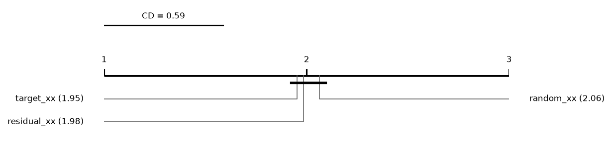
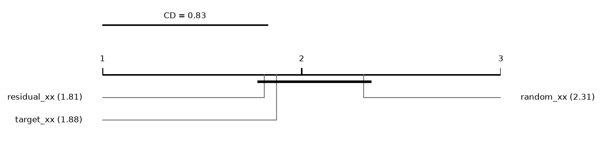
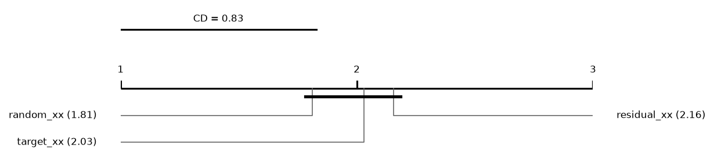

# Report: mixed

480 runs on 32 datasets. Error = 1 - balanced accuracy (classification) or RMSE (regression); relative reduction = (e_ref - e) / max(e_ref, e) of errors averaged over a dataset's runs; positive favours the method.

## Hypotheses (plan §5)

Not tested: some runs of the compared methods are unfinished.

## Mean ranks
Friedman over 3 methods and 32 datasets: chi2 = 0.22, p = 0.8965; Nemenyi critical difference = 0.59 (descriptive).

| method | mean rank |
|---|---|
| target_xx | 1.9531 |
| residual_xx | 1.9844 |
| random_xx | 2.0625 |

## Mean ranks: classification
Friedman over 3 methods and 16 datasets: chi2 = 2.53, p = 0.2818; Nemenyi critical difference = 0.83 (descriptive).

| method | mean rank |
|---|---|
| residual_xx | 1.8125 |
| target_xx | 1.875 |
| random_xx | 2.3125 |

## Mean ranks: regression
Friedman over 3 methods and 16 datasets: chi2 = 1.05, p = 0.5913; Nemenyi critical difference = 0.83 (descriptive).

| method | mean rank |
|---|---|
| random_xx | 1.8125 |
| target_xx | 2.0312 |
| residual_xx | 2.1562 |

## Per dataset: balanced_accuracy mean ± sd (classification)
| dataset | random_xx | target_xx | residual_xx |
|---|---|---|---|
| adult | 0.7658 ± 0.0076 | 0.7714 ± 0.0097 | 0.7688 ± 0.0093 |
| bank_marketing | 0.6015 ± 0.011 | 0.6078 ± 0.012 | 0.6066 ± 0.01 |
| cardiotocography | 0.8425 ± 0.027 | 0.8391 ± 0.043 | 0.8368 ± 0.022 |
| climate_crashes | 0.735 ± 0.096 | 0.7883 ± 0.058 | 0.7873 ± 0.056 |
| credit_default | 0.6591 ± 0.005 | 0.6615 ± 0.0064 | 0.6613 ± 0.01 |
| german_credit | 0.6588 ± 0.021 | 0.6733 ± 0.023 | 0.6755 ± 0.027 |
| heart_statlog | 0.8392 ± 0.017 | 0.8325 ± 0.022 | 0.8325 ± 0.022 |
| page_blocks | 0.8671 ± 0.034 | 0.8677 ± 0.033 | 0.87 ± 0.035 |
| phishing | 0.9526 ± 0.0075 | 0.9549 ± 0.0051 | 0.9549 ± 0.0051 |
| qsar_biodeg | 0.8372 ± 0.043 | 0.8392 ± 0.035 | 0.8371 ± 0.037 |
| sonar | 0.8204 ± 0.049 | 0.8192 ± 0.061 | 0.8192 ± 0.061 |
| spambase | 0.9492 ± 0.0084 | 0.951 ± 0.012 | 0.9515 ± 0.013 |
| spectf | 0.6033 ± 0.048 | 0.5968 ± 0.076 | 0.6373 ± 0.062 |
| steel_plates | 0.7876 ± 0.032 | 0.7736 ± 0.01 | 0.7832 ± 0.025 |
| tictactoe | 0.9853 ± 0.01 | 0.9876 ± 0.0075 | 0.9876 ± 0.0075 |
| vehicle | 0.7665 ± 0.027 | 0.7649 ± 0.027 | 0.7769 ± 0.014 |

## Per dataset: log_loss mean ± sd (classification)
| dataset | random_xx | target_xx | residual_xx |
|---|---|---|---|
| adult | 0.3137 ± 0.0094 | 0.3083 ± 0.01 | 0.3122 ± 0.0097 |
| bank_marketing | 0.2968 ± 0.0029 | 0.2983 ± 0.0029 | 0.2949 ± 0.0036 |
| cardiotocography | 0.2255 ± 0.036 | 0.2215 ± 0.038 | 0.2304 ± 0.034 |
| climate_crashes | 0.1528 ± 0.011 | 0.1371 ± 0.026 | 0.1445 ± 0.031 |
| credit_default | 0.4332 ± 0.0066 | 0.4332 ± 0.0053 | 0.4334 ± 0.0052 |
| german_credit | 0.4952 ± 0.03 | 0.499 ± 0.047 | 0.4945 ± 0.041 |
| heart_statlog | 0.3826 ± 0.018 | 0.3818 ± 0.021 | 0.3801 ± 0.019 |
| page_blocks | 0.09677 ± 0.023 | 0.09355 ± 0.018 | 0.09868 ± 0.027 |
| phishing | 0.1233 ± 0.024 | 0.1311 ± 0.012 | 0.1311 ± 0.012 |
| qsar_biodeg | 0.3105 ± 0.036 | 0.3062 ± 0.038 | 0.3052 ± 0.038 |
| sonar | 0.3835 ± 0.067 | 0.4077 ± 0.078 | 0.409 ± 0.077 |
| spambase | 0.1478 ± 0.019 | 0.1422 ± 0.033 | 0.1432 ± 0.033 |
| spectf | 0.3833 ± 0.028 | 0.3884 ± 0.026 | 0.3786 ± 0.033 |
| steel_plates | 0.562 ± 0.05 | 0.5829 ± 0.035 | 0.559 ± 0.025 |
| tictactoe | 0.04013 ± 0.015 | 0.04059 ± 0.013 | 0.04364 ± 0.013 |
| vehicle | 0.4508 ± 0.068 | 0.4721 ± 0.067 | 0.4213 ± 0.013 |

## Per dataset: macro_f1 mean ± sd (classification)
| dataset | random_xx | target_xx | residual_xx |
|---|---|---|---|
| adult | 0.7862 ± 0.0074 | 0.7913 ± 0.0093 | 0.7882 ± 0.008 |
| bank_marketing | 0.634 ± 0.013 | 0.6411 ± 0.014 | 0.6398 ± 0.012 |
| cardiotocography | 0.8451 ± 0.03 | 0.8366 ± 0.029 | 0.8361 ± 0.013 |
| climate_crashes | 0.7772 ± 0.085 | 0.8316 ± 0.04 | 0.827 ± 0.034 |
| credit_default | 0.6829 ± 0.0051 | 0.6856 ± 0.0058 | 0.6849 ± 0.0094 |
| german_credit | 0.6732 ± 0.026 | 0.6873 ± 0.029 | 0.6897 ± 0.031 |
| heart_statlog | 0.8411 ± 0.017 | 0.8338 ± 0.024 | 0.8338 ± 0.024 |
| page_blocks | 0.8723 ± 0.021 | 0.8745 ± 0.023 | 0.8749 ± 0.023 |
| phishing | 0.9529 ± 0.0074 | 0.9554 ± 0.0052 | 0.9554 ± 0.0052 |
| qsar_biodeg | 0.8441 ± 0.038 | 0.8478 ± 0.032 | 0.8441 ± 0.032 |
| sonar | 0.8188 ± 0.044 | 0.8184 ± 0.058 | 0.8184 ± 0.058 |
| spambase | 0.9501 ± 0.009 | 0.9519 ± 0.012 | 0.9521 ± 0.012 |
| spectf | 0.6136 ± 0.062 | 0.5972 ± 0.085 | 0.6517 ± 0.066 |
| steel_plates | 0.8044 ± 0.024 | 0.792 ± 0.0096 | 0.7999 ± 0.02 |
| tictactoe | 0.984 ± 0.012 | 0.9863 ± 0.0094 | 0.9863 ± 0.0094 |
| vehicle | 0.7585 ± 0.027 | 0.7564 ± 0.028 | 0.7691 ± 0.015 |

## Per dataset: accuracy mean ± sd (classification)
| dataset | random_xx | target_xx | residual_xx |
|---|---|---|---|
| adult | 0.8559 ± 0.0053 | 0.8589 ± 0.0067 | 0.8567 ± 0.0047 |
| bank_marketing | 0.8939 ± 0.00097 | 0.8939 ± 0.0012 | 0.8938 ± 0.00092 |
| cardiotocography | 0.9106 ± 0.02 | 0.9055 ± 0.019 | 0.9073 ± 0.016 |
| climate_crashes | 0.9444 ± 0.019 | 0.9556 ± 0.0077 | 0.9537 ± 0.0065 |
| credit_default | 0.8177 ± 0.0028 | 0.8189 ± 0.0018 | 0.818 ± 0.0016 |
| german_credit | 0.761 ± 0.027 | 0.764 ± 0.032 | 0.767 ± 0.028 |
| heart_statlog | 0.8444 ± 0.017 | 0.837 ± 0.024 | 0.837 ± 0.024 |
| page_blocks | 0.9766 ± 0.0052 | 0.9764 ± 0.0053 | 0.9764 ± 0.0053 |
| phishing | 0.9536 ± 0.0072 | 0.956 ± 0.0052 | 0.956 ± 0.0052 |
| qsar_biodeg | 0.8645 ± 0.031 | 0.8682 ± 0.025 | 0.8645 ± 0.024 |
| sonar | 0.8221 ± 0.043 | 0.8218 ± 0.056 | 0.8218 ± 0.056 |
| spambase | 0.9524 ± 0.0087 | 0.9541 ± 0.011 | 0.9544 ± 0.012 |
| spectf | 0.7976 ± 0.022 | 0.809 ± 0.015 | 0.8089 ± 0.031 |
| steel_plates | 0.7826 ± 0.032 | 0.7743 ± 0.016 | 0.78 ± 0.026 |
| tictactoe | 0.9854 ± 0.011 | 0.9875 ± 0.0087 | 0.9875 ± 0.0087 |
| vehicle | 0.7648 ± 0.027 | 0.7624 ± 0.026 | 0.7743 ± 0.014 |

## Per dataset: roc_auc mean ± sd (classification)
| dataset | random_xx | target_xx | residual_xx |
|---|---|---|---|
| adult | 0.9076 ± 0.006 | 0.9112 ± 0.0062 | 0.9099 ± 0.0042 |
| bank_marketing | 0.7858 ± 0.0082 | 0.7821 ± 0.0087 | 0.7839 ± 0.0068 |
| cardiotocography | 0.9755 ± 0.009 | 0.9756 ± 0.0099 | 0.9746 ± 0.0088 |
| climate_crashes | 0.9264 ± 0.026 | 0.9396 ± 0.049 | 0.9252 ± 0.074 |
| credit_default | 0.7723 ± 0.0097 | 0.7734 ± 0.0084 | 0.7727 ± 0.0075 |
| german_credit | 0.7934 ± 0.04 | 0.7911 ± 0.049 | 0.796 ± 0.045 |
| heart_statlog | 0.9163 ± 0.012 | 0.9144 ± 0.016 | 0.9158 ± 0.016 |
| page_blocks | 0.9925 ± 0.0036 | 0.993 ± 0.0029 | 0.9928 ± 0.003 |
| phishing | 0.9921 ± 0.0022 | 0.9922 ± 0.0018 | 0.9922 ± 0.0018 |
| qsar_biodeg | 0.9355 ± 0.021 | 0.9361 ± 0.02 | 0.9351 ± 0.019 |
| sonar | 0.9379 ± 0.047 | 0.9371 ± 0.043 | 0.9376 ± 0.043 |
| spambase | 0.9848 ± 0.0072 | 0.9858 ± 0.0076 | 0.9851 ± 0.0077 |
| spectf | 0.8324 ± 0.04 | 0.8397 ± 0.043 | 0.843 ± 0.044 |
| steel_plates | 0.9627 ± 0.0071 | 0.9597 ± 0.0064 | 0.9619 ± 0.0056 |
| tictactoe | 0.9995 ± 0.00069 | 0.9996 ± 0.00047 | 0.9995 ± 0.00058 |
| vehicle | 0.9337 ± 0.01 | 0.9371 ± 0.0067 | 0.9389 ± 0.0082 |

## Per dataset: average_precision mean ± sd (classification)
| dataset | random_xx | target_xx | residual_xx |
|---|---|---|---|
| adult | 0.877 ± 0.0079 | 0.8816 ± 0.0075 | 0.8793 ± 0.0039 |
| bank_marketing | 0.6929 ± 0.005 | 0.6903 ± 0.0069 | 0.6927 ± 0.0062 |
| cardiotocography | 0.919 ± 0.033 | 0.9215 ± 0.03 | 0.9174 ± 0.026 |
| climate_crashes | 0.8657 ± 0.026 | 0.8878 ± 0.041 | 0.8833 ± 0.042 |
| credit_default | 0.73 ± 0.0084 | 0.7296 ± 0.0069 | 0.729 ± 0.0068 |
| german_credit | 0.7724 ± 0.042 | 0.7683 ± 0.055 | 0.7741 ± 0.048 |
| heart_statlog | 0.9198 ± 0.015 | 0.9195 ± 0.015 | 0.9207 ± 0.014 |
| page_blocks | 0.9174 ± 0.023 | 0.9152 ± 0.02 | 0.915 ± 0.02 |
| phishing | 0.9922 ± 0.0023 | 0.9922 ± 0.0019 | 0.9922 ± 0.0019 |
| qsar_biodeg | 0.9291 ± 0.02 | 0.93 ± 0.021 | 0.9292 ± 0.02 |
| sonar | 0.9429 ± 0.042 | 0.9417 ± 0.039 | 0.9421 ± 0.039 |
| spambase | 0.9832 ± 0.0074 | 0.9847 ± 0.0082 | 0.9836 ± 0.0086 |
| spectf | 0.732 ± 0.042 | 0.7548 ± 0.044 | 0.7541 ± 0.057 |
| steel_plates | 0.874 ± 0.015 | 0.8647 ± 0.013 | 0.871 ± 0.014 |
| tictactoe | 0.9994 ± 0.00081 | 0.9995 ± 0.00055 | 0.9994 ± 0.00067 |
| vehicle | 0.8316 ± 0.026 | 0.8391 ± 0.018 | 0.8407 ± 0.023 |

## Per dataset: cpu_seconds mean ± sd (classification)
| dataset | random_xx | target_xx | residual_xx |
|---|---|---|---|
| adult | 90.58 ± 11 | 103.4 ± 17 | 85.31 ± 15 |
| bank_marketing | 80.22 ± 16 | 67.59 ± 22 | 67.16 ± 19 |
| cardiotocography | 8.965 ± 1.8 | 7.668 ± 0.12 | 7.764 ± 1.5 |
| climate_crashes | 5.366 ± 1.7 | 4.642 ± 0.91 | 4.899 ± 1.1 |
| credit_default | 90.28 ± 23 | 98.45 ± 20 | 95.47 ± 29 |
| german_credit | 4.689 ± 0.72 | 6.276 ± 2.4 | 5.078 ± 0.76 |
| heart_statlog | 3.027 ± 0.47 | 2.813 ± 0.38 | 2.829 ± 0.41 |
| page_blocks | 12.74 ± 0.31 | 12.98 ± 2.1 | 12.91 ± 2.1 |
| phishing | 19.05 ± 2.8 | 16.14 ± 0.24 | 16.18 ± 0.21 |
| qsar_biodeg | 5.06 ± 0.81 | 4.963 ± 0.77 | 5.586 ± 1.3 |
| sonar | 3.907 ± 0.8 | 3.37 ± 0.86 | 3.182 ± 0.49 |
| spambase | 15.8 ± 1.9 | 14.59 ± 1.8 | 16.58 ± 4.4 |
| spectf | 4.335 ± 1.2 | 3.963 ± 1.1 | 3.775 ± 0.029 |
| steel_plates | 11.08 ± 0.1 | 10.76 ± 1.3 | 11.23 ± 0.063 |
| tictactoe | 4.127 ± 0.069 | 4.581 ± 0.89 | 4.196 ± 0.048 |
| vehicle | 5.31 ± 0.6 | 4.987 ± 0.74 | 5.575 ± 0.056 |

## Per dataset: rmse mean ± sd (regression)
| dataset | random_xx | target_xx | residual_xx |
|---|---|---|---|
| abalone | 2.151 ± 0.063 | 2.157 ± 0.064 | 2.157 ± 0.064 |
| air_quality | 0.4519 ± 0.031 | 0.4481 ± 0.032 | 0.4481 ± 0.032 |
| auto_mpg | 2.741 ± 0.32 | 2.834 ± 0.33 | 2.801 ± 0.35 |
| automobile | 2263 ± 6.4e+02 | 2320 ± 8.2e+02 | 2343 ± 8.4e+02 |
| bike_sharing | 50.19 ± 2.7 | 51.72 ± 2.8 | 49.31 ± 2.8 |
| california | 0.479 ± 0.0062 | 0.4745 ± 0.0055 | 0.4756 ± 0.0055 |
| ccpp | 3.332 ± 0.043 | 3.35 ± 0.049 | 3.35 ± 0.049 |
| communities | 0.1358 ± 0.0029 | 0.1361 ± 0.0028 | 0.1361 ± 0.0028 |
| concrete_slump | 3.799 ± 0.68 | 3.868 ± 0.85 | 3.892 ± 0.84 |
| energy | 0.5096 ± 0.085 | 0.4942 ± 0.085 | 0.4911 ± 0.08 |
| parkinsons | 11.11 ± 1.7 | 11.12 ± 1.7 | 11.16 ± 1.7 |
| real_estate | 7.449 ± 1.7 | 7.541 ± 1.8 | 7.528 ± 1.8 |
| servo | 0.5814 ± 0.24 | 0.5869 ± 0.22 | 0.5913 ± 0.22 |
| student_math | 4.083 ± 0.3 | 4.064 ± 0.3 | 4.08 ± 0.32 |
| superconductivity | 9.862 ± 0.41 | 9.853 ± 0.41 | 9.855 ± 0.41 |
| wine_red | 0.6314 ± 0.03 | 0.631 ± 0.032 | 0.631 ± 0.032 |

## Per dataset: mae mean ± sd (regression)
| dataset | random_xx | target_xx | residual_xx |
|---|---|---|---|
| abalone | 1.521 ± 0.041 | 1.521 ± 0.04 | 1.521 ± 0.04 |
| air_quality | 0.288 ± 0.0084 | 0.285 ± 0.009 | 0.285 ± 0.009 |
| auto_mpg | 1.941 ± 0.22 | 2.005 ± 0.21 | 1.976 ± 0.23 |
| automobile | 1548 ± 4.1e+02 | 1574 ± 5.2e+02 | 1580 ± 5.3e+02 |
| bike_sharing | 31.79 ± 2 | 33.02 ± 2.1 | 31.15 ± 2.1 |
| california | 0.3123 ± 0.0028 | 0.3086 ± 0.002 | 0.3095 ± 0.0021 |
| ccpp | 2.41 ± 0.034 | 2.423 ± 0.037 | 2.423 ± 0.037 |
| communities | 0.09426 ± 0.0046 | 0.09411 ± 0.0042 | 0.09411 ± 0.0042 |
| concrete_slump | 2.986 ± 0.58 | 3.118 ± 0.73 | 3.127 ± 0.72 |
| energy | 0.3446 ± 0.039 | 0.3325 ± 0.036 | 0.3297 ± 0.035 |
| parkinsons | 9.319 ± 2 | 9.329 ± 2.1 | 9.376 ± 2.1 |
| real_estate | 4.765 ± 0.53 | 4.78 ± 0.64 | 4.773 ± 0.65 |
| servo | 0.3801 ± 0.17 | 0.3542 ± 0.15 | 0.3743 ± 0.15 |
| student_math | 3.097 ± 0.25 | 3.074 ± 0.21 | 3.089 ± 0.23 |
| superconductivity | 5.812 ± 0.25 | 5.806 ± 0.26 | 5.808 ± 0.25 |
| wine_red | 0.4964 ± 0.022 | 0.4973 ± 0.025 | 0.4973 ± 0.025 |

## Per dataset: r2 mean ± sd (regression)
| dataset | random_xx | target_xx | residual_xx |
|---|---|---|---|
| abalone | 0.5543 ± 0.0073 | 0.5516 ± 0.0054 | 0.5516 ± 0.0054 |
| air_quality | 0.8979 ± 0.024 | 0.8996 ± 0.024 | 0.8996 ± 0.024 |
| auto_mpg | 0.875 ± 0.018 | 0.8665 ± 0.018 | 0.8694 ± 0.021 |
| automobile | 0.916 ± 0.032 | 0.9108 ± 0.046 | 0.9084 ± 0.048 |
| bike_sharing | 0.9232 ± 0.0057 | 0.9185 ± 0.0062 | 0.9259 ± 0.0054 |
| california | 0.8285 ± 0.0039 | 0.8317 ± 0.003 | 0.8309 ± 0.0031 |
| ccpp | 0.9619 ± 0.0014 | 0.9614 ± 0.0016 | 0.9614 ± 0.0016 |
| communities | 0.6592 ± 0.014 | 0.658 ± 0.012 | 0.658 ± 0.012 |
| concrete_slump | 0.7503 ± 0.077 | 0.7386 ± 0.11 | 0.7354 ± 0.1 |
| energy | 0.9973 ± 0.00091 | 0.9975 ± 0.00088 | 0.9975 ± 0.00082 |
| parkinsons | -0.2506 ± 0.3 | -0.2574 ± 0.32 | -0.2667 ± 0.33 |
| real_estate | 0.689 ± 0.065 | 0.6819 ± 0.067 | 0.6831 ± 0.069 |
| servo | 0.8523 ± 0.083 | 0.8532 ± 0.07 | 0.8499 ± 0.073 |
| student_math | 0.194 ± 0.025 | 0.201 ± 0.036 | 0.1951 ± 0.037 |
| superconductivity | 0.9164 ± 0.0067 | 0.9166 ± 0.0067 | 0.9165 ± 0.0066 |
| wine_red | 0.3842 ± 0.043 | 0.3849 ± 0.048 | 0.3849 ± 0.048 |

## Per dataset: cpu_seconds mean ± sd (regression)
| dataset | random_xx | target_xx | residual_xx |
|---|---|---|---|
| abalone | 10.02 ± 0.059 | 9.529 ± 0.044 | 9.916 ± 0.06 |
| air_quality | 18.45 ± 0.13 | 18.1 ± 0.16 | 18.07 ± 0.13 |
| auto_mpg | 2.587 ± 0.4 | 2.633 ± 0.37 | 2.807 ± 0.44 |
| automobile | 3.247 ± 0.35 | 3.011 ± 0.7 | 2.933 ± 1 |
| bike_sharing | 66.61 ± 0.35 | 72.55 ± 0.45 | 67.22 ± 0.45 |
| california | 76.96 ± 0.54 | 75.25 ± 0.15 | 76.12 ± 0.39 |
| ccpp | 19.74 ± 0.06 | 19.68 ± 0.056 | 19.85 ± 0.04 |
| communities | 15.3 ± 2.7 | 14.21 ± 0.13 | 14.09 ± 0.092 |
| concrete_slump | 2.631 ± 0.025 | 2.429 ± 0.29 | 2.071 ± 0.24 |
| energy | 3.951 ± 0.05 | 4.108 ± 0.46 | 3.902 ± 0.045 |
| parkinsons | 42.69 ± 17 | 31.43 ± 7.4 | 31.83 ± 7.7 |
| real_estate | 2.934 ± 0.74 | 2.633 ± 0.37 | 2.639 ± 0.37 |
| servo | 2.462 ± 0.38 | 2.598 ± 0.31 | 2.465 ± 0.37 |
| student_math | 2.714 ± 0.022 | 3.472 ± 1.6 | 2.742 ± 0.017 |
| superconductivity | 136.6 ± 19 | 138.2 ± 19 | 135.2 ± 18 |
| wine_red | 4.885 ± 0.04 | 4.84 ± 0.054 | 4.856 ± 0.059 |
