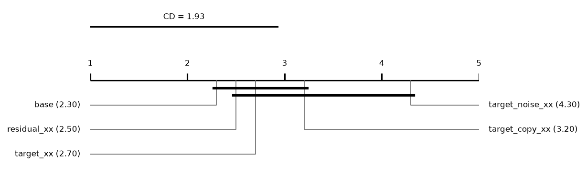
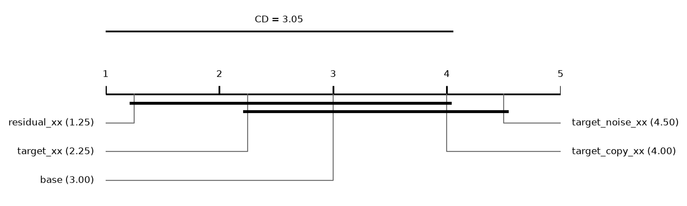
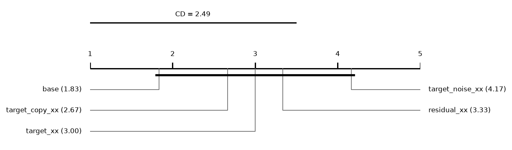

# Report: sampling

300 runs on 10 datasets. Error = 1 - balanced accuracy (classification) or RMSE (regression); relative reduction = (e_ref - e) / max(e_ref, e) of errors averaged over a dataset's runs; positive favours the method.

## Hypotheses (plan §5)

Not tested: some runs of the compared methods are unfinished.

## Depth rule of the base cascade (descriptive)
*picked*: share of base runs whose chosen layer is this depth. *median_test_vs_oof*: median over runs of (OOF error - test error) / max of the two, with the OOF error from the depth score (1 - balanced accuracy, or √MSE); positive = the test error is lower than the OOF error the rule sees. *median_reduction* to *p*: base cut at this depth vs base at its chosen layer, over datasets; positive = the fixed depth has the lower error.

| depth | picked | picked_classification | picked_regression | median_test_vs_oof | median_reduction | wins | losses | zeros | p |
|---|---|---|---|---|---|---|---|---|---|
| 1 | 0.68 | 0.7 | 0.6667 | 0.0215 | 0 | 2 | 4 | 4 | 0.4375 |
| 2 | 0.22 | 0.15 | 0.2667 | 0.057 | -0.0015 | 3 | 6 | 1 | 0.4258 |
| 3 | 0.04 | 0.1 | 0 | 0.083 | -0.0128 | 2 | 8 | 0 | 0.1055 |

## Other methods vs the base cascade (descriptive)
Two-sided Wilcoxon p without Holm's correction.

| comparison | method | reference | datasets | median_reduction | wins | losses | zeros | p |
|---|---|---|---|---|---|---|---|---|
| target_xx | target_xx | base | 10 | -0.000164 | 5 | 5 | 0 | 0.7695 |
| target_copy_xx | target_copy_xx | base | 10 | -0.0067 | 3 | 7 | 0 | 0.0645 |
| target_noise_xx | target_noise_xx | base | 10 | -0.0255 | 1 | 9 | 0 | 0.0059 |

## Mean ranks
Friedman over 5 methods and 10 datasets: chi2 = 10.45, p = 0.0335; Nemenyi critical difference = 1.93 (descriptive).

| method | mean rank |
|---|---|
| base | 2.3 |
| residual_xx | 2.5 |
| target_xx | 2.7 |
| target_copy_xx | 3.2 |
| target_noise_xx | 4.3 |

## Other methods vs the base cascade: classification (descriptive)
Two-sided Wilcoxon p without Holm's correction.

| comparison | method | reference | datasets | median_reduction | wins | losses | zeros | p |
|---|---|---|---|---|---|---|---|---|
| target_xx | target_xx | base | 4 | 0.0081 | 3 | 1 | 0 | 0.625 |
| target_copy_xx | target_copy_xx | base | 4 | -0.0067 | 1 | 3 | 0 | 0.25 |
| target_noise_xx | target_noise_xx | base | 4 | -0.0129 | 1 | 3 | 0 | 0.25 |

## Mean ranks: classification
Friedman over 5 methods and 4 datasets: chi2 = 11.00, p = 0.0266; Nemenyi critical difference = 3.05 (descriptive).

| method | mean rank |
|---|---|
| residual_xx | 1.25 |
| target_xx | 2.25 |
| base | 3 |
| target_copy_xx | 4 |
| target_noise_xx | 4.5 |

## Other methods vs the base cascade: regression (descriptive)
Two-sided Wilcoxon p without Holm's correction.

| comparison | method | reference | datasets | median_reduction | wins | losses | zeros | p |
|---|---|---|---|---|---|---|---|---|
| target_xx | target_xx | base | 6 | -0.0049 | 2 | 4 | 0 | 0.2188 |
| target_copy_xx | target_copy_xx | base | 6 | -0.0075 | 2 | 4 | 0 | 0.2188 |
| target_noise_xx | target_noise_xx | base | 6 | -0.0289 | 0 | 6 | 0 | 0.0312 |

## Mean ranks: regression
Friedman over 5 methods and 6 datasets: chi2 = 7.31, p = 0.1204; Nemenyi critical difference = 2.49 (descriptive).

| method | mean rank |
|---|---|
| base | 1.8333 |
| target_copy_xx | 2.6667 |
| target_xx | 3 |
| residual_xx | 3.3333 |
| target_noise_xx | 4.1667 |

## Common depth (descriptive)
Median relative reduction vs base at each depth reached by every cascade variant in a run; *runs* counts those runs, so deep rows rest on few.

| depth | target_xx | residual_xx | target_copy_xx | target_noise_xx | datasets | runs |
|---|---|---|---|---|---|---|
| 1 | -0.000164 | -0.000164 | -0.0091 | -0.0251 | 10 | 50 |
| 2 | 0.0071 | 0.0033 | 0.000779 | -0.0199 | 10 | 50 |
| 3 | 0.0047 | 0.000654 | -0.0011 | -0.0234 | 10 | 50 |
| 4 | -0.0237 | 0.0114 | 0.0036 | 0.0154 | 3 | 11 |

## Per dataset: balanced_accuracy mean ± sd (classification)
| dataset | base | target_xx | residual_xx | target_copy_xx | target_noise_xx |
|---|---|---|---|---|---|
| adult | 0.7716 ± 0.0038 | 0.7671 ± 0.0056 | 0.7674 ± 0.0059 | 0.767 ± 0.0043 | 0.7663 ± 0.0017 |
| bank_marketing | 0.6027 ± 0.0078 | 0.606 ± 0.0034 | 0.6114 ± 0.013 | 0.6001 ± 0.0097 | 0.6015 ± 0.0097 |
| credit_default | 0.6533 ± 0.011 | 0.6561 ± 0.011 | 0.6582 ± 0.0093 | 0.6552 ± 0.012 | 0.6544 ± 0.0093 |
| phishing | 0.9456 ± 0.0076 | 0.9471 ± 0.0053 | 0.9471 ± 0.0053 | 0.9452 ± 0.0068 | 0.9404 ± 0.0067 |

## Per dataset: log_loss mean ± sd (classification)
| dataset | base | target_xx | residual_xx | target_copy_xx | target_noise_xx |
|---|---|---|---|---|---|
| adult | 0.3536 ± 0.019 | 0.3463 ± 0.018 | 0.3534 ± 0.019 | 0.3375 ± 0.018 | 0.3264 ± 0.011 |
| bank_marketing | 0.3118 ± 0.0036 | 0.3168 ± 0.011 | 0.3112 ± 0.0028 | 0.3096 ± 0.005 | 0.3055 ± 0.0012 |
| credit_default | 0.4436 ± 0.0056 | 0.4433 ± 0.0066 | 0.4436 ± 0.0054 | 0.4409 ± 0.0066 | 0.4423 ± 0.0049 |
| phishing | 0.1452 ± 0.013 | 0.1483 ± 0.0076 | 0.1485 ± 0.0073 | 0.1479 ± 0.01 | 0.1498 ± 0.015 |

## Per dataset: macro_f1 mean ± sd (classification)
| dataset | base | target_xx | residual_xx | target_copy_xx | target_noise_xx |
|---|---|---|---|---|---|
| adult | 0.7848 ± 0.0063 | 0.7817 ± 0.0037 | 0.7824 ± 0.003 | 0.7819 ± 0.005 | 0.7849 ± 0.0033 |
| bank_marketing | 0.6332 ± 0.0089 | 0.6378 ± 0.0039 | 0.6432 ± 0.014 | 0.6306 ± 0.011 | 0.6327 ± 0.012 |
| credit_default | 0.6765 ± 0.0094 | 0.6797 ± 0.0093 | 0.6815 ± 0.0083 | 0.6788 ± 0.011 | 0.6787 ± 0.0089 |
| phishing | 0.9456 ± 0.0074 | 0.9472 ± 0.0054 | 0.9472 ± 0.0054 | 0.9457 ± 0.0066 | 0.941 ± 0.0067 |

## Per dataset: accuracy mean ± sd (classification)
| dataset | base | target_xx | residual_xx | target_copy_xx | target_noise_xx |
|---|---|---|---|---|---|
| adult | 0.8505 ± 0.0061 | 0.8493 ± 0.0033 | 0.8501 ± 0.0043 | 0.8496 ± 0.0055 | 0.8541 ± 0.0039 |
| bank_marketing | 0.8902 ± 0.0015 | 0.8915 ± 0.0011 | 0.8915 ± 0.0027 | 0.8911 ± 0.0018 | 0.8916 ± 0.0022 |
| credit_default | 0.8157 ± 0.0022 | 0.8172 ± 0.0015 | 0.8168 ± 0.0013 | 0.8172 ± 0.0018 | 0.818 ± 0.0027 |
| phishing | 0.9463 ± 0.0072 | 0.9479 ± 0.0053 | 0.9479 ± 0.0053 | 0.9465 ± 0.0064 | 0.9418 ± 0.0067 |

## Per dataset: roc_auc mean ± sd (classification)
| dataset | base | target_xx | residual_xx | target_copy_xx | target_noise_xx |
|---|---|---|---|---|---|
| adult | 0.8983 ± 0.0047 | 0.8993 ± 0.0076 | 0.899 ± 0.0054 | 0.8997 ± 0.0063 | 0.8998 ± 0.0073 |
| bank_marketing | 0.7648 ± 0.0062 | 0.7643 ± 0.0088 | 0.7666 ± 0.0091 | 0.7622 ± 0.0056 | 0.7627 ± 0.0045 |
| credit_default | 0.7596 ± 0.011 | 0.7597 ± 0.013 | 0.7596 ± 0.012 | 0.7635 ± 0.012 | 0.7606 ± 0.0085 |
| phishing | 0.9872 ± 0.0029 | 0.9872 ± 0.0026 | 0.9871 ± 0.0025 | 0.9879 ± 0.0027 | 0.9863 ± 0.0033 |

## Per dataset: average_precision mean ± sd (classification)
| dataset | base | target_xx | residual_xx | target_copy_xx | target_noise_xx |
|---|---|---|---|---|---|
| adult | 0.8664 ± 0.0069 | 0.8672 ± 0.0088 | 0.8667 ± 0.007 | 0.8654 ± 0.0087 | 0.8689 ± 0.01 |
| bank_marketing | 0.6711 ± 0.0078 | 0.6734 ± 0.008 | 0.6774 ± 0.006 | 0.673 ± 0.0077 | 0.6744 ± 0.005 |
| credit_default | 0.7163 ± 0.0069 | 0.7167 ± 0.0073 | 0.7175 ± 0.0065 | 0.7182 ± 0.0085 | 0.7176 ± 0.0079 |
| phishing | 0.9874 ± 0.0026 | 0.9872 ± 0.0023 | 0.9872 ± 0.0022 | 0.988 ± 0.0025 | 0.9865 ± 0.0031 |

## Per dataset: cpu_seconds mean ± sd (classification)
| dataset | base | target_xx | residual_xx | target_copy_xx | target_noise_xx |
|---|---|---|---|---|---|
| adult | 43.3 ± 13 | 107.6 ± 18 | 83.53 ± 20 | 65.81 ± 41 | 101.4 ± 2.2 |
| bank_marketing | 42.64 ± 7.1 | 79.89 ± 26 | 88.78 ± 36 | 58.19 ± 53 | 68.15 ± 9.2 |
| credit_default | 63.65 ± 21 | 96.65 ± 12 | 103.5 ± 16 | 55.06 ± 32 | 91.59 ± 13 |
| phishing | 19.18 ± 5.1 | 27.92 ± 4 | 29.92 ± 4.8 | 18.24 ± 11 | 29.01 ± 0.43 |

## Per dataset: rmse mean ± sd (regression)
| dataset | base | target_xx | residual_xx | target_copy_xx | target_noise_xx |
|---|---|---|---|---|---|
| air_quality | 0.4484 ± 0.031 | 0.4499 ± 0.034 | 0.4499 ± 0.034 | 0.4469 ± 0.028 | 0.449 ± 0.03 |
| bike_sharing | 55.98 ± 3 | 61.05 ± 2.7 | 58.45 ± 3.1 | 63.19 ± 6.8 | 59.42 ± 3.2 |
| california | 0.5724 ± 0.0088 | 0.5707 ± 0.009 | 0.5707 ± 0.009 | 0.5676 ± 0.015 | 0.5898 ± 0.0092 |
| ccpp | 3.635 ± 0.063 | 3.658 ± 0.064 | 3.658 ± 0.064 | 3.67 ± 0.072 | 3.712 ± 0.063 |
| parkinsons | 11.36 ± 1.3 | 11.32 ± 1.8 | 11.69 ± 1.5 | 11.59 ± 0.86 | 11.69 ± 1.2 |
| superconductivity | 11.82 ± 0.33 | 11.93 ± 0.3 | 11.93 ± 0.3 | 11.88 ± 0.33 | 12.51 ± 0.26 |

## Per dataset: mae mean ± sd (regression)
| dataset | base | target_xx | residual_xx | target_copy_xx | target_noise_xx |
|---|---|---|---|---|---|
| air_quality | 0.2814 ± 0.0068 | 0.2823 ± 0.009 | 0.2823 ± 0.009 | 0.2825 ± 0.0068 | 0.2823 ± 0.0061 |
| bike_sharing | 35.69 ± 2.1 | 38.88 ± 1.8 | 37.02 ± 2.1 | 41.62 ± 5.5 | 38.45 ± 2.3 |
| california | 0.3983 ± 0.0064 | 0.3978 ± 0.0073 | 0.3978 ± 0.0073 | 0.3916 ± 0.013 | 0.4167 ± 0.0066 |
| ccpp | 2.678 ± 0.026 | 2.697 ± 0.025 | 2.697 ± 0.025 | 2.718 ± 0.03 | 2.76 ± 0.034 |
| parkinsons | 9.502 ± 1.7 | 9.561 ± 2.3 | 9.794 ± 2 | 9.587 ± 1.4 | 9.655 ± 1.7 |
| superconductivity | 7.421 ± 0.2 | 7.527 ± 0.17 | 7.527 ± 0.17 | 7.465 ± 0.24 | 8.184 ± 0.17 |

## Per dataset: r2 mean ± sd (regression)
| dataset | base | target_xx | residual_xx | target_copy_xx | target_noise_xx |
|---|---|---|---|---|---|
| air_quality | 0.8993 ± 0.025 | 0.8984 ± 0.026 | 0.8984 ± 0.026 | 0.9002 ± 0.022 | 0.8992 ± 0.024 |
| bike_sharing | 0.9045 ± 0.005 | 0.8864 ± 0.0069 | 0.8959 ± 0.0062 | 0.8773 ± 0.025 | 0.8925 ± 0.0059 |
| california | 0.755 ± 0.0062 | 0.7564 ± 0.006 | 0.7564 ± 0.006 | 0.759 ± 0.012 | 0.7399 ± 0.0067 |
| ccpp | 0.9546 ± 0.002 | 0.954 ± 0.002 | 0.954 ± 0.002 | 0.9537 ± 0.0021 | 0.9527 ± 0.002 |
| parkinsons | -0.399 ± 0.65 | -0.2968 ± 0.3 | -0.4189 ± 0.46 | -0.425 ± 0.5 | -0.4484 ± 0.57 |
| superconductivity | 0.8801 ± 0.0068 | 0.8778 ± 0.0064 | 0.8778 ± 0.0064 | 0.8788 ± 0.0068 | 0.8657 ± 0.0054 |

## Per dataset: cpu_seconds mean ± sd (regression)
| dataset | base | target_xx | residual_xx | target_copy_xx | target_noise_xx |
|---|---|---|---|---|---|
| air_quality | 29.62 ± 0.11 | 45.1 ± 0.3 | 45.18 ± 0.22 | 29.3 ± 16 | 45.73 ± 0.25 |
| bike_sharing | 71.19 ± 0.42 | 145.2 ± 2.3 | 124.3 ± 1.2 | 74.59 ± 55 | 148.9 ± 1.9 |
| california | 33.72 ± 0.15 | 51.5 ± 0.17 | 51.26 ± 0.11 | 36.25 ± 14 | 50.95 ± 0.31 |
| ccpp | 21.39 ± 0.025 | 23.69 ± 0.073 | 23.78 ± 0.058 | 17.43 ± 6.6 | 23.58 ± 0.53 |
| parkinsons | 96.93 ± 42 | 143.6 ± 34 | 120.2 ± 2.2 | 73.19 ± 71 | 134.3 ± 26 |
| superconductivity | 142.9 ± 0.72 | 292.6 ± 1.7 | 305.3 ± 0.75 | 169.2 ± 1.4e+02 | 352.6 ± 2.6 |
