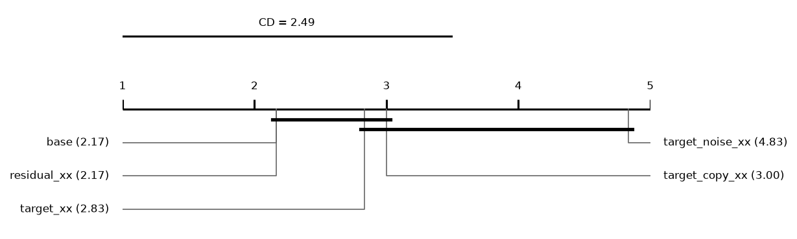
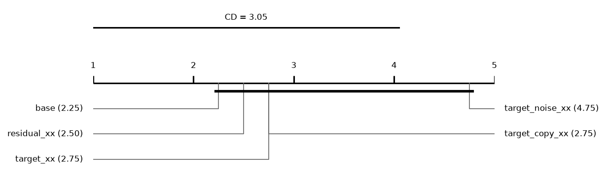
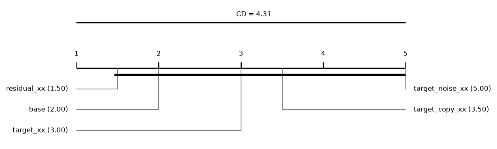

# Report: sampling_large (INCOMPLETE: 120 tasks missing; only runs finished by every method are used)

180 runs on 6 datasets. Error = 1 - balanced accuracy (classification) or RMSE (regression); relative reduction = (e_ref - e) / max(e_ref, e) of errors averaged over a dataset's runs; positive favours the method.

## Hypotheses (plan §5)

Not tested: some runs of the compared methods are unfinished.

## Depth rule of the base cascade (descriptive)
*picked*: share of base runs whose chosen layer is this depth. *median_test_vs_oof*: median over runs of (OOF error - test error) / max of the two, with the OOF error from the depth score (1 - balanced accuracy, or √MSE); positive = the test error is lower than the OOF error the rule sees. *median_reduction* to *p*: base cut at this depth vs base at its chosen layer, over datasets; positive = the fixed depth has the lower error.

| depth | picked | picked_classification | picked_regression | median_test_vs_oof | median_reduction | wins | losses | zeros | p |
|---|---|---|---|---|---|---|---|---|---|
| 1 | 0.5 | 0.5417 | 0.4167 | 0.0275 | -0.0491 | 0 | 4 | 2 | 0.125 |
| 2 | 0.4722 | 0.4167 | 0.5833 | 0.0573 | 0.002 | 3 | 1 | 2 | 0.25 |
| 3 | 0.0278 | 0.0417 | 0 | 0.0794 | -0.0036 | 2 | 4 | 0 | 0.3125 |

## Other methods vs the base cascade (descriptive)
Two-sided Wilcoxon p without Holm's correction.

| comparison | method | reference | datasets | median_reduction | wins | losses | zeros | p |
|---|---|---|---|---|---|---|---|---|
| target_xx | target_xx | base | 6 | 0.0083 | 3 | 3 | 0 | 0.8438 |
| target_copy_xx | target_copy_xx | base | 6 | -0.004 | 1 | 5 | 0 | 0.3125 |
| target_noise_xx | target_noise_xx | base | 6 | -0.0415 | 0 | 6 | 0 | 0.0312 |

## Mean ranks
Friedman over 5 methods and 6 datasets: chi2 = 11.66, p = 0.0201; Nemenyi critical difference = 2.49 (descriptive).

| method | mean rank |
|---|---|
| base | 2.1667 |
| residual_xx | 2.1667 |
| target_xx | 2.8333 |
| target_copy_xx | 3 |
| target_noise_xx | 4.8333 |

## Other methods vs the base cascade: classification (descriptive)
Two-sided Wilcoxon p without Holm's correction.

| comparison | method | reference | datasets | median_reduction | wins | losses | zeros | p |
|---|---|---|---|---|---|---|---|---|
| target_xx | target_xx | base | 4 | 0.0083 | 2 | 2 | 0 | 1 |
| target_copy_xx | target_copy_xx | base | 4 | -0.0019 | 1 | 3 | 0 | 0.875 |
| target_noise_xx | target_noise_xx | base | 4 | -0.0398 | 0 | 4 | 0 | 0.125 |

## Mean ranks: classification
Friedman over 5 methods and 4 datasets: chi2 = 6.56, p = 0.1608; Nemenyi critical difference = 3.05 (descriptive).

| method | mean rank |
|---|---|
| base | 2.25 |
| residual_xx | 2.5 |
| target_xx | 2.75 |
| target_copy_xx | 2.75 |
| target_noise_xx | 4.75 |

## Other methods vs the base cascade: regression (descriptive)
Two-sided Wilcoxon p without Holm's correction.

| comparison | method | reference | datasets | median_reduction | wins | losses | zeros | p |
|---|---|---|---|---|---|---|---|---|
| target_xx | target_xx | base | 2 | 0.0149 | 1 | 1 | 0 | 1 |
| target_copy_xx | target_copy_xx | base | 2 | -0.0251 | 0 | 2 | 0 | 0.5 |
| target_noise_xx | target_noise_xx | base | 2 | -0.0794 | 0 | 2 | 0 | 0.5 |

## Mean ranks: regression
Friedman over 5 methods and 2 datasets: chi2 = 6.00, p = 0.1991; Nemenyi critical difference = 4.31 (descriptive).

| method | mean rank |
|---|---|
| residual_xx | 1.5 |
| base | 2 |
| target_xx | 3 |
| target_copy_xx | 3.5 |
| target_noise_xx | 5 |

## Common depth (descriptive)
Median relative reduction vs base at each depth reached by every cascade variant in a run; *runs* counts those runs, so deep rows rest on few.

| depth | target_xx | residual_xx | target_copy_xx | target_noise_xx | datasets | runs |
|---|---|---|---|---|---|---|
| 1 | 0.0097 | 0.0097 | -0.0019 | -0.0517 | 6 | 18 |
| 2 | 0.0123 | 0.014 | -0.0033 | -0.0495 | 6 | 18 |
| 3 | 0.012 | 0.0098 | -0.0039 | -0.037 | 6 | 18 |
| 4 | -0.0048 | 9.4e-05 | -0.0191 | -0.091 | 3 | 9 |

## Per dataset: balanced_accuracy mean ± sd (classification)
| dataset | base | target_xx | residual_xx | target_copy_xx | target_noise_xx |
|---|---|---|---|---|---|
| covertype | 0.666 ± 0.086 | 0.6792 ± 0.084 | 0.6785 ± 0.081 | 0.6752 ± 0.076 | 0.5993 ± 0.084 |
| higgs | 0.7011 ± 0.0092 | 0.7 ± 0.0088 | 0.7 ± 0.0088 | 0.7001 ± 0.011 | 0.6964 ± 0.0095 |
| higgs_low | 0.6096 ± 0.015 | 0.6174 ± 0.015 | 0.6174 ± 0.015 | 0.6094 ± 0.015 | 0.5954 ± 0.019 |
| miniboone | 0.9173 ± 0.0078 | 0.9128 ± 0.0082 | 0.9143 ± 0.0089 | 0.915 ± 0.0082 | 0.9135 ± 0.0061 |

## Per dataset: log_loss mean ± sd (classification)
| dataset | base | target_xx | residual_xx | target_copy_xx | target_noise_xx |
|---|---|---|---|---|---|
| covertype | 0.4952 ± 0.089 | 0.4825 ± 0.098 | 0.4883 ± 0.1 | 0.4895 ± 0.095 | 0.5449 ± 0.067 |
| higgs | 0.5715 ± 0.01 | 0.5733 ± 0.011 | 0.5733 ± 0.011 | 0.5717 ± 0.011 | 0.579 ± 0.013 |
| higgs_low | 0.6538 ± 0.0088 | 0.6493 ± 0.0097 | 0.6493 ± 0.0097 | 0.6525 ± 0.0086 | 0.6616 ± 0.0096 |
| miniboone | 0.1734 ± 0.012 | 0.1835 ± 0.014 | 0.1813 ± 0.013 | 0.1812 ± 0.013 | 0.1817 ± 0.013 |

## Per dataset: macro_f1 mean ± sd (classification)
| dataset | base | target_xx | residual_xx | target_copy_xx | target_noise_xx |
|---|---|---|---|---|---|
| covertype | 0.7017 ± 0.076 | 0.7118 ± 0.075 | 0.7102 ± 0.073 | 0.7116 ± 0.071 | 0.6344 ± 0.086 |
| higgs | 0.701 ± 0.0092 | 0.6998 ± 0.0088 | 0.6998 ± 0.0088 | 0.6999 ± 0.011 | 0.6962 ± 0.0094 |
| higgs_low | 0.6085 ± 0.016 | 0.6168 ± 0.015 | 0.6168 ± 0.015 | 0.6085 ± 0.015 | 0.5928 ± 0.021 |
| miniboone | 0.917 ± 0.0066 | 0.9125 ± 0.0071 | 0.9144 ± 0.0077 | 0.9143 ± 0.0064 | 0.9129 ± 0.0053 |

## Per dataset: accuracy mean ± sd (classification)
| dataset | base | target_xx | residual_xx | target_copy_xx | target_noise_xx |
|---|---|---|---|---|---|
| covertype | 0.8095 ± 0.038 | 0.8137 ± 0.04 | 0.8132 ± 0.04 | 0.81 ± 0.039 | 0.7794 ± 0.03 |
| higgs | 0.7019 ± 0.0092 | 0.7005 ± 0.0088 | 0.7005 ± 0.0088 | 0.7007 ± 0.011 | 0.6971 ± 0.0092 |
| higgs_low | 0.6146 ± 0.014 | 0.6218 ± 0.014 | 0.6218 ± 0.014 | 0.614 ± 0.014 | 0.6013 ± 0.017 |
| miniboone | 0.9328 ± 0.0051 | 0.9292 ± 0.0057 | 0.9308 ± 0.006 | 0.9306 ± 0.0049 | 0.9294 ± 0.0042 |

## Per dataset: roc_auc mean ± sd (classification)
| dataset | base | target_xx | residual_xx | target_copy_xx | target_noise_xx |
|---|---|---|---|---|---|
| covertype | 0.9629 ± 0.013 | 0.9642 ± 0.014 | 0.9633 ± 0.015 | 0.9638 ± 0.014 | 0.955 ± 0.012 |
| higgs | 0.7755 ± 0.01 | 0.7726 ± 0.011 | 0.7726 ± 0.011 | 0.7734 ± 0.012 | 0.7695 ± 0.011 |
| higgs_low | 0.6582 ± 0.019 | 0.6673 ± 0.021 | 0.6673 ± 0.021 | 0.6588 ± 0.018 | 0.6419 ± 0.023 |
| miniboone | 0.9781 ± 0.0028 | 0.9756 ± 0.0033 | 0.9764 ± 0.0031 | 0.9766 ± 0.0027 | 0.9754 ± 0.0038 |

## Per dataset: average_precision mean ± sd (classification)
| dataset | base | target_xx | residual_xx | target_copy_xx | target_noise_xx |
|---|---|---|---|---|---|
| covertype | 0.7662 ± 0.073 | 0.7725 ± 0.079 | 0.7674 ± 0.084 | 0.7732 ± 0.074 | 0.7148 ± 0.069 |
| higgs | 0.7701 ± 0.011 | 0.7662 ± 0.013 | 0.7662 ± 0.013 | 0.7673 ± 0.013 | 0.7634 ± 0.012 |
| higgs_low | 0.6464 ± 0.02 | 0.6544 ± 0.022 | 0.6544 ± 0.022 | 0.6471 ± 0.018 | 0.6298 ± 0.023 |
| miniboone | 0.9657 ± 0.0043 | 0.9627 ± 0.0047 | 0.9637 ± 0.0045 | 0.9641 ± 0.0042 | 0.961 ± 0.0064 |

## Per dataset: cpu_seconds mean ± sd (classification)
| dataset | base | target_xx | residual_xx | target_copy_xx | target_noise_xx |
|---|---|---|---|---|---|
| covertype | 250.5 ± 1.8e+02 | 456.7 ± 2.9e+02 | 455.3 ± 2.9e+02 | 417.9 ± 2.8e+02 | 493 ± 3.3e+02 |
| higgs | 305.4 ± 1.9e+02 | 534.6 ± 3.3e+02 | 516.9 ± 3.2e+02 | 465.3 ± 2.9e+02 | 525.8 ± 3.4e+02 |
| higgs_low | 192 ± 1.2e+02 | 327.7 ± 2.2e+02 | 330.8 ± 2.3e+02 | 314.4 ± 2.2e+02 | 358.1 ± 2.7e+02 |
| miniboone | 414.6 ± 3e+02 | 937.4 ± 7.1e+02 | 954.2 ± 7.4e+02 | 978.1 ± 7.7e+02 | 1138 ± 8.8e+02 |

## Per dataset: rmse mean ± sd (regression)
| dataset | base | target_xx | residual_xx | target_copy_xx | target_noise_xx |
|---|---|---|---|---|---|
| casp | 4.096 ± 0.28 | 4.116 ± 0.25 | 4.097 ± 0.28 | 4.116 ± 0.26 | 4.261 ± 0.34 |
| sgemm | 0.1306 ± 0.035 | 0.1261 ± 0.034 | 0.1226 ± 0.032 | 0.1369 ± 0.036 | 0.1485 ± 0.037 |

## Per dataset: mae mean ± sd (regression)
| dataset | base | target_xx | residual_xx | target_copy_xx | target_noise_xx |
|---|---|---|---|---|---|
| casp | 3.052 ± 0.32 | 3.096 ± 0.27 | 3.06 ± 0.32 | 3.074 ± 0.26 | 3.24 ± 0.45 |
| sgemm | 0.09269 ± 0.027 | 0.08862 ± 0.026 | 0.08644 ± 0.025 | 0.09661 ± 0.028 | 0.1079 ± 0.029 |

## Per dataset: r2 mean ± sd (regression)
| dataset | base | target_xx | residual_xx | target_copy_xx | target_noise_xx |
|---|---|---|---|---|---|
| casp | 0.5526 ± 0.061 | 0.5486 ± 0.055 | 0.5526 ± 0.06 | 0.5487 ± 0.055 | 0.5154 ± 0.077 |
| sgemm | 0.9859 ± 0.0071 | 0.9868 ± 0.0068 | 0.9875 ± 0.0062 | 0.9845 ± 0.0077 | 0.9819 ± 0.0086 |

## Per dataset: cpu_seconds mean ± sd (regression)
| dataset | base | target_xx | residual_xx | target_copy_xx | target_noise_xx |
|---|---|---|---|---|---|
| casp | 153.4 ± 1.3e+02 | 238.3 ± 1.9e+02 | 263.9 ± 2.2e+02 | 231.9 ± 1.8e+02 | 326.1 ± 2.7e+02 |
| sgemm | 106.6 ± 65 | 181.7 ± 1.2e+02 | 179.9 ± 1.1e+02 | 154.4 ± 96 | 212.6 ± 1.4e+02 |
