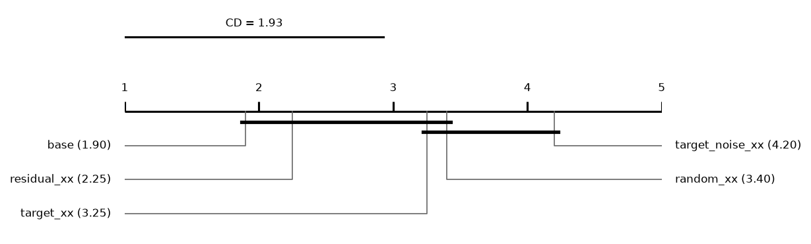
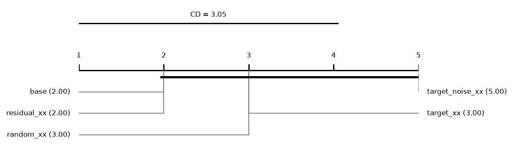
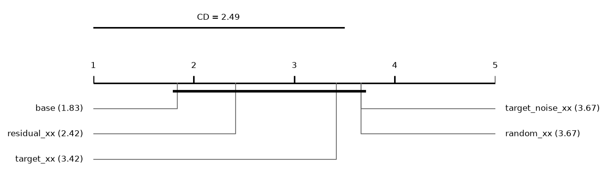

# Report: size

750 runs on 10 datasets. Error = 1 - balanced accuracy (classification) or RMSE (regression); relative reduction = (e_ref - e) / max(e_ref, e) of errors averaged over a dataset's runs; positive favours the method.

## Hypotheses (plan §5)

Not tested: some runs of the compared methods are unfinished.

## Depth rule of the base cascade (descriptive)
*picked*: share of base runs whose chosen layer is this depth. *median_test_vs_oof*: median over runs of (OOF error - test error) / max of the two, with the OOF error from the depth score (1 - balanced accuracy, or √MSE); positive = the test error is lower than the OOF error the rule sees. *median_reduction* to *p*: base cut at this depth vs base at its chosen layer, over datasets; positive = the fixed depth has the lower error.

| depth | picked | picked_classification | picked_regression | median_test_vs_oof | median_reduction | wins | losses | zeros | p |
|---|---|---|---|---|---|---|---|---|---|
| 1 | 0.5067 | 0.4667 | 0.5333 | 0.0133 | -0.0096 | 0 | 7 | 3 | 0.0156 |
| 2 | 0.3333 | 0.3167 | 0.3444 | 0.0517 | 0.0079 | 8 | 2 | 0 | 0.0645 |
| 3 | 0.0533 | 0.1 | 0.0222 | 0.0787 | 0.0074 | 6 | 4 | 0 | 0.6953 |

## Other methods vs the base cascade (descriptive)
Two-sided Wilcoxon p without Holm's correction.

| comparison | method | reference | datasets | median_reduction | wins | losses | zeros | p |
|---|---|---|---|---|---|---|---|---|
| random_xx | random_xx | base | 10 | -0.0127 | 0 | 10 | 0 | 0.002 |
| target_xx | target_xx | base | 10 | -0.0107 | 3 | 7 | 0 | 0.0273 |
| target_noise_xx | target_noise_xx | base | 10 | -0.0282 | 1 | 9 | 0 | 0.0039 |

## Mean ranks
Friedman over 5 methods and 10 datasets: chi2 = 13.81, p = 0.0079; Nemenyi critical difference = 1.93 (descriptive).

| method | mean rank |
|---|---|
| base | 1.9 |
| residual_xx | 2.25 |
| target_xx | 3.25 |
| random_xx | 3.4 |
| target_noise_xx | 4.2 |

## Other methods vs the base cascade: classification (descriptive)
Two-sided Wilcoxon p without Holm's correction.

| comparison | method | reference | datasets | median_reduction | wins | losses | zeros | p |
|---|---|---|---|---|---|---|---|---|
| random_xx | random_xx | base | 4 | -0.0122 | 0 | 4 | 0 | 0.125 |
| target_xx | target_xx | base | 4 | -0.0045 | 2 | 2 | 0 | 0.625 |
| target_noise_xx | target_noise_xx | base | 4 | -0.0218 | 0 | 4 | 0 | 0.125 |

## Mean ranks: classification
Friedman over 5 methods and 4 datasets: chi2 = 9.60, p = 0.0477; Nemenyi critical difference = 3.05 (descriptive).

| method | mean rank |
|---|---|
| base | 2 |
| residual_xx | 2 |
| random_xx | 3 |
| target_xx | 3 |
| target_noise_xx | 5 |

## Other methods vs the base cascade: regression (descriptive)
Two-sided Wilcoxon p without Holm's correction.

| comparison | method | reference | datasets | median_reduction | wins | losses | zeros | p |
|---|---|---|---|---|---|---|---|---|
| random_xx | random_xx | base | 6 | -0.0127 | 0 | 6 | 0 | 0.0312 |
| target_xx | target_xx | base | 6 | -0.012 | 1 | 5 | 0 | 0.0625 |
| target_noise_xx | target_noise_xx | base | 6 | -0.0306 | 1 | 5 | 0 | 0.0625 |

## Mean ranks: regression
Friedman over 5 methods and 6 datasets: chi2 = 6.69, p = 0.1533; Nemenyi critical difference = 2.49 (descriptive).

| method | mean rank |
|---|---|
| base | 1.8333 |
| residual_xx | 2.4167 |
| target_xx | 3.4167 |
| random_xx | 3.6667 |
| target_noise_xx | 3.6667 |

## Common depth (descriptive)
Median relative reduction vs base at each depth reached by every cascade variant in a run; *runs* counts those runs, so deep rows rest on few.

| depth | random_xx | target_xx | residual_xx | target_noise_xx | datasets | runs |
|---|---|---|---|---|---|---|
| 1 | -0.0136 | -0.0102 | -0.0102 | -0.0693 | 10 | 50 |
| 2 | -0.0139 | -0.0121 | -0.0087 | -0.036 | 10 | 50 |
| 3 | -0.0111 | -0.0107 | -0.0029 | -0.0312 | 10 | 50 |
| 4 | -0.0205 | -0.0083 | 0.0174 | -0.0248 | 7 | 32 |
| 5 | -0.0035 | -0.0125 | 0.0019 | -0.0598 | 3 | 6 |
| 6 | -0.0175 | -0.0349 | -0.0102 | -0.0128 | 2 | 2 |

## Per dataset: balanced_accuracy mean ± sd (classification)
| dataset | base | random_xx | target_xx | residual_xx | target_noise_xx |
|---|---|---|---|---|---|
| adult | 0.7429 ± 0.025 | 0.7416 ± 0.027 | 0.7436 ± 0.027 | 0.7455 ± 0.025 | 0.7369 ± 0.024 |
| bank_marketing | 0.567 ± 0.041 | 0.5601 ± 0.042 | 0.569 ± 0.04 | 0.569 ± 0.04 | 0.5578 ± 0.042 |
| credit_default | 0.635 ± 0.042 | 0.6317 ± 0.039 | 0.6308 ± 0.037 | 0.6315 ± 0.038 | 0.6292 ± 0.041 |
| phishing | 0.9369 ± 0.014 | 0.9346 ± 0.014 | 0.9341 ± 0.016 | 0.9345 ± 0.015 | 0.931 ± 0.014 |

## Per dataset: log_loss mean ± sd (classification)
| dataset | base | random_xx | target_xx | residual_xx | target_noise_xx |
|---|---|---|---|---|---|
| adult | 0.352 ± 0.023 | 0.3514 ± 0.022 | 0.352 ± 0.027 | 0.3515 ± 0.027 | 0.3537 ± 0.023 |
| bank_marketing | 0.3184 ± 0.013 | 0.3174 ± 0.012 | 0.3251 ± 0.019 | 0.3228 ± 0.018 | 0.3125 ± 0.012 |
| credit_default | 0.4523 ± 0.014 | 0.4539 ± 0.015 | 0.4556 ± 0.016 | 0.4551 ± 0.017 | 0.4516 ± 0.015 |
| phishing | 0.1932 ± 0.043 | 0.1949 ± 0.047 | 0.2012 ± 0.048 | 0.1943 ± 0.045 | 0.2175 ± 0.064 |

## Per dataset: macro_f1 mean ± sd (classification)
| dataset | base | random_xx | target_xx | residual_xx | target_noise_xx |
|---|---|---|---|---|---|
| adult | 0.7593 ± 0.023 | 0.759 ± 0.024 | 0.7624 ± 0.024 | 0.762 ± 0.023 | 0.7586 ± 0.023 |
| bank_marketing | 0.5806 ± 0.066 | 0.5705 ± 0.067 | 0.5848 ± 0.062 | 0.5848 ± 0.061 | 0.567 ± 0.068 |
| credit_default | 0.6508 ± 0.058 | 0.6479 ± 0.054 | 0.6483 ± 0.05 | 0.6487 ± 0.051 | 0.646 ± 0.057 |
| phishing | 0.9384 ± 0.013 | 0.9361 ± 0.014 | 0.9358 ± 0.015 | 0.9362 ± 0.015 | 0.9328 ± 0.013 |

## Per dataset: accuracy mean ± sd (classification)
| dataset | base | random_xx | target_xx | residual_xx | target_noise_xx |
|---|---|---|---|---|---|
| adult | 0.837 ± 0.013 | 0.8379 ± 0.013 | 0.8411 ± 0.012 | 0.8389 ± 0.012 | 0.8409 ± 0.013 |
| bank_marketing | 0.8888 ± 0.0035 | 0.8888 ± 0.0042 | 0.8895 ± 0.0046 | 0.8891 ± 0.0042 | 0.8891 ± 0.0043 |
| credit_default | 0.8086 ± 0.011 | 0.8079 ± 0.0093 | 0.8086 ± 0.011 | 0.8083 ± 0.011 | 0.8108 ± 0.01 |
| phishing | 0.9395 ± 0.013 | 0.9372 ± 0.013 | 0.9369 ± 0.015 | 0.9373 ± 0.014 | 0.934 ± 0.013 |

## Per dataset: roc_auc mean ± sd (classification)
| dataset | base | random_xx | target_xx | residual_xx | target_noise_xx |
|---|---|---|---|---|---|
| adult | 0.884 ± 0.015 | 0.8844 ± 0.015 | 0.8877 ± 0.016 | 0.8865 ± 0.015 | 0.8852 ± 0.017 |
| bank_marketing | 0.7421 ± 0.023 | 0.7426 ± 0.024 | 0.7389 ± 0.03 | 0.7388 ± 0.028 | 0.7435 ± 0.024 |
| credit_default | 0.7481 ± 0.021 | 0.7438 ± 0.024 | 0.7422 ± 0.024 | 0.743 ± 0.025 | 0.7464 ± 0.023 |
| phishing | 0.9833 ± 0.007 | 0.9808 ± 0.0086 | 0.9812 ± 0.0086 | 0.9811 ± 0.0089 | 0.9797 ± 0.0086 |

## Per dataset: average_precision mean ± sd (classification)
| dataset | base | random_xx | target_xx | residual_xx | target_noise_xx |
|---|---|---|---|---|---|
| adult | 0.8383 ± 0.023 | 0.8374 ± 0.024 | 0.8447 ± 0.025 | 0.8422 ± 0.026 | 0.8385 ± 0.025 |
| bank_marketing | 0.6514 ± 0.024 | 0.6537 ± 0.025 | 0.6505 ± 0.031 | 0.65 ± 0.03 | 0.6553 ± 0.026 |
| credit_default | 0.6984 ± 0.024 | 0.6984 ± 0.022 | 0.6959 ± 0.026 | 0.6964 ± 0.027 | 0.6988 ± 0.023 |
| phishing | 0.9834 ± 0.0071 | 0.9806 ± 0.009 | 0.9811 ± 0.0089 | 0.981 ± 0.0093 | 0.98 ± 0.0086 |

## Per dataset: cpu_seconds mean ± sd (classification)
| dataset | base | random_xx | target_xx | residual_xx | target_noise_xx |
|---|---|---|---|---|---|
| adult | 9.746 ± 5.6 | 13.5 ± 9.5 | 15.02 ± 9.5 | 13.53 ± 9.2 | 15.5 ± 9 |
| bank_marketing | 11.45 ± 9.2 | 14.7 ± 12 | 12.33 ± 7.4 | 11.31 ± 8.3 | 13.47 ± 8.5 |
| credit_default | 11.42 ± 6.6 | 15.32 ± 11 | 13.02 ± 8.7 | 15.22 ± 16 | 15.85 ± 10 |
| phishing | 4.934 ± 1.9 | 5.875 ± 2.4 | 5.618 ± 2.5 | 5.814 ± 2.5 | 6.653 ± 3.5 |

## Per dataset: rmse mean ± sd (regression)
| dataset | base | random_xx | target_xx | residual_xx | target_noise_xx |
|---|---|---|---|---|---|
| air_quality | 0.486 ± 0.046 | 0.4908 ± 0.049 | 0.4826 ± 0.045 | 0.4827 ± 0.045 | 0.5004 ± 0.047 |
| bike_sharing | 89.6 ± 27 | 91.39 ± 27 | 99.19 ± 25 | 88.88 ± 30 | 98.4 ± 27 |
| california | 0.6067 ± 0.079 | 0.6318 ± 0.082 | 0.628 ± 0.084 | 0.6308 ± 0.095 | 0.6239 ± 0.072 |
| ccpp | 4.016 ± 0.41 | 4.081 ± 0.43 | 4.073 ± 0.41 | 4.073 ± 0.41 | 4.151 ± 0.42 |
| parkinsons | 11.04 ± 1.8 | 11.07 ± 1.6 | 11.14 ± 1.5 | 11.11 ± 1.5 | 10.93 ± 1.8 |
| superconductivity | 14.53 ± 2.4 | 14.63 ± 2.4 | 14.68 ± 2.5 | 14.48 ± 2.5 | 15.13 ± 2.5 |

## Per dataset: mae mean ± sd (regression)
| dataset | base | random_xx | target_xx | residual_xx | target_noise_xx |
|---|---|---|---|---|---|
| air_quality | 0.3141 ± 0.026 | 0.3188 ± 0.027 | 0.3152 ± 0.027 | 0.3151 ± 0.027 | 0.3267 ± 0.027 |
| bike_sharing | 63.74 ± 22 | 65.17 ± 22 | 71.69 ± 21 | 63.14 ± 24 | 71.56 ± 23 |
| california | 0.4312 ± 0.073 | 0.4557 ± 0.074 | 0.4512 ± 0.076 | 0.4528 ± 0.085 | 0.4487 ± 0.063 |
| ccpp | 3.041 ± 0.36 | 3.1 ± 0.38 | 3.094 ± 0.37 | 3.094 ± 0.37 | 3.175 ± 0.37 |
| parkinsons | 9.293 ± 1.9 | 9.27 ± 1.8 | 9.301 ± 1.8 | 9.301 ± 1.7 | 9.17 ± 1.9 |
| superconductivity | 9.865 ± 2.1 | 10 ± 2.2 | 9.984 ± 2.3 | 9.825 ± 2.3 | 10.51 ± 2.2 |

## Per dataset: r2 mean ± sd (regression)
| dataset | base | random_xx | target_xx | residual_xx | target_noise_xx |
|---|---|---|---|---|---|
| air_quality | 0.8823 ± 0.026 | 0.8799 ± 0.028 | 0.8839 ± 0.026 | 0.8839 ± 0.026 | 0.8756 ± 0.026 |
| bike_sharing | 0.7354 ± 0.15 | 0.7259 ± 0.16 | 0.6828 ± 0.16 | 0.7357 ± 0.17 | 0.6848 ± 0.17 |
| california | 0.7204 ± 0.074 | 0.6968 ± 0.08 | 0.7004 ± 0.078 | 0.6964 ± 0.091 | 0.7054 ± 0.068 |
| ccpp | 0.944 ± 0.011 | 0.9422 ± 0.012 | 0.9425 ± 0.012 | 0.9425 ± 0.012 | 0.9402 ± 0.012 |
| parkinsons | -0.2211 ± 0.23 | -0.2333 ± 0.24 | -0.2643 ± 0.31 | -0.2544 ± 0.29 | -0.1912 ± 0.2 |
| superconductivity | 0.8144 ± 0.06 | 0.8115 ± 0.062 | 0.8101 ± 0.064 | 0.8149 ± 0.064 | 0.7988 ± 0.064 |

## Per dataset: cpu_seconds mean ± sd (regression)
| dataset | base | random_xx | target_xx | residual_xx | target_noise_xx |
|---|---|---|---|---|---|
| air_quality | 5.991 ± 4 | 7.179 ± 4.9 | 7.079 ± 5 | 7.076 ± 5 | 7.761 ± 5.5 |
| bike_sharing | 9.844 ± 6.3 | 11.61 ± 7.8 | 12.93 ± 9.6 | 13.7 ± 10 | 15 ± 11 |
| california | 9.269 ± 6.3 | 10.72 ± 7.9 | 10.6 ± 8 | 10.7 ± 8 | 11.34 ± 7.6 |
| ccpp | 5.635 ± 3.4 | 6.252 ± 4.1 | 6.25 ± 4.1 | 6.246 ± 4.1 | 5.753 ± 3.4 |
| parkinsons | 13.8 ± 11 | 16.11 ± 15 | 14.41 ± 13 | 15.65 ± 16 | 18.34 ± 17 |
| superconductivity | 14.58 ± 12 | 20.85 ± 17 | 22.04 ± 18 | 23.11 ± 19 | 25.16 ± 20 |
