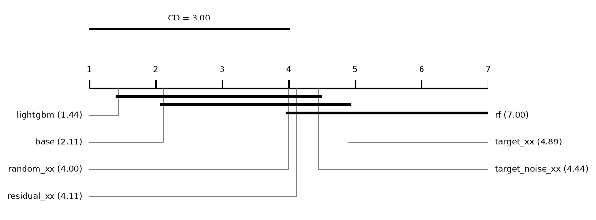

# Report: synth

945 runs on 9 datasets. Error = 1 - balanced accuracy (classification) or RMSE (regression); relative reduction = (e_ref - e) / max(e_ref, e) of errors averaged over a dataset's runs; positive favours the method.

## Hypotheses (plan §5)

Not tested: some runs of the compared methods are unfinished.

## Depth rule of the base cascade (descriptive)
*picked*: share of base runs whose chosen layer is this depth. *median_test_vs_oof*: median over runs of (OOF error - test error) / max of the two, with the OOF error from the depth score (1 - balanced accuracy, or √MSE); positive = the test error is lower than the OOF error the rule sees. *median_reduction* to *p*: base cut at this depth vs base at its chosen layer, over datasets; positive = the fixed depth has the lower error.

| depth | picked | picked_classification | picked_regression | median_test_vs_oof | median_reduction | wins | losses | zeros | p |
|---|---|---|---|---|---|---|---|---|---|
| 1 | 0 | - | 0 | 0.02 | -0.2821 | 0 | 9 | 0 | 0.0039 |
| 2 | 0.8667 | - | 0.8667 | 0.0976 | -0.000282 | 0 | 5 | 4 | 0.0625 |
| 3 | 0.1333 | - | 0.1333 | 0.1725 | 0.0201 | 7 | 2 | 0 | 0.0195 |

## Other methods vs the base cascade (descriptive)
Two-sided Wilcoxon p without Holm's correction.

| comparison | method | reference | datasets | median_reduction | wins | losses | zeros | p |
|---|---|---|---|---|---|---|---|---|
| random_xx | random_xx | base | 9 | -0.0702 | 1 | 8 | 0 | 0.0078 |
| target_xx | target_xx | base | 9 | -0.078 | 1 | 8 | 0 | 0.1289 |
| target_noise_xx | target_noise_xx | base | 9 | -0.0725 | 0 | 9 | 0 | 0.0039 |
| rf | rf | base | 9 | -0.1988 | 0 | 9 | 0 | 0.0039 |
| lightgbm | lightgbm | base | 9 | 0.0495 | 7 | 2 | 0 | 0.0195 |

## Mean ranks
Friedman over 7 methods and 9 datasets: chi2 = 38.76, p = 7.97e-07; Nemenyi critical difference = 3.00 (descriptive).

| method | mean rank |
|---|---|
| lightgbm | 1.4444 |
| base | 2.1111 |
| random_xx | 4 |
| residual_xx | 4.1111 |
| target_noise_xx | 4.4444 |
| target_xx | 4.8889 |
| rf | 7 |

## Other methods vs the base cascade: regression (descriptive)
Two-sided Wilcoxon p without Holm's correction.

| comparison | method | reference | datasets | median_reduction | wins | losses | zeros | p |
|---|---|---|---|---|---|---|---|---|
| random_xx | random_xx | base | 9 | -0.0702 | 1 | 8 | 0 | 0.0078 |
| target_xx | target_xx | base | 9 | -0.078 | 1 | 8 | 0 | 0.1289 |
| target_noise_xx | target_noise_xx | base | 9 | -0.0725 | 0 | 9 | 0 | 0.0039 |
| rf | rf | base | 9 | -0.1988 | 0 | 9 | 0 | 0.0039 |
| lightgbm | lightgbm | base | 9 | 0.0495 | 7 | 2 | 0 | 0.0195 |

## Mean ranks: regression
Friedman over 7 methods and 9 datasets: chi2 = 38.76, p = 7.97e-07; Nemenyi critical difference = 3.00 (descriptive).

| method | mean rank |
|---|---|
| lightgbm | 1.4444 |
| base | 2.1111 |
| random_xx | 4 |
| residual_xx | 4.1111 |
| target_noise_xx | 4.4444 |
| target_xx | 4.8889 |
| rf | 7 |

## Common depth (descriptive)
Median relative reduction vs base at each depth reached by every cascade variant in a run; *runs* counts those runs, so deep rows rest on few.

| depth | random_xx | target_xx | residual_xx | target_noise_xx | datasets | runs |
|---|---|---|---|---|---|---|
| 1 | -0.098 | -0.0719 | -0.0719 | -0.1584 | 9 | 135 |
| 2 | -0.0984 | -0.09 | -0.0839 | -0.1039 | 9 | 135 |
| 3 | -0.0727 | -0.0928 | -0.083 | -0.0714 | 9 | 135 |
| 4 | -0.0559 | -0.0806 | -0.0653 | -0.054 | 9 | 134 |
| 5 | -0.115 | -0.0954 | -0.0816 | -0.1406 | 5 | 13 |

## Per dataset: rmse mean ± sd (regression)
| dataset | base | random_xx | target_xx | residual_xx | target_noise_xx | rf | lightgbm |
|---|---|---|---|---|---|---|---|
| syn_add | 0.6166 ± 0.03 | 0.6632 ± 0.036 | 0.6663 ± 0.036 | 0.6658 ± 0.037 | 0.6572 ± 0.033 | 0.7505 ± 0.042 | 0.5887 ± 0.037 |
| syn_add_oracle | 0.5892 ± 0.026 | 0.6179 ± 0.03 | 0.6258 ± 0.033 | 0.6215 ± 0.032 | 0.6185 ± 0.027 | 0.6649 ± 0.035 | 0.56 ± 0.028 |
| syn_add_oracle_noise | 0.6194 ± 0.026 | 0.6708 ± 0.033 | 0.6896 ± 0.028 | 0.6848 ± 0.031 | 0.6678 ± 0.03 | 0.7731 ± 0.041 | 0.5688 ± 0.028 |
| syn_hidden | 1.117 ± 0.23 | 1.242 ± 0.25 | 1.25 ± 0.24 | 1.243 ± 0.24 | 1.308 ± 0.25 | 1.342 ± 0.24 | 0.9626 ± 0.18 |
| syn_hidden_oracle | 0.7548 ± 0.15 | 0.8055 ± 0.15 | 0.8324 ± 0.16 | 0.8358 ± 0.17 | 0.8127 ± 0.16 | 0.8769 ± 0.19 | 0.7815 ± 0.12 |
| syn_hidden_oracle_noise | 0.8184 ± 0.17 | 0.9426 ± 0.2 | 0.9714 ± 0.19 | 0.9668 ± 0.19 | 0.9474 ± 0.19 | 1.081 ± 0.2 | 0.7843 ± 0.12 |
| syn_prod | 1.531 ± 0.33 | 1.524 ± 0.37 | 1.062 ± 0.35 | 1.053 ± 0.34 | 2.288 ± 0.29 | 2.631 ± 0.3 | 1.284 ± 0.27 |
| syn_prod_oracle | 0.9189 ± 0.33 | 0.9844 ± 0.35 | 0.9305 ± 0.34 | 0.9304 ± 0.34 | 0.9618 ± 0.34 | 1.161 ± 0.36 | 0.9197 ± 0.28 |
| syn_prod_oracle_noise | 0.9846 ± 0.35 | 1.121 ± 0.38 | 1.068 ± 0.37 | 1.056 ± 0.37 | 1.119 ± 0.38 | 1.464 ± 0.38 | 0.912 ± 0.3 |

## Per dataset: mae mean ± sd (regression)
| dataset | base | random_xx | target_xx | residual_xx | target_noise_xx | rf | lightgbm |
|---|---|---|---|---|---|---|---|
| syn_add | 0.4826 ± 0.025 | 0.5147 ± 0.028 | 0.5147 ± 0.024 | 0.5145 ± 0.025 | 0.5103 ± 0.025 | 0.5791 ± 0.034 | 0.458 ± 0.025 |
| syn_add_oracle | 0.4604 ± 0.018 | 0.4793 ± 0.021 | 0.4837 ± 0.021 | 0.4811 ± 0.021 | 0.4826 ± 0.019 | 0.5112 ± 0.022 | 0.4403 ± 0.02 |
| syn_add_oracle_noise | 0.483 ± 0.02 | 0.5159 ± 0.023 | 0.5277 ± 0.02 | 0.5251 ± 0.023 | 0.5135 ± 0.02 | 0.5919 ± 0.029 | 0.4478 ± 0.022 |
| syn_hidden | 0.7055 ± 0.075 | 0.7711 ± 0.093 | 0.7699 ± 0.088 | 0.7659 ± 0.087 | 0.8481 ± 0.1 | 0.8575 ± 0.095 | 0.6107 ± 0.062 |
| syn_hidden_oracle | 0.5177 ± 0.048 | 0.5486 ± 0.051 | 0.5587 ± 0.053 | 0.5603 ± 0.058 | 0.5486 ± 0.055 | 0.5784 ± 0.064 | 0.5337 ± 0.036 |
| syn_hidden_oracle_noise | 0.5484 ± 0.055 | 0.6018 ± 0.068 | 0.624 ± 0.07 | 0.6203 ± 0.069 | 0.6084 ± 0.065 | 0.6905 ± 0.073 | 0.5306 ± 0.041 |
| syn_prod | 0.9262 ± 0.099 | 0.8965 ± 0.15 | 0.629 ± 0.078 | 0.6256 ± 0.075 | 1.468 ± 0.13 | 1.726 ± 0.15 | 0.8277 ± 0.075 |
| syn_prod_oracle | 0.5683 ± 0.066 | 0.5934 ± 0.073 | 0.5728 ± 0.068 | 0.5698 ± 0.068 | 0.5953 ± 0.068 | 0.6918 ± 0.079 | 0.5694 ± 0.059 |
| syn_prod_oracle_noise | 0.6051 ± 0.073 | 0.6549 ± 0.077 | 0.6321 ± 0.073 | 0.6238 ± 0.079 | 0.6666 ± 0.084 | 0.872 ± 0.1 | 0.564 ± 0.066 |

## Per dataset: r2 mean ± sd (regression)
| dataset | base | random_xx | target_xx | residual_xx | target_noise_xx | rf | lightgbm |
|---|---|---|---|---|---|---|---|
| syn_add | 0.8812 ± 0.01 | 0.8627 ± 0.01 | 0.8614 ± 0.011 | 0.8617 ± 0.01 | 0.8653 ± 0.0088 | 0.8243 ± 0.013 | 0.8916 ± 0.012 |
| syn_add_oracle | 0.8914 ± 0.0099 | 0.8806 ± 0.011 | 0.8775 ± 0.013 | 0.8792 ± 0.012 | 0.8804 ± 0.011 | 0.8619 ± 0.012 | 0.9018 ± 0.01 |
| syn_add_oracle_noise | 0.8801 ± 0.0095 | 0.8595 ± 0.01 | 0.8514 ± 0.012 | 0.8535 ± 0.012 | 0.8606 ± 0.011 | 0.8135 ± 0.014 | 0.8987 ± 0.01 |
| syn_hidden | 0.8357 ± 0.051 | 0.7979 ± 0.059 | 0.7969 ± 0.053 | 0.7995 ± 0.051 | 0.7758 ± 0.064 | 0.7658 ± 0.058 | 0.8787 ± 0.036 |
| syn_hidden_oracle | 0.9249 ± 0.025 | 0.9149 ± 0.026 | 0.9091 ± 0.028 | 0.9082 ± 0.031 | 0.9131 ± 0.028 | 0.899 ± 0.034 | 0.9204 ± 0.018 |
| syn_hidden_oracle_noise | 0.9122 ± 0.029 | 0.8839 ± 0.037 | 0.877 ± 0.035 | 0.8783 ± 0.034 | 0.8828 ± 0.035 | 0.8481 ± 0.039 | 0.9197 ± 0.019 |
| syn_prod | 0.7706 ± 0.065 | 0.7677 ± 0.099 | 0.8881 ± 0.057 | 0.8901 ± 0.055 | 0.4903 ± 0.062 | 0.3269 ± 0.06 | 0.8396 ± 0.045 |
| syn_prod_oracle | 0.9155 ± 0.048 | 0.903 ± 0.054 | 0.913 ± 0.05 | 0.913 ± 0.05 | 0.9077 ± 0.051 | 0.8672 ± 0.061 | 0.9163 ± 0.038 |
| syn_prod_oracle_noise | 0.9032 ± 0.053 | 0.8755 ± 0.063 | 0.8864 ± 0.061 | 0.8886 ± 0.061 | 0.8756 ± 0.063 | 0.7914 ± 0.072 | 0.9178 ± 0.041 |

## Per dataset: cpu_seconds mean ± sd (regression)
| dataset | base | random_xx | target_xx | residual_xx | target_noise_xx | rf | lightgbm |
|---|---|---|---|---|---|---|---|
| syn_add | 4.803 ± 0.031 | 5.373 ± 0.029 | 5.385 ± 0.02 | 5.384 ± 0.029 | 5.343 ± 0.031 | 0.5643 ± 0.0033 | 2.042 ± 0.48 |
| syn_add_oracle | 4.79 ± 0.023 | 5.697 ± 0.03 | 5.738 ± 0.038 | 5.734 ± 0.029 | 5.696 ± 0.027 | 0.5671 ± 0.0063 | 1.648 ± 0.42 |
| syn_add_oracle_noise | 5.138 ± 0.35 | 6.854 ± 0.67 | 6.525 ± 0.033 | 6.758 ± 0.58 | 7.247 ± 0.83 | 0.6785 ± 0.0038 | 2.364 ± 0.4 |
| syn_hidden | 5.291 ± 0.57 | 6.373 ± 0.71 | 6.237 ± 0.7 | 6.245 ± 0.7 | 6.789 ± 0.57 | 0.6176 ± 0.019 | 2.208 ± 0.63 |
| syn_hidden_oracle | 5.022 ± 0.32 | 7.013 ± 0.88 | 6.838 ± 0.76 | 6.837 ± 0.75 | 6.828 ± 0.72 | 0.6113 ± 0.0085 | 1.55 ± 0.36 |
| syn_hidden_oracle_noise | 6.143 ± 0.68 | 8.196 ± 0.44 | 8.365 ± 0.42 | 8.469 ± 1.1 | 8.477 ± 0.86 | 0.7448 ± 0.0085 | 2.062 ± 0.64 |
| syn_prod | 5.385 ± 0.58 | 7.379 ± 1.5 | 6.073 ± 0.67 | 6.259 ± 0.71 | 6.374 ± 0.7 | 0.7049 ± 0.012 | 4.304 ± 0.52 |
| syn_prod_oracle | 4.933 ± 0.023 | 6.894 ± 0.77 | 6.332 ± 0.69 | 6.471 ± 0.94 | 7.038 ± 0.69 | 0.6382 ± 0.008 | 1.932 ± 0.55 |
| syn_prod_oracle_noise | 6.441 ± 0.72 | 8.444 ± 1 | 8.393 ± 1.2 | 8.159 ± 0.68 | 8.338 ± 0.89 | 0.7791 ± 0.0088 | 3.003 ± 0.87 |
